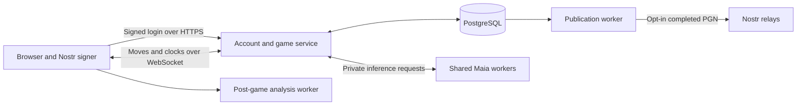
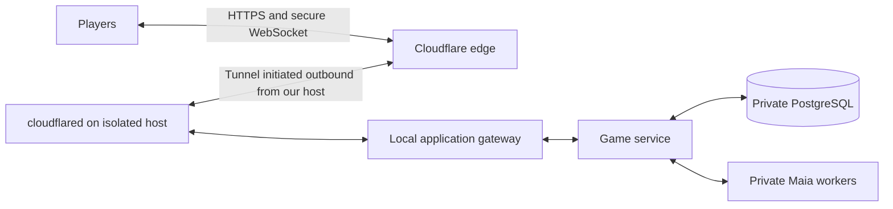

# Club Maia

**Lichess-style online chess, played exclusively against human-like Maia3 bots.**

Club Maia is a working name. This repository currently contains the project vision
and MVP plan; the application has not been implemented. The final name and domain
are undecided. `play.mobilemaia.org` is one possible home.

## Vision

Give people who enjoy online chess a familiar place to play, improve, and track
their progress without worrying about an opponent secretly using an engine,
abandoning a losing game, or behaving badly.

The central experience should feel almost exactly like Lichess: choose a time
control, join the pool, get paired with an opponent of similar playing strength,
play a complete game, see the rating change, and analyze the game afterward.

Every opponent is an openly identified Maia3-powered bot with a persistent
username and a calibrated rating. Bots wait for human matchmaking requests.
There are **no human-versus-human games and no bot-versus-bot games**, including
in the calibration plan. Opponent availability comes from the bot pool rather
than from needing enough humans online at each rating and time control.

The promise is trustworthy opponents and useful practice. Human players could
still use outside assistance themselves, so a public human leaderboard is not
part of the MVP.

## MVP experience

1. Create an account with a new Nostr identity or connect an existing identity.
2. Choose a time control and enter the pool.
3. Get paired immediately, subject to service capacity, with a bot near the
   player's estimated strength. New players have provisional ratings.
4. Play using familiar board controls, clocks, premoves, promotion, resignation,
   draw handling, and reconnection behavior.
5. Receive a result and rating update, then choose another game or a rematch.
6. Open a Lichess-style analysis board to replay moves, inspect engine evaluations
   and alternative lines, and identify mistakes.
7. Return to saved games and rating history, or download a PGN.

Start with standard chess, a small pool of roughly 24–32 named bots, and two
proposed time controls: **5+3 blitz and 10+5 rapid**. Maintain separate ratings
for blitz and rapid. Human testing will determine the supported strength range.

All bots are clearly labelled. They continue playing until a legal ending or
the human's resignation; they do not deliberately disconnect or stall. Humans
remain free to resign. An infrastructure failure must be reported honestly and
must not unfairly penalize the player.

Familiar opponents, rematches, and personal head-to-head records can give the
pool a sense of continuity. Bots need not play background games or pretend to be
humans to make the club feel active.

## Reuse the parts of Lichess we need

The goal is to reproduce the familiar playing and analysis experience while
adapting matchmaking to human-versus-bot play. We do not need every Lichess feature.

Lichess's main server repository is named **Lila**. This is the name of its server
code, not a separate product or a required architectural choice.

The initial preference is to reuse focused components:

| Component | Intended use |
| --- | --- |
| [Chessground](https://github.com/lichess-org/chessground) | Familiar interactive board, input, premoves, and move display |
| [Chessops](https://github.com/lichess-org/chessops) | Chess rules and FEN, SAN, and PGN operations |
| [Lichess server and analysis code](https://github.com/lichess-org/lila) | Evaluate reusable game, clock, replay, analysis, and rating behavior |
| [Stockfish](https://github.com/official-stockfish/Stockfish) | Post-game evaluations and analysis lines |

Before choosing the implementation, time-box a comparison of a minimal Lichess
server adaptation and a smaller service built around these components. Test the
same slice: Nostr login, pool entry, one timed Maia game, reconnection, persistence,
rating update, and post-game analysis.

Choose the approach that delivers the required experience with the least total
implementation and maintenance burden. Component reuse is a preference, not a
reason to rebuild mature functionality unnecessarily. Preserve upstream licenses
and attribution, and use our own project identity and branding.

## Nostr integration

**Use Nostr for identity and optional sharing; use ordinary WebSockets for live
games.**

Relay-based live play would still require decisions about authoritative clocks,
ordering, duplicated messages, conflicting moves, and reconnects. It adds work
without removing our need for an authoritative game service. It is outside the
MVP, and no new live-chess NIP is required to launch.

| Function | Plan |
| --- | --- |
| Account identity | Nostr public key, with a site-specific unique username |
| Existing signers | [NIP-07](https://github.com/nostr-protocol/nips/blob/master/07.md) browser signers and [NIP-46](https://github.com/nostr-protocol/nips/blob/master/46.md) remote signers |
| New identities | Local key generation with encrypted backup and a tested restore flow; use [NIP-49](https://github.com/nostr-protocol/nips/blob/master/49.md) where supported |
| Login | [NIP-98](https://github.com/nostr-protocol/nips/blob/master/98.md) signed authentication, then a revocable application session |
| Live games | Authenticated HTTPS/WebSocket connection; no per-move signer prompts |
| Optional game sharing | Publish a completed PGN using [NIP-64](https://github.com/nostr-protocol/nips/blob/master/64.md) |

Human private keys stay with the player's browser or signer. Login must validate
signatures, request binding, expiry, and a one-time server challenge. Ordinary
gameplay should not require learning Nostr terminology. Games are not published
to public relays automatically; sharing must explain the identity and persistence
implications. Relay outages must not interrupt an authenticated live game.

## Backend architecture

The following is the proposed small-service architecture, subject to the Lichess
reuse comparison.

- **Web client:** TypeScript, Chessground, and a familiar playing and analysis UI.
- **Application:** proposed TypeScript/Node.js service handling accounts, pool
  matching, authoritative games, clocks, ratings, and history.
- **Database:** PostgreSQL for users, bot identities, versioned policies,
  calibration records, games, move events, rating history, and background jobs.
- **Maia workers:** proposed Python/ONNX Runtime service with shared loaded models
  and bounded concurrency. A bot identity is configuration and state, not a
  dedicated process or a separate model copy.
- **Analysis:** evaluate browser Worker/WASM Stockfish first. Provide replay,
  evaluations, and variations without competing with live Maia inference. If
  server analysis is needed, give it a separate bounded background queue.
- **Operations:** TLS reverse proxy, containers, one initial hosting region,
  backups, structured logs, metrics, and error reporting.

The game server validates every move and controls the clocks. Commands carry
unique IDs and an expected game version; retries cannot apply a move twice.
Reconnection restores authoritative state. Results and rating updates are
transactional and idempotent. Bot inference counts toward its total thinking time.

Player disconnects leave their clocks running. A genuine clock loss follows the
published chess rules. Identified service failures void affected games without
rating penalties. The initial recovery policy may void unfinished games after a
server restart rather than reconstruct uncertain clocks.

## Bot strength and timing

Keep three concepts separate:

1. **Identity:** persistent username, avatar, and personal match history.
2. **Playing policy:** model hash, encoder, history mode, conditioning inputs,
   sampling, opening behavior, and timing policy.
3. **Calibration:** measured strength and uncertainty for each time control.

A Maia conditioning input of 1500 does not prove a playing strength of 1500.
Sampling, history, model size, and clock behavior can change results. Several
identities may share a policy; their calibration evidence should be pooled for
that policy rather than treating every name as an independent measurement.

Start with broad strength bands and a small number of timing variants. Evaluate
the 79M model as the initial quality target and benchmark smaller models if needed.
Pin both conditioning inputs within each policy. Do not silently change difficulty
or substitute a different model during a rated game. Timing variety should feel
natural, but it does not by itself establish a distinct chess style.

### Calibration through human-versus-bot play

1. Use conditioning settings and existing Mobile Maia research only as initial
   estimates. Mark unvalidated bot ratings as provisional.
2. Recruit an alpha cohort across the intended strength range. Give each person
   games against several nearby policies, balancing colors and collecting results
   separately for each time control.
3. Fit relative bot and human strengths on this connected set of human-versus-bot
   games. Choose and document an internal rating anchor: the absolute scale cannot
   be identified from results alone. External human ratings can provide rough
   context, not guaranteed equivalence to another site's scale.
4. Reserve games or participants for validation. Check predicted scores against
   actual scores, uncertainty, rating-band coverage, timeout rates, and reports
   of unrealistic behavior. Collect more human games where evidence is weak.
5. Publish versioned calibration snapshots. Use Glicko-2 for human ratings against
   these reference opponents, retaining uncertainty rather than treating bot
   estimates as exact. Monitor human outcomes and revise calibrations deliberately.

There are no automated bot-versus-bot calibration matches. The tradeoff is that
credible calibration depends on enough human play; precise ratings across the
whole range should not be promised on day one.

Changes to model, sampling, openings, history, or timing create a new policy
version requiring validation. Preserve the policy and rating snapshots used by
each historical game. Test reproducible inference and chess correctness without
creating a separate bot match pool.

## Self-hosting and infrastructure

**Start on our own hardware behind Cloudflare Tunnel.** A rented cloud server is
an option for later growth or availability, not a prerequisite for the MVP.

Use a dedicated machine or isolated VM, preferably on a separate network segment
with firewall rules preventing access to personal devices and shared file stores.
Keep application data and credentials separate from personal accounts, signing
keys, other projects, and Mobile Maia release infrastructure. Containers organize
services but do not replace host and network isolation.

The initial deployment should:

- Use a persistent named tunnel and a custom hostname. The connector establishes
  outbound connections, so no inbound router port forwarding or public origin
  address is needed. Publish only the web application through the tunnel.
- Keep PostgreSQL, inference endpoints, and management interfaces private. Allow
  administration only through an authenticated private access path. Players use
  the application's Nostr login; they do not need Cloudflare accounts.
- Bind the local gateway to loopback or an isolated service network. If the
  connector-to-gateway connection crosses machines or an untrusted network, use
  HTTPS with certificate verification.
- Use HTTPS/WSS, application authentication, origin checks, request validation,
  connection limits, and per-message rate limits. Cloudflare protects the edge;
  the application still validates all game commands.
- Keep tunnel credentials outside Git, minimize personal information in logs,
  and retain encrypted backups off the serving machine. Test restoring them.

[Cloudflare Tunnel](https://developers.cloudflare.com/tunnel/) provides the
outbound origin connection. [Cloudflare supports WebSockets on all plans](https://developers.cloudflare.com/network/websockets/),
but connections can close during network updates or idle periods. Heartbeats,
reconnection, and authoritative game snapshots remain necessary. Its WebSocket
WAF inspection covers the initial upgrade, not subsequent game messages.

### Security, privacy, and availability boundaries

This setup reduces direct exposure of our network and keeps the serving address
out of normal public DNS. It cannot undo an address disclosed through another
service or guarantee anonymity. Audit alternative origin routes before launch.

Cloudflare knows the connector's origin address and the visitors' IP addresses.
Its [TLS proxy terminates browser connections at its edge](https://developers.cloudflare.com/ssl/concepts/),
so it can process application traffic. This is origin shielding and encrypted
transport, not end-to-end privacy from Cloudflare. Nostr private keys must remain
local to the player or their signer.

Our power supply, ISP, hardware, and upload bandwidth become availability limits.
Cloudflare does not host the game process or Maia model for us, repair a vulnerable
application, or keep games running through an origin outage. Measure latency from
the intended player regions, load-test the actual machine, and start with a small
admission cap. Consider a UPS and automatic service recovery for the beta.

### Costs and migration

GitHub hosts source, issues, CI, and deployment workflows. GitHub Pages cannot run
the persistent game server, database, or Maia workers. Its [published limits and
use restrictions](https://docs.github.com/en/pages/getting-started-with-github-pages/github-pages-limits)
also make it unsuitable as the foundation for a commercial hosted application.

Initial self-hosting costs depend on existing hardware, electricity, the domain,
backup storage, and the Cloudflare features selected. Check the current plan and
usage limits before launch; we should not describe the entire service as free.
There is no initial requirement to rent a GPU or a cloud database.

Keep application, database, inference, and tunnel configuration portable so we can
move to a rented server or split inference onto another host without changing
accounts or the player experience. Database migrations and tested backup/restore
procedures are part of that portability. Consider managed PostgreSQL when the
operational benefit justifies it.

For a later cloud deployment, as of 28 October 2026 rough planning allowances are
**US$55–75/month** for a small single-VM alpha and **US$100–160/month** for an initial
separated beta deployment.
These are estimates based on [VM](https://www.digitalocean.com/pricing/droplets)
and [database](https://www.digitalocean.com/pricing/managed-databases) pricing, not
capacity guarantees. They exclude tax, engineering, separate staging, and any
additional temporary compute. Recheck pricing when provisioning.

Measure latency and throughput on the actual host before setting player limits.
Bound inference queues, limit active games per account, and stop admitting new
games before existing games suffer. Add workers as measured demand requires;
choose GPU hosting only if benchmarks justify its cost.

Before public access, test database restoration, duplicate commands, reconnection,
clock boundaries, draw rules, inference failures, and restart behavior. Monitor
failed games, queue delay, disk growth, resource usage, and spending. Keep model
weights out of ordinary Git history and disposable build output out of the repo.

## Implementation milestones

| Milestone | Deliverable |
| --- | --- |
| 1. Reuse and hosting spike | Decide how much Lichess code to reuse; benchmark our isolated self-hosted machine; validate Cloudflare Tunnel and demonstrate the full playing-to-analysis slice |
| 2. Playable alpha | Nostr onboarding and recovery, pool entry, named bots, clocks, reconnects, saved games, and post-game analysis |
| 3. Human calibration | Connected alpha cohort, provisional ratings, policy versions, held-out checks, and documented calibration uncertainty |
| 4. Public beta | Rating history, rematches, capacity controls, monitoring, tested backups, and optional Nostr PGN sharing |

Measure second-game conversion, completed games, return visits, perceived fairness,
repeat encounters with named bots, calibration accuracy, and hosting cost per
completed game. Use those results to choose the next features and pool expansion.

This plan covers a separate online project. It does not require changes to the
existing Mobile Maia Stable or Preview applications or their release processes.

## License

GNU Affero General Public License version 3.0. See [LICENSE](LICENSE).

SPDX identifier: `AGPL-3.0-only`. Third-party components retain their respective
licenses and attribution requirements.
