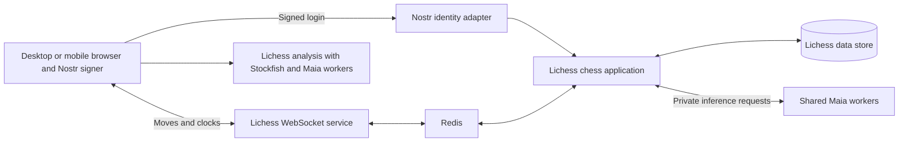
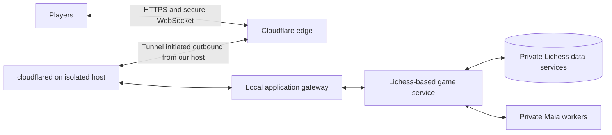

# nosweatchess

**Stay human. Play bots.**

[Play the unrated alpha at nosweatchess.org](https://nosweatchess.org/club).

The No Sweat Chess Club is an independent, noncommercial, open-source chess
project licensed under GNU AGPL v3.0, built on Lichess with human-like Maia bots.

## The club

In the fictional year 2097, neural implants give everyone access to Stockfish 99
at 4750 Elo. A few nonchippers discover an old SSD containing a copy of the
Lichess repository. They use it to form the No Sweat Chess Club, preserving the
spirit of human chess by playing only bots trained on human games from the before
times, 2023.

To keep human chess alive, they stopped playing humans.

The 2097 setting and the 2023 archive are fictional. Games use Maia3 bots with
provisional ratings that are subject to calibration.

## Confirmed chess foundation

**Lichess with our name and logo, for desktop and mobile browsers.**

No Sweat Chess combines:

1. **The familiar Lichess interface:** use Lichess/Lila as the base for playing
   and analysis, retaining its layout, board controls, clocks, move list,
   settings, game flow, and responsive behavior with No Sweat Chess branding.
2. **Multiple stacked premoves:** let players queue several future moves, with
   clear board feedback and cancellation, processed in order against the actual
   game state. Support mouse and touch interaction.
3. **Maia alongside Stockfish analysis:** compare both engines at the same
   selected position. Keep Stockfish's searched evaluations and best lines
   distinct from Maia's human-move probabilities and candidates at selected
   conditioning levels.
4. **A human-like-bot-only opponent pool:** humans enter the pool and are paired
   with openly identified Maia bots, never with other humans. See the
   [bot roster](https://github.com/Dash1971/no-sweat-chess/issues/1) and
   [rating calibration](https://github.com/Dash1971/no-sweat-chess/issues/2).

Play and analyze in desktop and mobile browsers using Lichess's responsive
layout and mouse/touch controls.

Move-quality classifications, combined Stockfish/Maia candidate arrows,
interactive candidate comparisons, and a Moves by rating explorer help players
review their games from both engine and human perspectives.

See the [product roadmap](https://github.com/Dash1971/no-sweat-chess/issues/3)
and [chess architecture and source map](docs/chess-foundation.md).

The native Lila application now integrates Maia3 opponents and Nostr identity.
See [development setup](deploy/lila/README.md) and [public deployment](deploy/public/README.md).

## Implementation status — 28 October 2026

The alpha uses the native Lichess homepage, quick-pair grid, custom time-control
dialog, rounds, clocks, reconnect, game history, PGN and analysis. It automatically
assigns one of the confirmed 44 Maia opponents; there is no bot chooser or direct
challenge flow. A violet rook logo identifies No Sweat Chess within the native
Lichess interface.
NIP-07 signs a short-lived, one-use NIP-98 login challenge; the server verifies
signatures and issues native HttpOnly sessions. Private keys stay in the signer;
no relay publication is required. The browser signer is recommended. Generating
or importing an nsec and remembering it in this browser is also supported with
encrypted IndexedDB storage. NIP-46 remains work.

Anonymous games are casual. Nostr accounts start at native provisional 1500 and
use native Glicko updates, with automatic pairing within ±200 of the current
rating for that speed. Bot priors remain estimates. Admission allows one active
game per browser/account and at most two games overall. The complete stack has not been benchmarked for
ten concurrent games. Policy/model/history metadata are frozen per game; worker
failure voids affected active games. Server inference consumes the native clock.

Automated checks cover signed login/replay protection, stable identity, sessions,
the roster, admission, both colors and controls, Maia replies, native WebSocket
moves, reconnect, stale retry rejection, resignation, PGN and worker crash
recovery. Nine adapter/storage tests and all 277 native frontend tests pass; the
three model/encoder checks and private/public game-flow checks are recorded in
the deployment notes. This records automated verification, not human manual acceptance.

Multiple premoves are shown as board-square highlights, with native cancellation
and promotion. A board-menu setting selects single or multiple premoves.

Post-game and standalone analysis now offer browser-local Maia3 5M/79M probabilities beside Stockfish, candidate previews/return, bounded same-move Stockfish comparisons, 600–2600 rating exploration and EC/Mobile Maia review of individual moves or the full mainline. Full-game review shows White/Black accuracy, a navigable evaluation graph and move classifications; it supports Stop/Resume. Maia model, rating, history, arrow and review-quality preferences live in the native Analysis Menu → Settings and persist in this browser. Maia arrows keep the primary Stockfish width regardless of probability; inferior Stockfish alternatives retain their native taper. Computed classifications stay separate from PGN glyphs and last for the open analysis session. Persisted computed annotations and rating calibration remain work.

Release discipline is **checks and review → merge to main → deploy main**.
`main` is the only permanent branch. See the [release runbook](deploy/public/README.md).

The remaining sections describe the intended product and operational plan.

## Vision

Give people who enjoy online chess a familiar place to play, improve, and track
their progress without worrying about an opponent secretly using an engine,
abandoning a losing game, or behaving badly.

Use the familiar Lichess experience on desktop and mobile: choose a time
control, join the human-like bot pool, play with multiple stacked premoves, see
the result and rating change, and review the game with Maia alongside Stockfish.
Retain native navigation and responsive mouse/touch interaction.

Every opponent is an openly identified Maia3-powered bot with a persistent
username and a calibrated rating. Bots wait for human matchmaking requests.
There are **no human-versus-human games and no bot-versus-bot games**, including
in the calibration plan. Opponent availability comes from the bot pool rather
than from needing enough humans online at each rating and time control.

The promise is trustworthy opponents and useful practice. Human players could
still use outside assistance themselves, so a public human leaderboard is not
part of the MVP.

## MVP experience

1. Create an account with a new Nostr identity or connect an existing identity.
2. Choose a time control and enter the pool.
3. Get paired immediately, subject to service capacity, with a bot near the
   player's estimated strength. New players have provisional ratings.
4. Play using familiar Lichess board controls, clocks, multiple stacked
   premoves, promotion, resignation, draw handling, and reconnection behavior on
   desktop and mobile browsers.
5. Receive a result and rating update, then choose another game or a rematch.
6. Open the Lichess-based analysis board to replay moves and compare Maia
   alongside Stockfish at the same position: searched evaluations and variations
   beside human-move predictions at selected conditioning levels, on desktop
   and mobile browsers.
7. Return to saved games and rating history, or download a PGN.

Use standard chess and the [confirmed 44-bot roster](https://github.com/Dash1971/no-sweat-chess/issues/1):
32 core identities at conditioning 600–2000 and 12 experimental identities at
2200–2600. Policy mappings, provisional Blitz/Rapid estimates and human
calibration are tracked in [issue #2](https://github.com/Dash1971/no-sweat-chess/issues/2).
Initial clocks remain **5+3 blitz and 10+5 rapid**, with separate ratings. Human
testing will determine the supported strength range. Conditioning is not a
measured rating.

All bots are clearly labelled. They continue playing until a legal ending or
the human's resignation; they do not deliberately disconnect or stall. Humans
remain free to resign. An infrastructure failure must be reported honestly and
must not unfairly penalize the player.

Familiar opponents, rematches, and personal head-to-head records can give the
pool a sense of continuity. Bots need not play background games or pretend to be
humans to make the club feel active.

## Lichess as the chess foundation

Use **Lila**, the server and web application powering Lichess, as the base for
our supported chess play and analysis on desktop and mobile. Retain its mature
round, clock, promotion, reconnect, replay, variation, PGN and analysis behavior,
with our multiple stacked-premove extension. Chessground, scalachess and the
existing Lichess client-evaluation machinery stay within that base. We do not need unrelated Lichess product features such as tournaments,
forums or human matchmaking.

Nostr identity, human-versus-Maia matchmaking, pinned bot policies, and calibration
integrate with Lila through dedicated adapters.

Extend Lichess analysis with the existing En Croissant-derived Mobile Maia move
classification, simultaneous Stockfish/Maia candidates and arrows, and the Maia
platform's candidate comparison and Moves by rating interactions. Preserve the
native Lichess interface with our name and logo. Source pins, integration
order and acceptance details are in the [architecture and source map](docs/chess-foundation.md).
Preserve upstream licenses, notices and corresponding sources.

## Nostr integration

**Use Nostr for identity and optional sharing; use ordinary WebSockets for live
games.**

Relay-based live play would still require decisions about authoritative clocks,
ordering, duplicated messages, conflicting moves, and reconnects. It adds work
without removing our need for an authoritative game service. It is outside the
MVP, and no new live-chess NIP is required to launch.

| Function              | Plan                                                                                                                                                                     |
| --------------------- | ------------------------------------------------------------------------------------------------------------------------------------------------------------------------ |
| Account identity      | Nostr public key, with a site-specific unique username                                                                                                                   |
| Existing signers      | [NIP-07](https://github.com/nostr-protocol/nips/blob/master/07.md) browser signers and [NIP-46](https://github.com/nostr-protocol/nips/blob/master/46.md) remote signers |
| New identities        | Local key generation with encrypted backup and a tested restore flow; use [NIP-49](https://github.com/nostr-protocol/nips/blob/master/49.md) where supported             |
| Login                 | [NIP-98](https://github.com/nostr-protocol/nips/blob/master/98.md) signed authentication, then a revocable application session                                           |
| Live games            | Authenticated HTTPS/WebSocket connection; no per-move signer prompts                                                                                                     |
| Optional game sharing | Publish a completed PGN using [NIP-64](https://github.com/nostr-protocol/nips/blob/master/64.md)                                                                         |

Human private keys stay with the player's browser or signer. Login must validate
signatures, request binding, expiry, and a one-time server challenge. Ordinary
gameplay should not require learning Nostr terminology. Games are not published
to public relays automatically; sharing must explain the identity and persistence
implications. Relay outages must not interrupt an authenticated live game.

## Backend architecture

The application uses Lichess/Lila with adapters for Maia inference and Nostr
identity.

- **Web client:** the native Lichess playing and analysis surfaces with No Sweat
  Chess branding, responsive on desktop and mobile. Retain mouse/touch chess
  interaction and shared tree/navigation state.
- **Application and chess state:** adapt Lila and its native services, retaining
  authoritative rules, clocks, results and persistence. Integrate Nostr, bot
  admission and policy/calibration metadata through narrow adapters.
- **Maia workers:** proposed Python/ONNX Runtime service with shared loaded models
  and bounded concurrency. A bot identity is configuration and state, not a
  dedicated process or a separate model copy.
- **Analysis:** run both Maia and Stockfish in browser workers, following the
  [Maia platform's client-side engine approach](https://github.com/CSSLab/maia-platform-frontend#client-side-chess-engines).
  Use ONNX Runtime Web for Maia and WebAssembly Stockfish. Evaluate WebGPU
  acceleration with a supported fallback for Maia. Model and engine downloads
  should be versioned, verified, cached locally, and accompanied by clear
  download progress and cache controls. Benchmark slower desktop and mobile
  devices before choosing browser model defaults. This keeps post-game work
  separate from live server inference; any server fallback needs its own bounded background queue.
- **Operations:** TLS reverse proxy, containers, one initial hosting region,
  backups, structured logs, metrics, and error reporting.

The Lichess-based game server validates every move and controls the clocks.
Preserve its versioning, acknowledgement and reconnect behavior; verify that
retries cannot apply a move twice. New identity, bot and rating adapters must be
idempotent. Bot queueing and inference count toward its total thinking time.

Player disconnects leave their clocks running. A genuine clock loss follows the
published chess rules. Identified service failures void affected games without
rating penalties. The initial recovery policy may void unfinished games after a
server restart rather than reconstruct uncertain clocks.

### Analysis with both engines

Stockfish provides searched evaluations, principal variations, and mistake
review. Maia provides human-move probabilities and comparisons at selected
conditioning levels. Display these as distinct kinds of information: a likely
human move is not necessarily the strongest move, and Maia's outcome predictions
are not searched Stockfish evaluations.

Both engines should support the selected game position and analysis variations.
Pin Maia's model, encoder, history handling, and conditioning inputs, and preserve
the original game's bot policy metadata. Browser analysis is available after the
game; server-side validation and inference remain authoritative during rated
play. The integration must test both engines in supported desktop and mobile
browsers, including loading, memory use, touch interaction, cancellation, cache
updates, and compatibility of threaded WebAssembly headers with Nostr login flows.

## Bot strength and timing

Keep three concepts separate:

1. **Identity:** persistent username, avatar, and personal match history.
2. **Playing policy:** model hash, encoder, history mode, conditioning inputs,
   sampling, opening behavior, and timing policy.
3. **Calibration:** measured strength and uncertainty for each time control.

A Maia conditioning input of 1500 does not prove a playing strength of 1500.
Sampling, history, model size, and clock behavior can change results. Several
identities may share a policy; their calibration evidence should be pooled for
that policy rather than treating every name as an independent measurement.

Start with broad strength bands and a small number of timing variants. Evaluate
the 79M model as the initial quality target and benchmark smaller models if needed.
Pin both conditioning inputs within each policy. Do not silently change difficulty
or substitute a different model during a rated game. Timing variety should feel
natural, but it does not by itself establish a distinct chess style.

### Calibration through human-versus-bot play

1. Use conditioning settings and existing Mobile Maia research only as initial
   estimates. Mark unvalidated bot ratings as provisional.
2. Recruit an alpha cohort across the intended strength range. Give each person
   games against several nearby policies, balancing colors and collecting results
   separately for each time control.
3. Fit relative bot and human strengths on this connected set of human-versus-bot
   games. Choose and document an internal rating anchor: the absolute scale cannot
   be identified from results alone. External human ratings can provide rough
   context, not guaranteed equivalence to another site's scale.
4. Reserve games or participants for validation. Check predicted scores against
   actual scores, uncertainty, rating-band coverage, timeout rates, and reports
   of unrealistic behavior. Collect more human games where evidence is weak.
5. Publish versioned calibration snapshots. Use Glicko-2 for human ratings against
   these reference opponents, retaining uncertainty rather than treating bot
   estimates as exact. Monitor human outcomes and revise calibrations deliberately.

There are no automated bot-versus-bot calibration matches. The tradeoff is that
credible calibration depends on enough human play; precise ratings across the
whole range should not be promised on day one.

Changes to model, sampling, openings, history, or timing create a new policy
version requiring validation. Preserve the policy and rating snapshots used by
each historical game. Test reproducible inference and chess correctness without
creating a separate bot match pool.

## Self-hosting and infrastructure

**Start on our own hardware behind Cloudflare Tunnel.** A rented cloud server is
an option for later growth or availability, not a prerequisite for the MVP.

Use a dedicated machine or isolated VM, preferably on a separate network segment
with firewall rules preventing access to personal devices and shared file stores.
Keep application data and credentials separate from personal accounts, signing
keys, other projects, and Mobile Maia release infrastructure. Containers organize
services but do not replace host and network isolation.

The initial host is a repurposed Intel Mac mini, starting from a fresh Ubuntu
installation after reformatting both disks. The previous OpenClaw account,
configuration, histories, and local recovery copies are not restored. This is an
ordinary reformat, not forensic erasure of deleted disk contents. Network isolation
and public exposure remain separate deployment steps; neither is implied by
retiring the old agent.

The initial deployment should:

- Use a persistent named tunnel and a custom hostname. The connector establishes
  outbound connections, so no inbound router port forwarding or public origin
  address is needed. Publish only the web application through the tunnel.
- Keep database, Redis, inference endpoints, and management interfaces private. Allow
  administration only through an authenticated private access path. Players use
  the application's Nostr login; they do not need Cloudflare accounts.
- Bind the local gateway to loopback or an isolated service network. If the
  connector-to-gateway connection crosses machines or an untrusted network, use
  HTTPS with certificate verification.
- Use HTTPS/WSS, application authentication, origin checks, request validation,
  connection limits, and per-message rate limits. Cloudflare protects the edge;
  the application still validates all game commands.
- Keep tunnel credentials outside Git, minimize personal information in logs,
  and retain encrypted backups off the serving machine. Test restoring them.

[Cloudflare Tunnel](https://developers.cloudflare.com/tunnel/) provides the
outbound origin connection. [Cloudflare supports WebSockets on all plans](https://developers.cloudflare.com/network/websockets/),
but connections can close during network updates or idle periods. Heartbeats,
reconnection, and authoritative game snapshots remain necessary. Its WebSocket
WAF inspection covers the initial upgrade, not subsequent game messages.

### Security, privacy, and availability boundaries

This setup reduces direct exposure of our network and keeps the serving address
out of normal public DNS. It cannot undo an address disclosed through another
service or guarantee anonymity. Audit alternative origin routes before launch.

Cloudflare knows the connector's origin address and the visitors' IP addresses.
Its [TLS proxy terminates browser connections at its edge](https://developers.cloudflare.com/ssl/concepts/),
so it can process application traffic. This is origin shielding and encrypted
transport, not end-to-end privacy from Cloudflare. Nostr private keys must remain
local to the player or their signer.

Our power supply, ISP, hardware, and upload bandwidth become availability limits.
Cloudflare does not host the game process or Maia model for us, repair a vulnerable
application, or keep games running through an origin outage. Measure latency from
the intended player regions, load-test the actual machine, and start with a small
admission cap. Consider a UPS and automatic service recovery for the beta.

### Costs and migration

GitHub hosts source, issues, CI, and deployment workflows. GitHub Pages can host
static project material for this noncommercial project, subject to its
[published limits](https://docs.github.com/en/pages/getting-started-with-github-pages/github-pages-limits).
It cannot run the persistent game server, database, or Maia workers.

Initial self-hosting costs depend on existing hardware, electricity, the domain,
backup storage, and the Cloudflare features selected. Check the current plan and
usage limits before launch; we should not describe the entire service as free.
There is no initial requirement to rent a GPU or a cloud database.

Keep application, database, inference, and tunnel configuration portable so we can
move to a rented server or split inference onto another host without changing
accounts or the player experience. Data migrations and tested backup/restore procedures are part of that portability.
Choose storage and managed-service options compatible with the Lichess base;
the prototype's PostgreSQL choice is not a constraint on the final architecture.

For a later cloud deployment, as of 28 October 2026 rough planning allowances are
**US$55–75/month** for a small single-VM alpha and **US$100–160/month** for an initial
separated beta deployment.
These are estimates based on [VM](https://www.digitalocean.com/pricing/droplets)
and [database](https://www.digitalocean.com/pricing/managed-databases) pricing, not
capacity guarantees. They exclude tax, engineering, separate staging, and any
additional temporary compute. Recheck pricing when provisioning.

Measure latency and throughput on the actual host before setting player limits.
Bound inference queues, limit active games per account, and stop admitting new
games before existing games suffer. Add workers as measured demand requires;
choose GPU hosting only if benchmarks justify its cost.

Before public access, test database restoration, duplicate commands, reconnection,
clock boundaries, draw rules, inference failures, and restart behavior. Monitor
failed games, queue delay, disk growth, resource usage, and spending. Keep model
weights out of ordinary Git history and disposable build output out of the repo.

## Implementation milestones

| Milestone                  | Deliverable                                                                                                                                                      |
| -------------------------- | ---------------------------------------------------------------------------------------------------------------------------------------------------------------- |
| 1. Reuse and hosting spike | Run the Lichess base with Maia/Nostr adapters; benchmark the complete private stack and demonstrate the playing-to-analysis slice |
| 2. Playable alpha          | Nostr onboarding and recovery, pool entry, named bots, clocks, reconnects, saved games, and post-game analysis                                                   |
| 3. Human calibration       | Connected alpha cohort, provisional ratings, policy versions, held-out checks, and documented calibration uncertainty                                            |
| 4. Public beta             | Rating history, rematches, capacity controls, monitoring, tested backups, and optional Nostr PGN sharing                                                         |

Measure second-game conversion, completed games, return visits, perceived fairness,
repeat encounters with named bots, calibration accuracy, and hosting cost per
completed game. Use those results to choose the next features and pool expansion.

## License

GNU Affero General Public License version 3.0. See [LICENSE](LICENSE).

SPDX identifier: `AGPL-3.0-only`. Third-party components retain their respective
licenses and attribution requirements.
