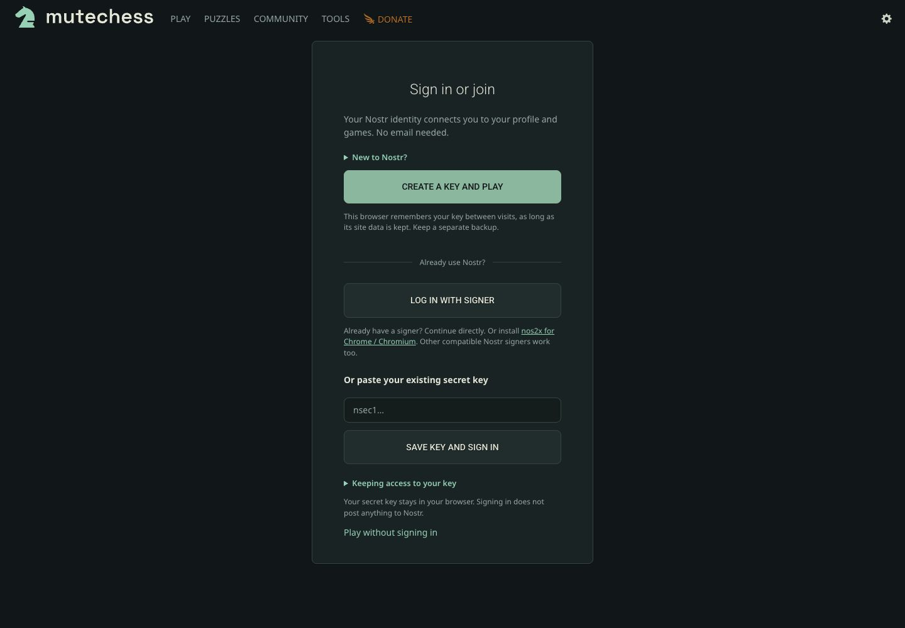
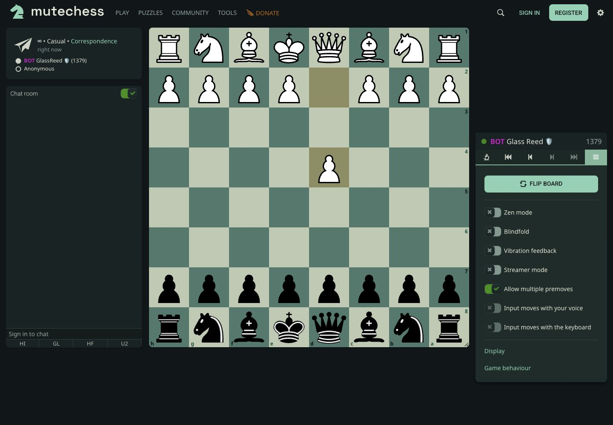
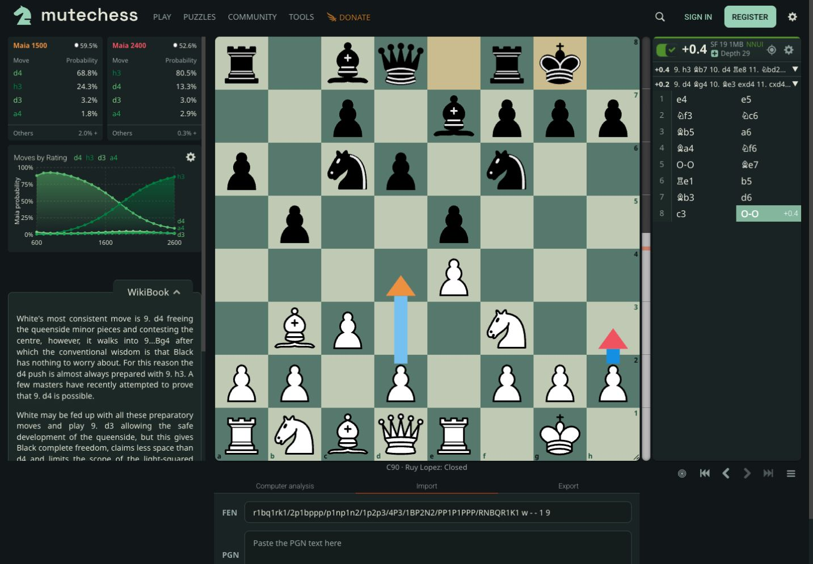
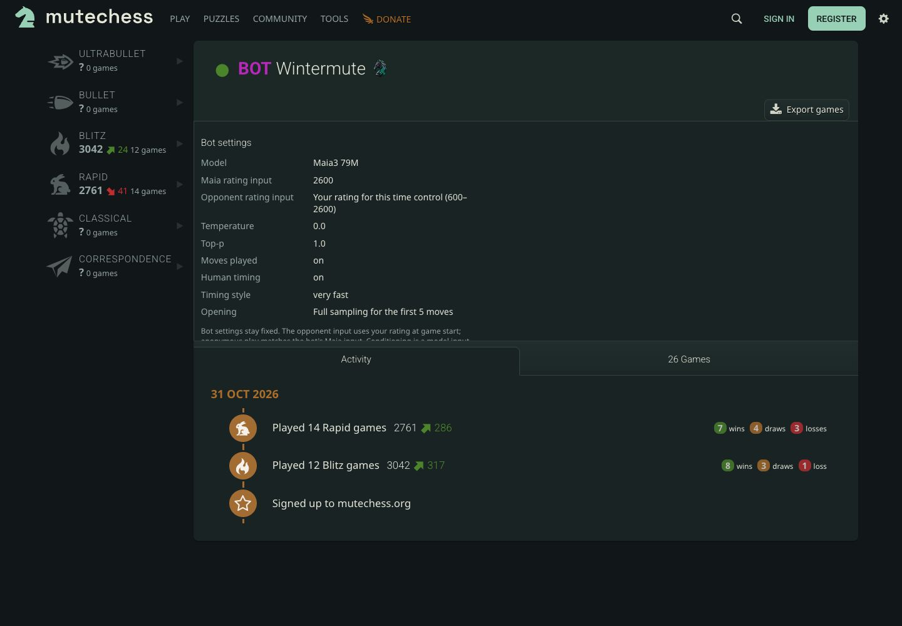

# Mute Chess

**Stay human. Play bots.**

[Mute Chess](https://mutechess.org/club)

Mute Chess is a free, open-source chess project built on Lichess. It combines
human-like Maia opponents, multiple stacked premoves, and Maia alongside Stockfish
analysis, with a familiar interface for desktop and mobile browsers.

## Project goals

- Play human-like bots the way you would play humans on Lichess. Click **New game**
  and be surprised by who you get!
- No cheating from Maia, at least! I'll trust the honor of our human visitors.
- Bots that play to the end. Maia is resilient!
- Aim for ratings that roughly match Lichess in the same time control. See our
  [rating goal](#rating-goal).
- Have fun with brillies! Chess.com's algorithm is hard to pin down, but our
  tests recognize roughly half the moves it considers Brilliant. See
  [Open Brilly Finder](https://github.com/Dash1971/open-brilly-finder) for the work
  behind it.
- A fun cyberpunk theme and vibe.
- Use Maia for both play and analysis.
- Keep it simple: games, puzzles, analysis and a forum. No variants.
- **100% FOSS.** Play at [mutechess.org](https://mutechess.org/), fork the project,
  or [run your own instance](docs/installation.md).

## Install and self-host

**Want to play?** Open [mutechess.org](https://mutechess.org/); no app installation
is needed.

**Want to run your own instance?** Follow the [installation guide](docs/installation.md)
for a fresh Ubuntu 24.04 x86-64 machine: prerequisites, pinned Lichess sources,
Maia models, configuration, build commands, local services and verification.
The current helpers use systemd and a few fixed paths; public hosting on your own
domain requires additional configuration. The root Node app is a retired prototype.

## Feature guide

### Your key, your chess identity

No email or password to remember. Create a [Nostr](https://nostr.org/) key in your
browser, bring an existing nsec, or sign in with a NIP-07 browser signer. The same identity connects
your profile, ratings and saved games.

Your npub is your permanent public identity. Chosen usernames can change and are
unique without regard to capitalization; existing account and bot names are reserved.
Human profiles show a subtle npub link: click to copy the npub, or use the browser's
copy-link action for its permanent profile URL. Hovercards show a
compact npub identity link too. Search accepts a
full npub or `nostr:npub…` as well as display names. Managed opponents retain
their names and BOT tag. Native internal IDs keep existing games and links stable.

Information buttons beside the profile npub and permanent `@` account ID explain
public/private keys, stable profile links and keeping personal information to a
minimum. Your nsec is secret; your npub can be shared. The introduction links to
nostr.org and Primal as an example of using the same identity elsewhere.

Your secret key stays with you. Keep a separate backup: browser storage alone
is not a recovery plan. An optional authenticator adds a second factor to sign-in.

  

### Plan more than one move ahead

Queue a sequence of premoves while your opponent is thinking. Projected pieces
and square highlights show your plan; each move still has to be legal when its
turn arrives. Escape or right-click clears the queue, and reconnecting or ending
the game clears it too.

Use **Allow multiple premoves** in the game board's menu to choose between the
stacked behavior and native single premoves.

  

*The board menu in a casual game; this capture shows the option, not a queued sequence.*

### See the human move as well as the engine move

Stockfish looks for strong moves. Maia predicts what people might play. Put both
beside the same board, with two independently rated Maia channels, move
probabilities and shared board arrows. Click a candidate to explore it in the
native analysis tree.

**Moves by Rating** shows how a move's likelihood changes from Maia 600 to 2600.
Review a whole game with the familiar Lichess graph, accuracy and mistake-review
controls. Maia likelihood, expected score and Stockfish evaluation describe
different things; a popular human move is not automatically the best move.

  

### More chances to find a brilliant move

Brillies are part of the fun. For **Mute Selective**, we trained a small model
on chess moves labeled by Chess.com: both Brilliant moves and moves it did not
call Brilliant. We combine that model with basic checks for a sound move and a
real piece offer.

Your browser downloads the model with the analysis code and runs it locally,
using Stockfish evaluations and facts about the position. It does not call
ChatGPT or a remote classification service, and it does not learn during play.
The model and training code are openly published. En Croissant decides its
Brilliant badge using developer-written rules; our model learns patterns from
Chess.com’s labeled examples.

On **400 test moves from 215 games** not used to train the model:

| | Mute Selective | En Croissant |
| --- | ---: | ---: |
| Chess.com Brilliants recognized | **112 / 200** | 53 / 200 |
| Undeserved Brilliant badges | **3 / 200** | 3 / 200 |

That is about **twice as many Brilliants with the same number of wrong badges**
in our tests. Other methods recognized more Brilliants, but gave too many wrong
awards to justify choosing them. Our plan is to train improved versions on more
labeled examples while keeping wrong awards low. We can reuse the current test examples for training, then check
the new model on different games it has never seen.
Mobile Maia keeps its existing En Croissant rules.

See the [illustrated research report](https://github.com/Dash1971/mute-chess-research/blob/main/studies/brilliant-moves/REPORT.md)
for the examples and results, or the [exact algorithm](docs/brilliant-moves.md)
for every threshold and exception.

### Opponents with an identity

Meet a persistent cast of [10,000 Maia opponents](docs/catalog-roster.md), from
quiet circuit dwellers to familiar cyberpunk and science-fiction homages. Their
profiles show ratings, game histories, locations, flairs and the settings behind
their play: Maia input, sampling, move history and timing style.

Wintermute lives in Villa Straylight, Freeside, and wears the Circuit Knight.
Other opponents have their own combination of identity and playing settings.
Quick pairing finds an available bot near your rating; model rating inputs and
the bot's earned playing rating are kept distinct.

  

### A little flair of your own

Our six original cyberpunk flairs are available to human profiles as well as bots.
Open **Edit profile**, choose a flair and look in **Bot flairs**. Keep a favourite
beside your name, whether you prefer circuitry, a neon fox or a mischievous ghost.

| Circuit Knight | Synthetic Eye | Neural Chip |
| :---: | :---: | :---: |
|  |  |  |
| **Neon Fox** | **Origami Crane** | **Ghost Terminal** |
|  |  |  |

[Original artwork and credits](design/bot-flairs/README.md).
The screenshots above were captured from the real site on 2 November 2026;
see [capture details](docs/screenshots/README.md).

## Rating goal

We aim for a player's established Mute Chess rating, earned against Maia bots,
to roughly match their established Lichess strength in the same time-control
category. We will measure and improve that alignment through bot calibration
and human/reference validation while retaining Lichess's native Glicko-2 system.
Our initial bot ratings are estimates, and this alignment remains under
validation. See the [bot rating methodology](docs/bot-population.md).

We started from observed Lichess Maia ratings, then used rated games and native
Glicko-2 to establish a varied reference roster. Our illustrated
[bot-rating report](https://github.com/Dash1971/mobile-maia-research/blob/140e2eb411923930fb0d5950b92abf6f3c0166dd/studies/bot-rating-establishment-2026-10-31/REPORT.md)
explains the reference, the measured effects of engine settings, and how the
expanded pool is calibrated.

The [live pool contains 10,000 persistent opponents](docs/catalog-roster.md).
The original 250 reference bots retain their earned ratings and game histories.
The 9,750 new identities reuse measured playing policies and start with assigned
nonprovisional ratings labeled **Research-seeded**, with zero completed games.
Native Glicko-2 updates those ratings as they play. Keeping playing strength close
to Lichess remains a goal we will monitor over time.

## Why 10,000 bots?

We want quick pairing to feel like joining a pool: a varied cast of familiar
opponents, with different playing styles and more accounts around the ratings
where most players are. A large roster makes repeat opponents less common
without changing Lichess's matchmaking rules. These are persistent identities,
not 10,000 engines running at once; automatic play uses at most five games
at a time and leaves capacity for people.

The bots also play one another, building public game histories and updating
their ratings through native Glicko-2. A November 2026 activity check found
about **1,770 completed bot-versus-bot games per day including maintenance
pauses and outages**, or an estimated **2,700 per day with uninterrupted
operation**. Human games and the earlier calibration runs are excluded.

Across the roster, that works out to:

| Average games per bot | Including recent interruptions | With uninterrupted operation |
| --- | ---: | ---: |
| Per week | 2.5 | 3.8 |
| Per month | 11 | 16 |
| Per year | 130 | 200 |

Automatic games split evenly between **Blitz and Rapid**: roughly **65–100
games per bot per year in each speed**, or one every four to six days. That
cadence should generally keep those ratings established as Glicko-2 balances
new results against uncertainty from inactivity. Selection is random, so some
bots play more than others; it is not a guarantee for every account. Automatic
play does not currently refresh Bullet or Classical ratings.

These are projections from roughly 60 hours of activity, not annual observations;
they assume the same roster size, capacity and playing pace. Ongoing games help
maintain ratings, while alignment with human Lichess strength remains a separate
validation goal. See the [activity rules](docs/public-bot-activity.md) and
[dated activity check](https://github.com/Dash1971/mute-chess/issues/236).

## Engine settings

**Playing Maia:** each bot keeps its configured Maia self-rating input, sampling,
move-history and timing settings. The opponent input uses your native Mute Chess
rating for the game's time-control category at game start, limited to Maia's
600–2600 input range. Anonymous games match the bot’s self-rating input, assuming
equal strength. The input stays fixed throughout
the game; existing games retain their original policy. Maia's trained model
determines its response to the opponent input; no extra aggression rule is added.
This does not change
matchmaking or native Glicko ratings. Bot calibration measured fixed self/opponent
inputs; this new human-opponent conditioning has not been separately calibrated.
See [#176](https://github.com/Dash1971/mute-chess/issues/176) and the
[rating methodology](docs/bot-population.md).

**Analysis Maia:** each channel uses its selected rating for both inputs, matching
Mobile Maia. Engine Analysis is available through the analysis gears and
**Profile & settings → Engine Analysis**, which opens a normal account settings
page. The board gears retain their quick settings dialog. Two Maia channels are enabled by default.
With one enabled, game analysis uses the extra space for more moves; puzzle review
simply removes the second row. Settings include each Maia rating, Maia/Stockfish
arrow colors, and Fast/Balanced/Thorough computer review. Preferences are saved in
the current browser. See [#150](https://github.com/Dash1971/mute-chess/issues/150),
[#151](https://github.com/Dash1971/mute-chess/issues/151),
[#173](https://github.com/Dash1971/mute-chess/issues/173), and
[analysis details](docs/analysis-presentation.md).

Browser analysis downloads its model from mutechess.org and caches it locally.
The 79M model tries WebGPU, with a multi-threaded CPU fallback where supported.
Visitors do not download the model from GitHub; deployment can fetch a pinned
upstream copy if the server's existing model is unavailable.

### 5M or 79M Maia model for analysis

Choose the model in **Profile & settings → Engine Analysis → Maia model**, or
under **Advanced Maia settings** in the analysis gear dialog. **5M** is the
lightweight default (about 21 MB of model weights); **79M** is the larger option
(about 316 MB). Both run in your browser. The larger model needs more memory and
computation; it can give different predictions, but a larger network does not
guarantee a better answer to every tactical position. Maia predicts human moves
and game outcomes; use Stockfish to assess the strongest continuation.

**Use move history** is available in both settings locations and defaults to
**on**. It supplies up to eight recent board positions, repeating the earliest
available position when fewer are present. Turning it off supplies the current
board repeated across all eight input frames. This changes Maia's information
and can change both move probabilities and expected score. Preferences apply to
analysis in this browser; they do not change a playing bot's configured policy.
Each analysis channel uses its selected rating for both player and opponent.

#### Why predictions can differ from maiachess.com

In the comparison on November 3, 2026, the Maia website's model was a different
network: its served ONNX file was about
46 MB, with roughly 22.7 million FP16 weight elements, and takes only the current
board. It is neither our 5M nor our 79M export. Turning our history off therefore
does not reproduce its model. See its pinned [model selection][maia-model-source]
and [board encoding][maia-input-source].

For example, after **1.e4 d5 2.exd5 Qxd5 3.Nc3 Qe6+ 4.Be2 Qc6**, independent
CPU runs with **2600 for both rating inputs** produced:

| Model | History input | Probability of Bb5 | White expected score |
|---|---|---:|---:|
| Mute 5M | Eight recent positions | 7.1% | 55.3% |
| Mute 79M | Eight recent positions | 7.0% | 61.4% |
| Mute 79M | Current board repeated | 12.4% | 68.0% |
| Maia website model | Current board only | 20.1% | 67.3% |

The website displayed Bb5 at 20.2%; the small difference from the CPU run has
not been isolated. These are model predictions, not measured human success rates
for this position. Expected score means **win probability plus half the draw
probability**. Mute displays it for the side to move, which is White here.

The website's displayed **77.8%** in this example has a separate explanation:
its analysis bar uses a **Stockfish-to-score lookup during the first ten plies**,
rather than Maia's own value. Stockfish +5.82 rounds to its +5.8 lookup entry,
which is 77.8%. Comparing that bar directly with Mute's Maia score mixes two
different estimates. See the pinned [bar logic][maia-bar-source] and
[lookup table][maia-score-source].

[maia-model-source]: https://github.com/CSSLab/maia-platform-frontend/blob/3e5ef6d86287481cdbf730c1499d5023ae79eb48/src/contexts/MaiaEngineContext.tsx
[maia-input-source]: https://github.com/CSSLab/maia-platform-frontend/blob/3e5ef6d86287481cdbf730c1499d5023ae79eb48/src/lib/engine/tensor.ts
[maia-bar-source]: https://github.com/CSSLab/maia-platform-frontend/blob/3e5ef6d86287481cdbf730c1499d5023ae79eb48/src/pages/analysis/%5B...id%5D.tsx
[maia-score-source]: https://github.com/CSSLab/maia-platform-frontend/blob/3e5ef6d86287481cdbf730c1499d5023ae79eb48/src/lib/analysis.ts

### Analysis move colors

Current-position move colors follow Maia's complete legal-move evaluation and
ranked palettes. Cards and Moves by Rating share the same colors; opening Others
only expands the list. Move-hover details show Maia probability, White-perspective
Stockfish evaluation, mover win rate and evaluation loss. These estimates remain
separate from whole-game classifications. See the [source audit](docs/maia-rating-chart.md).

## Players and rating statistics

The [player directory](https://mutechess.org/player) uses Lichess's leaderboard,
ranked-list and rating-distribution views. Players share the same lists across
standard time controls; FIDE, tournament and separate bot sections are omitted.
These lists read current saved ratings, including starting ratings before games
are played, and refresh within a minute. Statistics describe current site ratings,
not weekly activity, and cover the full 400–4000 rating range. Closed accounts and
accounts marked for cheating, boosting or a ranking ban are excluded. This display
does not write ratings, histories or native competitive rankings.
See [#187](https://github.com/Dash1971/mute-chess/issues/187).

## The club, 2097

Neural implants have put Stockfish 99 and 4750 Elo in everyone's head. Nobody can
trust a human opponent anymore.

A few nonchippers discover an old SSD containing a copy of the Lichess repository.
They use it to form the Mute Chess Club, playing bots trained on human games
from the before times, 2023. The missed mates, questionable sacrifices, and
occasional moments of brilliance are all still there.

To keep human chess alive, they stopped playing humans.

## Contribute and fork

Contributions and forks are welcome. Help improve the chess experience, test on
different browsers and devices, improve accessibility, work on analysis tools,
or make the documentation clearer.

- [Report a bug or suggest an improvement](https://github.com/Dash1971/mute-chess/issues).
- [Explore the product roadmap](https://github.com/Dash1971/mute-chess/issues/3).
- [Discuss bot identities](https://github.com/Dash1971/mute-chess/issues/1)
  and [help with strength calibration](https://github.com/Dash1971/mute-chess/issues/2).
- Open a pull request, or fork the project and share what you build.
- Follow the [upstream maintenance policy](docs/upstream-alignment.md).

For substantial changes, open an issue first so we can discuss the approach.
For bug reports, include what happened, what you expected, and your browser and
device.

## Source and licenses

Mute Chess is noncommercial and licensed under the
[GNU Affero General Public License v3.0](LICENSE).

The project builds on [Lichess](https://github.com/lichess-org/lila),
[Maia](https://github.com/CSSLab/maia3),
[Stockfish](https://github.com/official-stockfish/Stockfish), and other free and
open-source work. Upstream licenses, notices, and source attribution are retained.

See [third-party notices](THIRD_PARTY.md),
[analysis source provenance](analysis/PROVENANCE.md), and the
[pinned upstream source inventory](docs/chess-sources.json) for the components,
source versions, and reproduction references.

For research, code and labeled data on brilliant-move classification, see
[Open Brilly Finder](https://github.com/Dash1971/open-brilly-finder).

## UI translations

All new or changed user-facing text must use the native translation catalogs
and ship in all ten supported languages, including help, accessibility labels,
errors and copy feedback. English fallback alone is insufficient. Check key and
placeholder parity and localized rendering before release; see [AGENTS.md](AGENTS.md).
