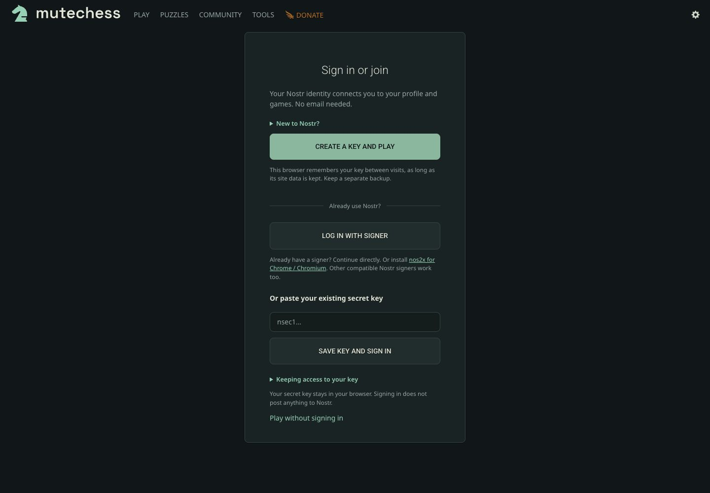
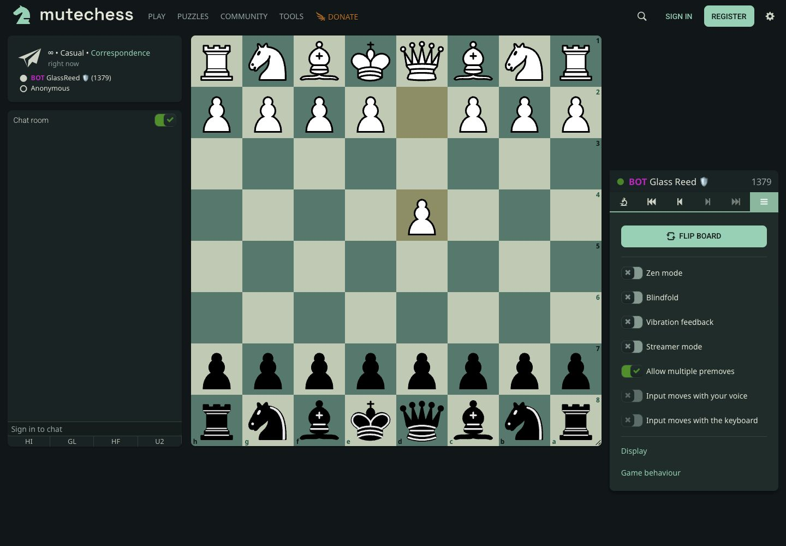
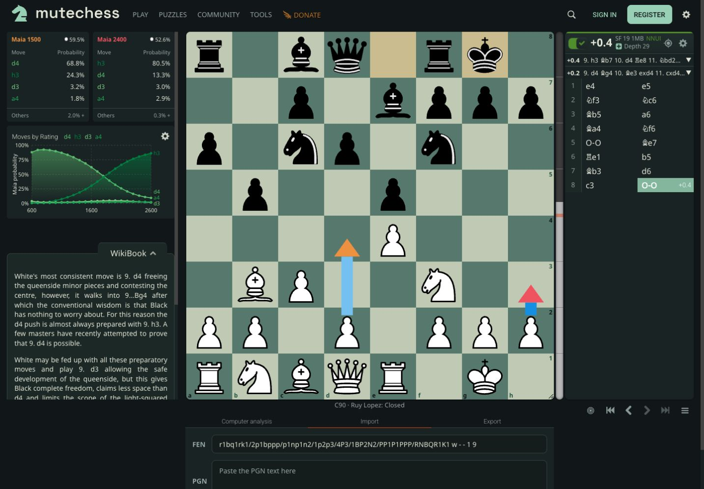
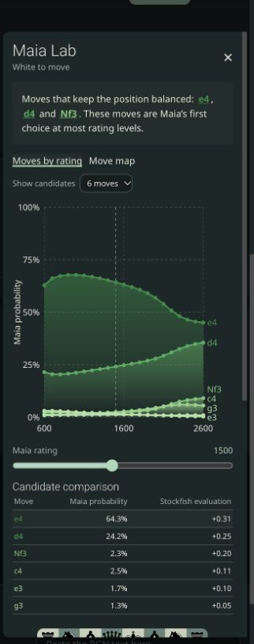
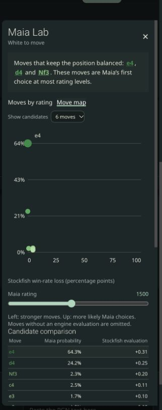
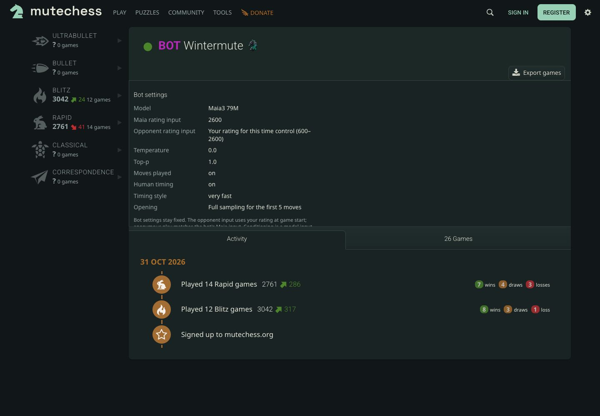

# Mute Chess

**Stay human. Play bots.**

[Mute Chess](https://mutechess.org/club)

Mute Chess is a free, open-source chess project built on Lichess. It combines
human-like Maia opponents, multiple stacked premoves, and Maia alongside Stockfish
analysis, with a familiar interface for desktop and mobile browsers.

## Project goals

- Play human-like bots in the pool the way you would play humans on Lichess.
- Opponents that don't cheat, rage quit, or abuse you.
- Aim for ratings that roughly match Lichess. See our
  [rating goal](#rating-goal).
- Play like your YouTube heroes with brilliant moves and multiple stacked premoves.
  See [Open Brilly Finder](https://github.com/Dash1971/open-brilly-finder) for the
  work behind it.
- Maintain a fun cyberpunk theme and vibe.
- Tightly integrate Maia for both play and analysis.
- Keep it simple: games, puzzles, analysis and a forum. No variants.
- **100% FOSS.** Play at [mutechess.org](https://mutechess.org/), fork the project,
  or [run your own instance](https://github.com/Dash1971/mute-chess/blob/main/docs/installation.md).

## Install and self-host

**Want to play?** Open [mutechess.org](https://mutechess.org/); no app installation
is needed.

**Want to run your own instance?** Follow the [installation guide](docs/installation.md)
for a fresh Ubuntu 24.04 x86-64 machine: prerequisites, pinned Lichess sources,
Maia models, configuration, build commands, local services and verification.
The current helpers use systemd and a few fixed paths; public hosting on your own
domain requires additional configuration. The root Node app is a retired prototype.

## Feature guide

See the [feature and site behavior manual](docs/site-manual.md) for detailed
rules, engine settings, bot pool behavior and reconnecting. Browse
[all documentation](docs/README.md) for everything else.

### Your key, your chess identity

No email or password to remember. Create a [Nostr](https://nostr.org/) key in your
browser, bring an existing nsec, or sign in with a NIP-07 browser signer. The same identity connects
your profile, ratings and saved games.

New human accounts always get a public-key-derived account ID, including when
a name is chosen during signup. That chosen name is an editable display name.

Your npub is your permanent public identity. Chosen usernames can change and are
unique without regard to capitalization; existing account and bot names are reserved.
Human profiles show a subtle npub link: click to copy the npub, or use the browser's
copy-link action for its permanent profile URL. Hovercards show a
compact npub identity link too. Search accepts a
full npub or `nostr:npub…` as well as display names. Managed opponents retain
their names and BOT tag. Native internal IDs keep existing games and links stable.

Information buttons beside the profile npub and permanent `@` account ID explain
public/private keys, stable profile links and keeping personal information to a
minimum. Your nsec is secret; your npub can be shared. The introduction links to
nostr.org and Primal as an example of using the same identity elsewhere.

Your secret key stays with you. Keep a separate backup: browser storage alone
is not a recovery plan. An optional authenticator adds a second factor to sign-in.

  

### Plan more than one move ahead

Queue a sequence of premoves while your opponent is thinking. Projected pieces
and square highlights show your plan; each move still has to be legal when its
turn arrives. Escape or right-click clears the queue, and reconnecting or ending
the game clears it too.

Use **Allow multiple premoves** in the game board's menu to choose between the
stacked behavior and native single premoves.

  

*The board menu in a casual game; this capture shows the option, not a queued sequence.*

### See the human move as well as the engine move

Stockfish looks for strong moves. Maia predicts what people might play. Put both
beside the same board, with two independently rated Maia channels, move
probabilities and shared board arrows. Click a candidate to explore it in the
native analysis tree. See [arrow behavior and classification badges](docs/arrow-behavior.md)
for the overlap rules, retained Lichess tapering and cross-app screenshot comparisons.

**Moves by Rating** shows how a move's likelihood changes from Maia 600 to 2600.
Review a whole game with the familiar Lichess graph, accuracy and mistake-review
controls. Maia likelihood, expected score and Stockfish evaluation describe
different things; a popular human move is not automatically the best move.

  

### Explore a position in Maia Lab

Open **Maia Lab** beside **Moves by Rating** to explore a position in more detail.
It is available on the analysis board, in post-game analysis, and after a puzzle
has reached review.

Maia Lab builds on [maiachess.com](https://www.maiachess.com/) and its
[open-source frontend](https://github.com/CSSLab/maia-platform-frontend), including
adapted position-description logic and inspiration for the Move map.

Compare six or eight candidate moves and slide the Maia rating from **600 to
2600**. **Moves by rating** shows how their popularity changes; **Move map** puts
Maia's likely choices beside Stockfish's assessment of their strength. A short
position description points out strong continuations and tempting mistakes.

Select a candidate to preview it, then choose **Explore selected move** to enter
that variation on the analysis board. The Lab rating is independent of your
saved Maia settings. Everything runs in your browser. Position descriptions
combine Maia predictions with Stockfish analysis and fixed chess rules.

  
  

*Live narrow-screen views; scroll inside the dialog for the preview board and
selected-move details. See the [Maia Lab guide](docs/maia-lab.md) for the controls,
what the numbers mean and how to interpret the descriptions.*

### More chances to find a brilliant move

Brillies are part of the fun. Mute Chess uses
[Open Brilly Finder](https://github.com/Dash1971/open-brilly-finder), our open-source
project for spotting sound sacrifices and marking them **Brilliant (!!)** during
game review.

Its classifier, **Mute Exchange**, first checks that a piece is really on offer,
then asks a model trained on Chess.com's own Game Review labels whether the
sacrifice would earn the badge there. It runs locally in your browser.
Chess.com's full formula is private; this is our own open implementation.

On **337 Witty_Alien games** held out from training:

- It recognized **300 of 416 Chess.com Brilliants (72.1%)**, up from 259 (62.3%)
  for the previous classifier on the same games.
- Of the **319 Brilliant badges it awarded, 300 matched Chess.com's gallery
  (94.0%)**. Seven more are Brilliants in Chess.com's review today.

Both classifiers were scored on the site's saved Stockfish 19 Fast review
output for those games. They are one titled player's games; results for other
players and settings can differ, and no live browser test has been run.

**[Read the illustrated research report](https://github.com/Dash1971/open-brilly-finder/blob/main/studies/brilliant-exchange-2026-11-22/REPORT.md)**
for the method, results and what we want to improve next.
**[Explore Open Brilly Finder](https://github.com/Dash1971/open-brilly-finder)**
for the code, trained model, labeled games and instructions to reproduce the work.
For Mute Chess integration details, see the [implementation notes](docs/brilliant-moves.md).

### Opponents with an identity

Meet a persistent cast of [10,000 Maia opponents](docs/catalog-roster.md), from
quiet circuit dwellers to familiar cyberpunk and science-fiction homages. Their
profiles show ratings, game histories, locations, flairs and the settings behind
their play: Maia input, sampling, move history and timing style.

Wintermute lives in Villa Straylight, Freeside, and wears the Circuit Knight.
Other opponents have their own combination of identity and playing settings.
Quick pairing finds an available bot near your rating; model rating inputs and
the bot's earned playing rating are kept distinct.

  

### A little flair of your own

Our six original cyberpunk flairs are available to human profiles as well as bots.
Open **Edit profile**, choose a flair and look in **Bot flairs**. Keep a favorite
beside your name, whether you prefer circuitry, a neon fox or a mischievous ghost.

| Circuit Knight | Synthetic Eye | Neural Chip |
| :---: | :---: | :---: |
|  |  |  |
| **Neon Fox** | **Origami Crane** | **Ghost Terminal** |
|  |  |  |

[Original artwork and credits](design/bot-flairs/README.md).
The screenshots above were captured from the real site on November 2 and 22, 2026;
see [capture details](docs/screenshots/README.md).

### Basic Chess Insights and unsupported features

Basic Chess Insights groups game results, rating changes and opponent ratings by
opening, color, time control and date. Engine-analysis statistics are unavailable;
browser reviews are not uploaded for Insights. Unsupported inherited feature links
show a translated not-yet-supported notice. See
[scope and limitations](docs/basic-insights-and-unsupported-links.md).

### Full Lichess puzzle catalog

The puzzle importer supports the pinned full official CC0 export: 6,193,530
puzzles, with Lichess's native randomized path generation, quality tiers and
unchanged solver, ratings and replay behavior. Existing installations need an
explicit full data import; the bundled 50,000 puzzles are the small CI/development
fixture. Existing puzzle history, votes and earned ratings are preserved. See
[puzzle provenance, import and native path refresh](puzzles/README.md) (#289).

## Rating goal

We aim for established Mute Chess ratings to roughly match Lichess strength in
that time-control category, using native Glicko-2. Bot calibration remains under
validation. See the manual's [rating goal and calibration](docs/site-manual.md#rating-goal-and-calibration).

## Why 10,000 bots?

A varied roster of persistent Maia opponents makes repeat pairings less common.
Background games keep their histories and ratings active. See
[bot pool behavior](docs/site-manual.md#bot-pool-behavior) for matchmaking, shared
capacity, background top-ups and activity estimates.

## Engine settings

Configure Maia ratings, one or two analysis channels, model size, move history,
board arrows and review speed in **Profile & settings → Engine Analysis**.
Analysis runs in your browser. See the manual's
[engine settings](docs/site-manual.md#engine-settings), including
[5M versus 79M models](docs/site-manual.md#5m-or-79m-maia-model-for-analysis)
and [why predictions differ from maiachess.com](docs/site-manual.md#why-predictions-can-differ-from-maiachesscom).

## Players and rating statistics

Browse [players and ratings](https://mutechess.org/player) using native Lichess
leaderboard and distribution views. See
[statistics behavior](docs/site-manual.md#players-and-rating-statistics)
for what those lists count.

## The club, 2097

Neural implants have put Stockfish 99 and 4750 Elo in everyone's head. Nobody can
trust a human opponent anymore.

A few nonchippers discover an old SSD containing a copy of the Lichess repository.
They use it to form the Mute Chess Club, playing bots trained on human games
from the before times, 2023. The missed mates, questionable sacrifices, and
occasional moments of brilliance are all still there.

To keep human chess alive, they stopped playing humans.

## Staying in sync with Lichess

Mute Chess is a maintained fork of Lichess, not a rewrite. We keep Lichess's
code wherever our own features do not need a change, and we merge new Lichess
code about every two weeks. That way its fixes and security patches reach us
by default.

- **Our Lichess fork** lives in [Dash1971/lila](https://github.com/Dash1971/lila).
  Its `master` branch is an untouched copy of Lichess; `main` adds Mute Chess.
- **This repository** holds everything else: the Maia bot adapter, deployment,
  documentation, and a pin to the exact fork commit each release is built from.
- **Every difference from Lichess is listed** with its reason, and our checks
  fail if an unlisted one appears.

See [how we maintain Mute Chess](docs/maintenance.md) for the full approach.

## Contribute and fork

Contributions and forks are welcome. Help improve the chess experience, test on
different browsers and devices, improve accessibility, work on analysis tools,
or make the documentation clearer.

- [Report a bug or suggest an improvement](https://github.com/Dash1971/mute-chess/issues).
- Read about the [bot roster](docs/catalog-roster.md) and
  [help with strength calibration](https://github.com/Dash1971/mute-chess/issues/2).
- Open a pull request, or fork the project and share what you build.
- Read [how we maintain Mute Chess](docs/maintenance.md) and follow the
  [upstream maintenance policy](docs/upstream-alignment.md).
- User-facing text must ship in all ten supported languages; see
  [AGENTS.md](AGENTS.md).

For substantial changes, open an issue first so we can discuss the approach.
For bug reports, include what happened, what you expected, and your browser and
device.

## Source and licenses

Mute Chess is noncommercial and licensed under the
[GNU Affero General Public License v3.0](LICENSE).

The project builds on these distinct upstream contributions:

- [Lichess/Lila](https://github.com/lichess-org/lila): the native chess interface,
  rules, clocks, ratings and game review.
- [Maia3](https://github.com/CSSLab/maia3): the engine and models behind human-like
  play and move predictions.
- [maiachess.com](https://www.maiachess.com/) and its
  [Maia platform frontend](https://github.com/CSSLab/maia-platform-frontend)
  (GPL-3.0): Moves by Rating references, candidate-quality colors, adapted
  position descriptions and Move map inspiration.
- [Stockfish](https://github.com/official-stockfish/Stockfish): engine evaluations
  and strong-move analysis.

Upstream licenses, notices, and source attribution are retained for these and
other free and open-source components.

See [third-party notices](THIRD_PARTY.md),
[analysis source provenance](analysis/PROVENANCE.md), and the
[pinned upstream source inventory](docs/chess-sources.json) for the components,
source versions, and reproduction references.

For research, code and labeled data on brilliant-move classification, see
[Open Brilly Finder](https://github.com/Dash1971/open-brilly-finder).
