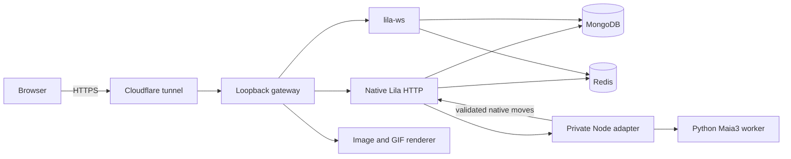

# Architecture

Mute Chess is a native Lichess/Lila application with Maia opponents, browser
analysis and Nostr sign-in. It is not the retired Fastify/PostgreSQL prototype.
The [prototype architecture](../archive/node-prototype/architecture.md) is retained
for historical reference.

## Request and move flow

Lila owns legal moves, games, clocks, ratings, permissions and persistence. The
adapter reads admitted native games, freezes the approved bot policy and returns
Maia moves to native validation. Nostr authentication and Lightning receipt
verification also use the adapter. Its internal endpoints require a shared token
and stay on loopback. The gateway limits the public surface; separate service
accounts and network rules protect databases, secrets and backups.

Stockfish and Maia **analysis** run in browser workers, separately from the
server-side Maia3 79M opponent worker. Browser analysis does not replace native
move trees, accuracy or saved review ownership. See [Maia Lab](maia-lab.md).

## Source authority

[Dash1971/lila](https://github.com/Dash1971/lila) holds native application code.
[Dash1971/mute-chess](https://github.com/Dash1971/mute-chess) holds the adapter,
deployment and documentation. [`native-pin.json`](../deploy/lila/native-pin.json)
selects the exact fork commit and upstream base. Releases also record its Git
tree. A native change is reviewed in the fork before a companion pin PR here;
see [source and review](native-fork.md#source-and-review).

## Directory map

| Location | Purpose |
| --- | --- |
| `analysis/` | Browser Maia/Stockfish integration assets, classification references and provenance |
| `lila-adapter/` | Nostr/Lightning integration, managed bot policies and Python inference worker |
| `learning/`, `puzzles/` | Licensed content, importers and validation; full puzzle export stays external |
| `deploy/lila/` | Native pin, source guards, development/build helpers and remaining small patches |
| `deploy/public/` | Host-specific public installer, gateway, isolation and committed live checks |
| `deploy/calibration/`, `deploy/study/` | Historical, explicitly bounded rating/research operations; not startup jobs |
| `design/`, `third-party/` | Artwork and its reproduction, licenses and retained source references |
| `scripts/` | Source archive packaging |
| `docs/` | Current guides, decisions, dated records and compact evidence |
| `archive/node-prototype/` | Retired `src/`, `web/`, `worker/`, `test/`, `public/`, dependency locks and helpers |

The public listeners are connected through the gateway; database and adapter
ports are not public. The current host's loopback ports and service accounts are
listed in [deployment](../deploy/public/README.md); development uses the separate
ports in [native development](../deploy/lila/README.md#runtime-and-access).
For setup and routine work, use [installation](installation.md) and
[operations](operations.md).
