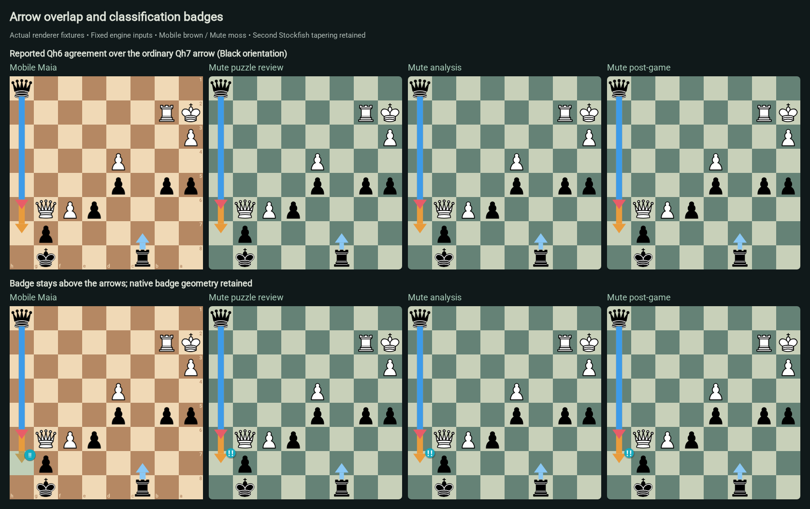

# Engine arrows and classification badges

This page documents the existing behavior of **Mute Chess and Mobile Maia**.

The source snapshots used here are Mute Chess
[`f1b93b9`](https://github.com/Dash1971/mute-chess/commit/f1b93b9703296ca0681cb53afa857dca9dcc1789)
and Mobile Maia
[`be6b97c`](https://github.com/Dash1971/maia-chess-android/commit/be6b97cd5ec0c1386233fbd824183c4fbb9c6efd).
Mute's helper is stored in the native fork as
`ui/lib/src/nosweat/arrows.ts`. Mobile's selection and agreement code is in
[`review.dart`](https://github.com/Dash1971/maia-chess-android/blob/be6b97cd5ec0c1386233fbd824183c4fbb9c6efd/lib/src/review.dart#L1838),
with its later overlay in
[`review_widgets.dart`](https://github.com/Dash1971/maia-chess-android/blob/be6b97cd5ec0c1386233fbd824183c4fbb9c6efd/lib/src/review_widgets.dart#L928).

## Colors and shared moves

| Engine source | Shaft | Arrowhead |
| --- | --- | --- |
| Stockfish best | Blue `#3d9be9` | Blue |
| Stockfish second | Light blue `#8ac8f5` | Light blue |
| Primary Maia | Orange `#e89b3c` | Orange |
| Second Maia | Red `#e85d68` | Red |
| Stockfish and one Maia choose the same UCI | Corresponding Stockfish blue | Agreeing Maia's color |
| Both Maias choose the same UCI, without Stockfish | Split orange/red | Split orange/red |
| Stockfish and both Maias choose the same UCI | Corresponding Stockfish blue | Split orange/red |

Each Maia contributes its **one top move**; Stockfish contributes up to two PV
roots. A shared move is drawn once with combined colors. Different promotion
choices remain distinct UCIs even when the visible arrow endpoints coincide.
These colors identify engine sources, not whether a move is good or bad.

## Overlap order: the apps currently differ

### Mute Chess

On a fresh board, the existing helper emits:

1. Stockfish best, including its combined Maia head if any.
2. Stockfish second, including its combined Maia head if any.
3. Remaining Maia moves, in primary/secondary channel order. If both Maias share
   a remaining move, it uses the split shaft and head.

All these engine arrows occupy the same owned SVG plane. A later arrow can cover
an earlier arrow's shaft or part of its head. **Combined Stockfish/Maia arrows do
not currently get a separate upper layer.** Consequently, a separate Maia move
can cover a Stockfish agreement arrow.

On subsequent updates there is another detail: native Chessground retains
unchanged SVG siblings and appends changed ones. The observed order can therefore
depend on which results changed and when they arrived, rather than only the
helper's newly returned array. The [recorded update sequences](arrow-behavior/browser-results.json)
include both helper order and retained DOM order. That behavior is preserved.

### Mobile Maia

Mobile paints ordinary arrows first: independent Stockfish best, independent
Stockfish second, independent primary Maia, independent second Maia.

It then paints combined agreement arrows in a separate overlay, in Maia-channel
insertion order. An agreement arrow therefore appears above ordinary arrows that
cross or share its path. Ordinary Maia arrows can still cover ordinary Stockfish
arrows: Mobile does **not** put every blue arrow on top.

These are the existing rules, not a proposed change. Neither policy guarantees
that every overlapping shaft remains fully visible.

## Longer, shorter and independent examples

The comparison gallery includes these deliberately fixed, legal inputs:

| Case | Stockfish best | Maia 1600 | Maia 2600 | Existing overlap result |
| --- | --- | --- | --- | --- |
| Longer independent Maia | Qh6 | Qh7 | Qh6 | Mute's later orange arrow can cover the blue/red agreement shaft. Mobile puts that agreement above orange. |
| Shorter independent Maia | Qh6 | Qh5 | Qh6 | Mute draws orange over the shared part of blue. Mobile draws blue over orange; the shorter orange head is partly covered, with its sides visible. |
| No agreement (source combination 18) | Rd5; second choice Rd6 | No result | Rd7 | Both apps draw the independent red Maia arrow after the blue arrows, obscuring their shafts. |

The `agreement-18` filename is a historical matrix identifier, not a claim that
engines agree in that row. Gallery labels describe these as source combinations.

[Open all current-behavior comparisons](arrow-behavior/gallery.md).

The pictured Qh6 position was reconstructed from the owner's screenshot; its
candidate moves are verified legal. These are illustrative engine inputs, not
fresh predictions from Maia or Stockfish.

## Tapering and geometry

Mute retains the native Lichess second-Stockfish shaft-width calculation:

`max(3.125, (12 - max(0, winning-chance difference) * 50) * 100 / 64)`

The score difference uses the mover's perspective. A less competitive second
choice becomes narrower. The best Stockfish shaft is width 25 in the helper's
100-unit square coordinates. Existing shared agreement arrows and Maia arrows
also use width 25. Arrowhead geometry is unchanged by that shaft tapering.
Mobile Maia uses a fixed quarter-square shaft for both Stockfish choices.

Both use a straight arrow from the source square toward the destination, even
for a knight move. Shaft start is about one third of a square from the source
center; the head reaches the destination center. The head length is 0.48 square,
with a half-angle of pi/5. Flipping the board mirrors the square mapping.

## Classification badges

Arrows sit above pieces; classification badges sit above engine arrows in both
apps. Mute retains the native Lichess SVG glyph geometry, shadow, placement and
stacking. Its engine SVG plane has z-index 3; native glyph SVGs have z-index 4.
Mobile's overlay paints agreement arrows, then the classified-square translucent
tint, then the badge circle and white symbol.

| Classification | Symbol | Color |
| --- | --- | --- |
| Brilliant | !! | Cyan `#15aabf` |
| Good | ! | Teal `#12b886` |
| Interesting | !? | Lime `#82c91e` |
| Dubious | ?! | Yellow `#fab005` |
| Mistake | ? | Orange `#fd7e14` |
| Blunder | ?? | Red `#fa5252` |

Badge colors describe the selected move's classification and match its summary.
They are independent of engine-source colors. Mute's SVG badges and Mobile's
circle/text badges intentionally have different artwork and square highlighting.

## Settings and surface behavior

Mute's puzzle-review, analysis and post-game paths use the existing shared arrow
helper. Its custom colors and separate Maia/Stockfish visibility preferences are
retained. The gallery's preference rows use fixed controller inputs to exercise
those branches. “Off” and “threat” rows check suppression of the **custom engine
layer**, while native stored-PV arrows can still be present in those fixtures.
They are not full-page tests of every engine-toggle or threat-search interaction.
Puzzle hovering hands control back to its native hover-arrow path; the analysis
and post-game paths retain their own existing hover behavior.

## Evidence and scope

The [gallery](arrow-behavior/gallery.md) and [fixture QC notes](arrow-behavior/qc-review.md)
show the actual board renderers with controlled inputs. Fresh-board snapshots
use the unmodified Mute helper and unmodified Mobile rendering logic; a separate
record observes retained-DOM updates. They document source colors, paint order,
visible source pieces, valid badge history and the intentional width/artwork
differences. They do not claim pixel-identical cross-app output.

Every candidate is legal for its shown position and side. Knight examples contain
knights on b1/g1; promotion examples contain a pawn on e7. Badge examples use a
legal preceding d3–d4 move and deliberately inject each classification label to
show the palette and layering. They do **not** claim that pawn move deserves any
particular classification. The original misleading geometry screenshots are
superseded by these matching-piece examples.

These are board-renderer/surface-path fixtures, not full application navigation,
physical-device screenshots or engine-strength tests. Mobile's headless captures
use its actual Chessground widget and overlay painter; a temporary explicit
Roboto font family makes unspecified badge text readable instead of test-runner
Ahem squares. That capture-only override is absent from app source.
Mute uses its actual helper, native surface selectors, board CSS, Cburnett pieces
and badge SVGs. The linked captures are retained evidence, not a new executable capture framework.

[Fixture inputs](arrow-behavior/fixtures.json) ·
[Current capture record](arrow-behavior/validation.json) ·
[Observed Mute colors and orders](arrow-behavior/browser-results.json) ·
[Mobile arrow descriptors](arrow-behavior/mobile-results.json)
