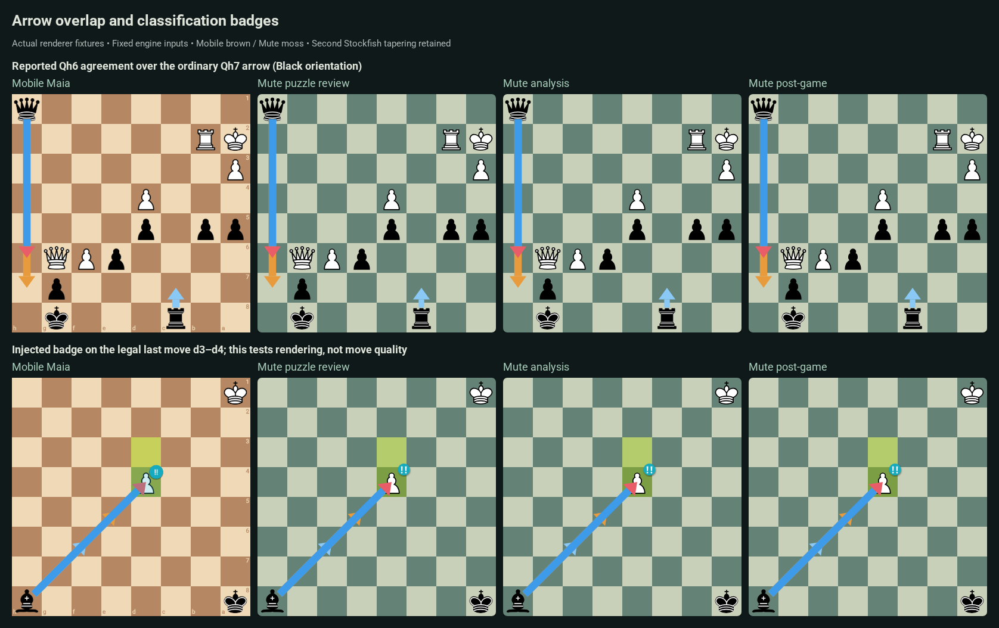

# Arrow behavior and classification badges

[Feature guide](../README.md#see-the-human-move-as-well-as-the-engine-move) · [Issue #328](https://github.com/Dash1971/mute-chess/issues/328) · [Mobile Maia reference](https://github.com/Dash1971/maia-chess-android/blob/be6b97cd5ec0c1386233fbd824183c4fbb9c6efd/lib/src/review.dart#L1838)

Mute uses Mobile Maia's engine-agreement colors, geometry and overlap order on
puzzle review, standalone analysis and post-game analysis. It deliberately keeps
Lichess's evaluation-based tapering of an independent second Stockfish arrow.

## What the arrows mean

| Source | Shaft | Head |
| --- | --- | --- |
| Stockfish best | Blue `#3d9be9` | Blue |
| Stockfish second | Light blue `#8ac8f5` | Light blue |
| Primary Maia | Orange `#e89b3c` | Orange |
| Second Maia | Red `#e85d68` | Red |
| Stockfish and one Maia agree | Corresponding Stockfish blue | Agreeing Maia color |
| Both Maias agree without Stockfish | Split orange/red | Split orange/red |
| Stockfish and both Maias agree | Corresponding Stockfish blue | Split orange/red |

Each Maia contributes its **one top move**. Stockfish contributes up to two PV
roots. A shared UCI is painted once; its colors communicate agreement. Different
promotion choices remain different UCIs even when their arrow endpoints coincide.

Ordinary arrows are painted in this order: independent Stockfish best, independent
Stockfish second, independent primary Maia, independent second Maia. Agreement
arrows are painted afterward, in primary/secondary Maia insertion order. Thus an
agreement stays above an ordinary overlapping arrow. This is **not** a rule that
every blue arrow must always be uppermost: ordinary overlaps follow Mobile Maia.

Arrows sit above pieces. Classification badges sit above every engine arrow.
The six badge colors match the review summary and native move-list palette:
Brilliant cyan, Good teal, Interesting lime, Dubious yellow, Mistake orange and
Blunder red. Arrow colors describe engine sources; badge colors describe move
classifications. They are separate concepts.

## Intentional differences retained

- **Tapering:** Mute keeps the existing native Lichess winning-chance-gap formula
  in both surface callers. A less competitive independent second Stockfish arrow
  gets a narrower shaft; its head geometry is unchanged. Shared agreement arrows
  retain their existing full-width shaft. This fix changes none of those widths.
  Mobile Maia uses fixed-width shafts for both Stockfish choices.
- **Native badges:** Mute retains Lichess's SVG glyph shapes, shadow, stacking and
  placement, recolored with the shared six-class palette. Mobile Maia draws its
  own circle/text and translucent classified-square tint after its arrows. These
  are intentionally not pixel-identical badges or board highlights.
- **Preferences:** Mute retains separate source-visibility controls and custom
  arrow colors. Disabling one source recomputes agreements using the remaining
  sources. Puzzle hover/threat behavior remains native; it is not replaced by
  engine arrows. Analysis and post-game share the existing analysis controller.

## The reported overlap and bounded fix

The reported J2VCe screenshot has Qh6 as Stockfish's best move and the second
Maia's choice, while the primary Maia chooses Qh7. Previously Mute emitted the
Qh6 agreement before the ordinary Qh7 arrow, which could hide its blue shaft.
Mobile Maia separates ordinary arrows from its later agreement overlay.

The shared helper now emits ordinary arrows first and agreements last. A common
scene identity also refreshes the small group of engine SVGs together when any
input changes. This matters because native Chessground retains unchanged SVG
siblings and appends changed ones: array ordering alone is insufficient after an
asynchronous result arrives. User-drawn shapes and the separate badge plane keep
their native lifetimes. Engine inference, classifications, arrow geometry,
settings and backend behavior are unchanged.

The board position is reconstructed from the supplied screenshot; it is a
**rendering regression fixture**, not a newly fetched puzzle record or a model
prediction. All matrix positions now use legal candidate moves from explicitly verified source
pieces. Badge rows have a valid preceding move and deliberately injected labels
for palette/layer tests; they do not assert a move-quality judgment. See the
[full fixture QC review](arrow-behavior/qc-review.md), including the superseded
input errors and all inspected contact sheets.

## Screenshot evidence

[Open the corrected comparison gallery](arrow-behavior/gallery.md) or the
[full fixture QC review](arrow-behavior/qc-review.md). Every matrix
row links the actual Flutter board/overlay capture and each Mute surface capture.



The reference is Mobile Maia commit
[`be6b97c`](https://github.com/Dash1971/maia-chess-android/commit/be6b97cd5ec0c1386233fbd824183c4fbb9c6efd).
The Flutter fixture obtains arrows through the production `ReviewPage` injected
engine boundaries, then captures its real Chessground widget and
`ReviewBoardOverlayPainter`. Mute's browser fixture calls the production
`PuzzleMaia.shapes`/puzzle auto-shapes and `NoSweatAnalysis.shapes`/analysis
`compute` paths, then draws their results with actual Chessground, native board
CSS, native badge SVGs and Cburnett pieces. Only controller/engine inputs are
fixed. These are **board-renderer/surface-path fixture screenshots**, not
full-page navigation, Android device screenshots, or live neural-inference tests.

Coverage and limits:

- All **32 canonical presence/agreement partitions** of SF1/SF2/Maia1/Maia2,
  both orientations. SF2 requires SF1; its root differs from SF1 in this matrix.
- The reported overlap, all six classification badges, diagonal crossings,
  opposite directions, knight vectors, shared destinations, short/long rays,
  promotion, castling, a 256px board and a large evaluation gap for tapering.
- **48 cases × 2 orientations × 3 Mute surfaces = 288 comparisons** against
  96 Flutter captures. These compare source colors, agreements and paint order;
  deliberately different shaft widths and badge geometry are not pixel-diffed.
- Six sequential DOM updates without remounting the board, including agreement
  changes, removal/reappearance and reversed SF/Maia source ordering.
- Both chess libraries validate every candidate root and badge history; native DOM
  checks verify visible source roles/positions. All 96 Mute surface groups are
  pixel-identical, and all twelve visual-review sheets were inspected.
- 21 Mute preference/hover/threat cases, plus existing six-class/four-stack badge
  SVG regression tests and origin/tip geometry checks at four board sizes.

The headless Flutter runner normally substitutes Ahem squares for unspecified
text fonts. For **captures only**, its badge TextStyle was temporarily given
`fontFamily: 'Roboto'`, using the existing shared SDK font; no geometry, color or
paint-order code changed. That one-line override was removed, and all 97 tests (including the new fixture audit)
were rerun successfully against unmodified production source. The Mobile draft
contains the test/fixtures and reproduction details. The Mute screenshots keep
native SVG badge paths and require no text/font override.

See [validation results and hashes](arrow-behavior/validation.json),
[Mobile arrow descriptors](arrow-behavior/mobile-results.json),
[Mute browser results](arrow-behavior/browser-results.json), and
[fixture inputs](arrow-behavior/fixtures.json). Testing establishes this bounded
rendering contract; it does not claim to exhaust all chess positions or unrelated
UI interactions. No application service was stopped, no public game was created,
and nothing was merged or deployed for this audit.

## Reproduce the browser comparison

Reconstruct the pinned native source with its patch and install its existing
locked dependencies. Build the native UI once so `public/css` contains `site` and
`lib.theme.all`. Use the Mobile capture procedure documented in the companion
feature page, then run with the native checkout's Node/Playwright environment:

```sh
node deploy/lila/arrow-behavior/capture.mjs NATIVE_ROOT MOBILE_CAPTURE_DIR OUTPUT_DIR
```

The fixture checks the bundle input paths so it cannot silently render a helper
from another checkout. It opens a loopback-only temporary fixture server and
closes that server/browser on completion. It is specific to this arrow matrix;
it does not control services, deployments, backups, models or databases.
