# Source combinations 00–07

[Gallery](gallery.md) · [Existing behavior](../arrow-behavior.md)

| Case / bottom side | Mobile Maia | Mute puzzle | Mute analysis | Mute post-game |
| --- | --- | --- | --- | --- |
| Sources 00 / white SF —; M1 —; M2 — | [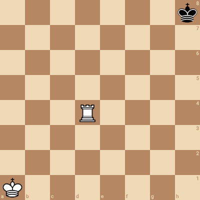](mobile/agreement-00-white.png) |  | [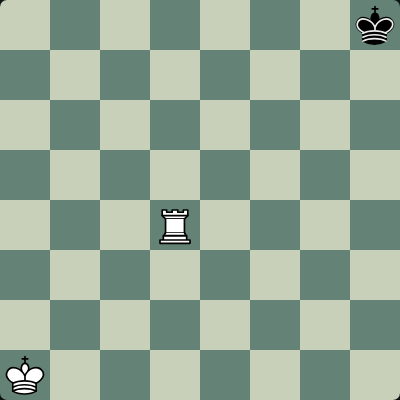](mute/agreement-00-white-analysis.png) |  |
| Sources 00 / black SF —; M1 —; M2 — | [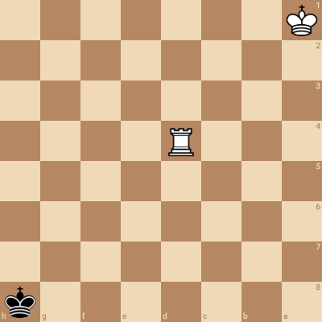](mobile/agreement-00-black.png) |  | [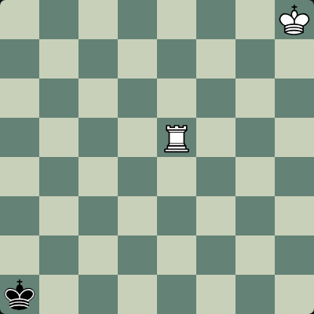](mute/agreement-00-black-analysis.png) |  |
| Sources 01 / white SF —; M1 —; M2 d4d5 | [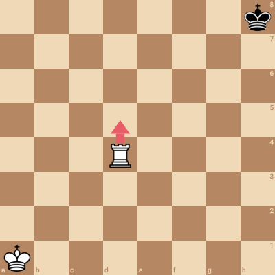](mobile/agreement-01-white.png) | [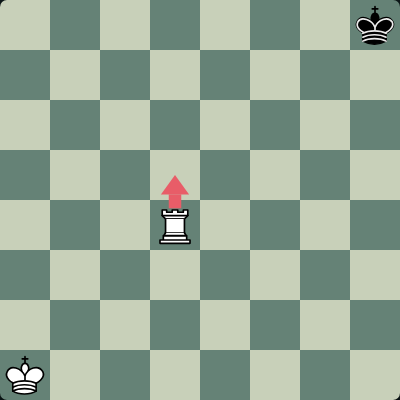](mute/agreement-01-white-puzzle.png) |  |  |
| Sources 01 / black SF —; M1 —; M2 d4d5 | [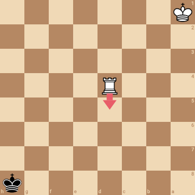](mobile/agreement-01-black.png) |  | [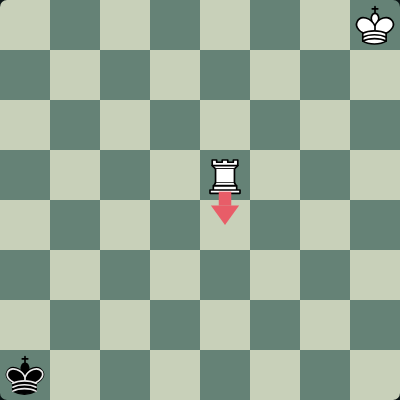](mute/agreement-01-black-analysis.png) |  |
| Sources 02 / white SF —; M1 d4d5; M2 — | [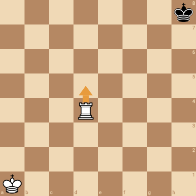](mobile/agreement-02-white.png) |  |  |  |
| Sources 02 / black SF —; M1 d4d5; M2 — | [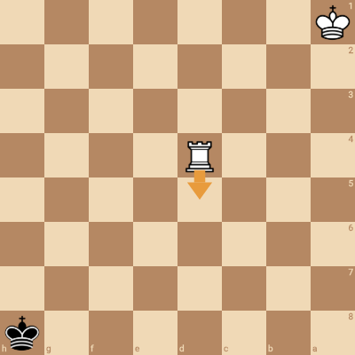](mobile/agreement-02-black.png) |  | [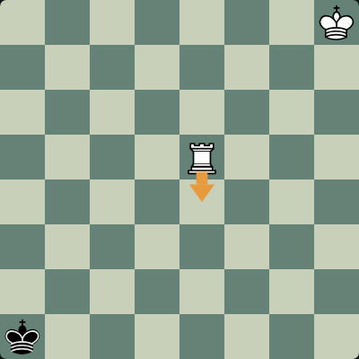](mute/agreement-02-black-analysis.png) |  |
| Sources 03 / white SF —; M1 d4d5; M2 d4d5 | [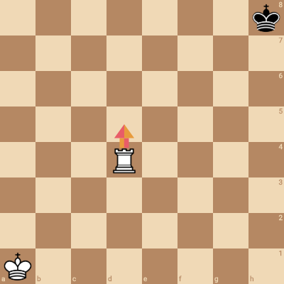](mobile/agreement-03-white.png) |  |  | [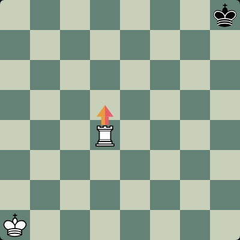](mute/agreement-03-white-postgame.png) |
| Sources 03 / black SF —; M1 d4d5; M2 d4d5 | [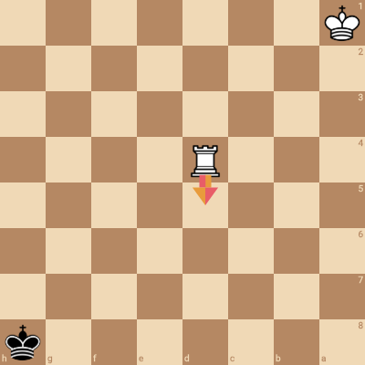](mobile/agreement-03-black.png) |  |  | [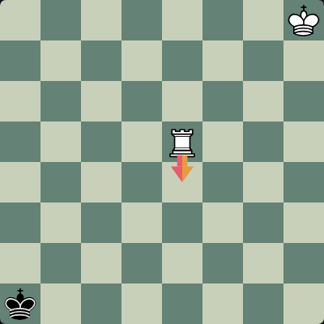](mute/agreement-03-black-postgame.png) |
| Sources 04 / white SF —; M1 d4d5; M2 d4d6 | [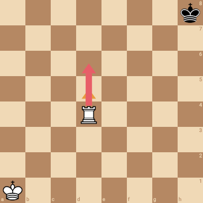](mobile/agreement-04-white.png) |  |  | [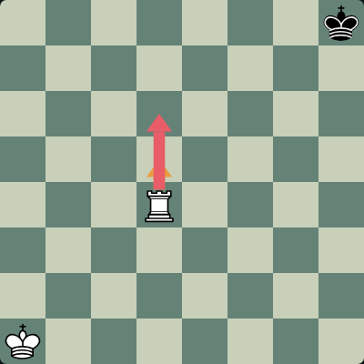](mute/agreement-04-white-postgame.png) |
| Sources 04 / black SF —; M1 d4d5; M2 d4d6 | [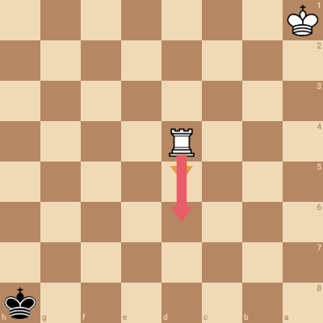](mobile/agreement-04-black.png) |  |  | [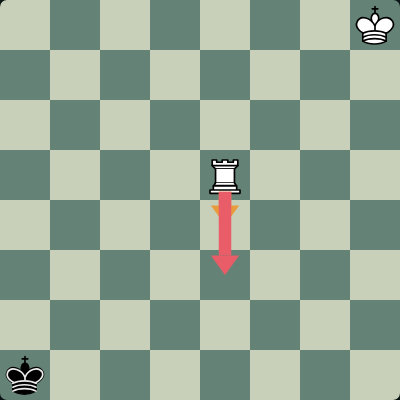](mute/agreement-04-black-postgame.png) |
| Sources 05 / white SF d4d5; M1 —; M2 — | [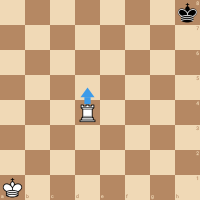](mobile/agreement-05-white.png) | [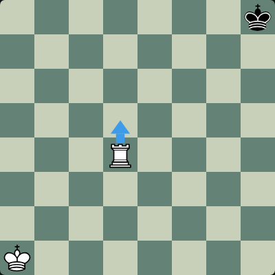](mute/agreement-05-white-puzzle.png) |  |  |
| Sources 05 / black SF d4d5; M1 —; M2 — | [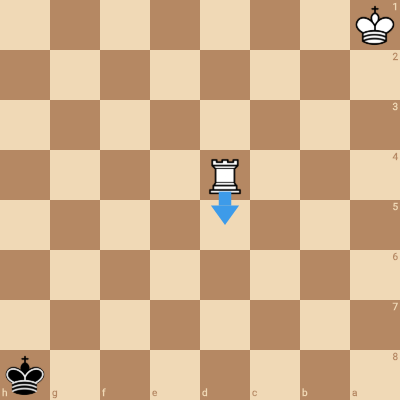](mobile/agreement-05-black.png) |  | [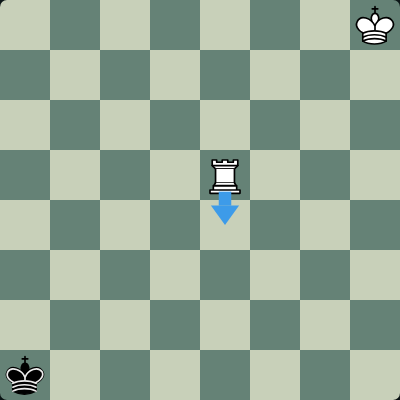](mute/agreement-05-black-analysis.png) |  |
| Sources 06 / white SF d4d5; M1 —; M2 d4d5 | [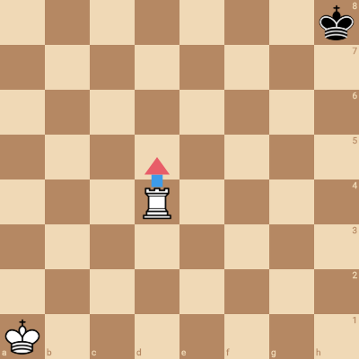](mobile/agreement-06-white.png) |  | [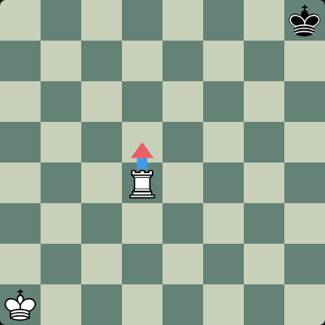](mute/agreement-06-white-analysis.png) |  |
| Sources 06 / black SF d4d5; M1 —; M2 d4d5 | [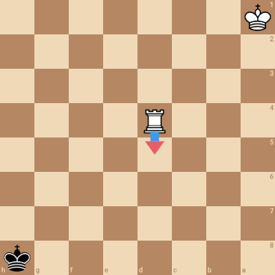](mobile/agreement-06-black.png) | [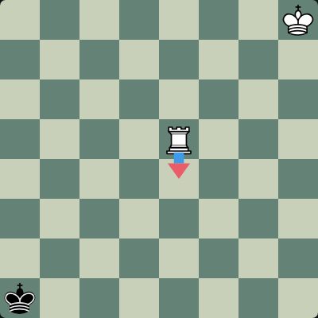](mute/agreement-06-black-puzzle.png) |  |  |
| Sources 07 / white SF d4d5; M1 —; M2 d4d6 | [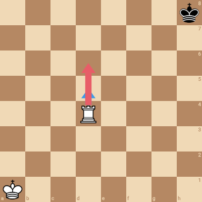](mobile/agreement-07-white.png) |  | [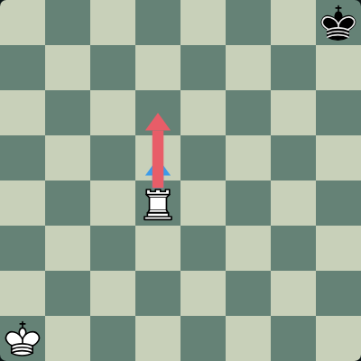](mute/agreement-07-white-analysis.png) |  |
| Sources 07 / black SF d4d5; M1 —; M2 d4d6 |  |  |  | [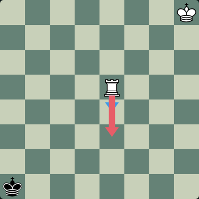](mute/agreement-07-black-postgame.png) |
