# Agreement partitions 00–07

[All comparisons](gallery.md) · [Methodology and limits](../arrow-behavior.md)

| Case / orientation | Mobile Maia | Mute puzzle review | Mute analysis | Mute post-game |
| --- | --- | --- | --- | --- |
| agreement-00 / white | [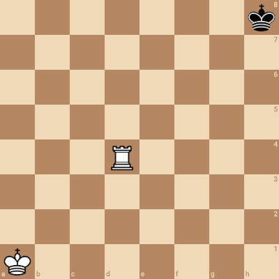](mobile/agreement-00-white.png) |  |  | [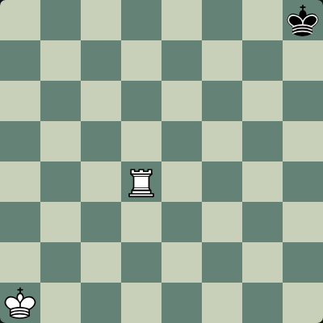](mute/agreement-00-white-postgame.png) |
| agreement-00 / black | [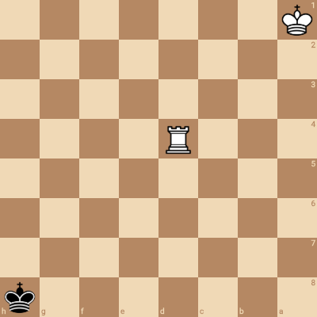](mobile/agreement-00-black.png) |  |  | [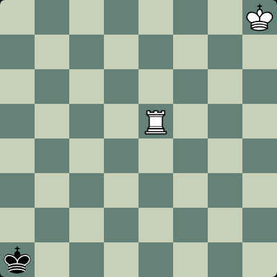](mute/agreement-00-black-postgame.png) |
| agreement-01 / white | [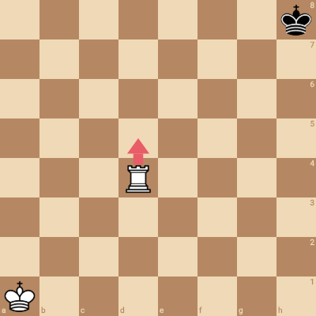](mobile/agreement-01-white.png) |  | [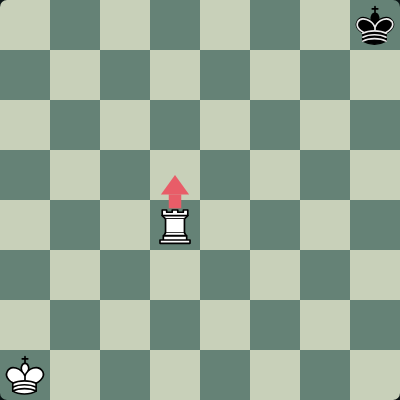](mute/agreement-01-white-analysis.png) |  |
| agreement-01 / black | [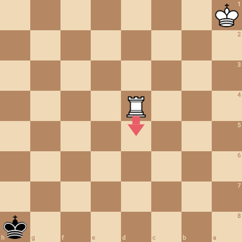](mobile/agreement-01-black.png) | [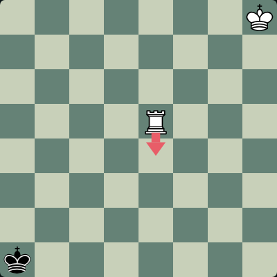](mute/agreement-01-black-puzzle.png) |  |  |
| agreement-02 / white | [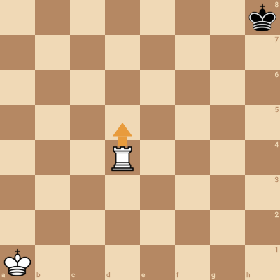](mobile/agreement-02-white.png) |  |  |  |
| agreement-02 / black | [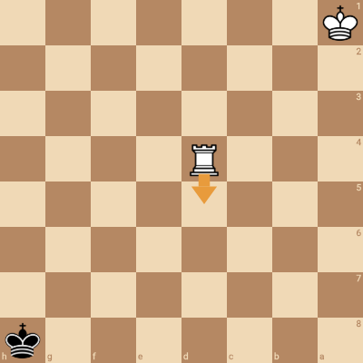](mobile/agreement-02-black.png) |  | [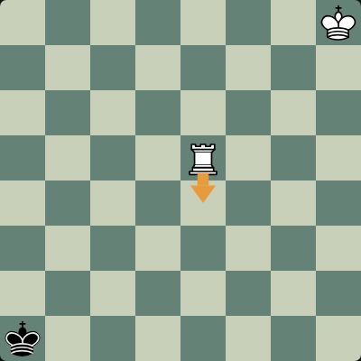](mute/agreement-02-black-analysis.png) |  |
| agreement-03 / white | [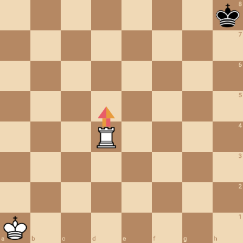](mobile/agreement-03-white.png) |  | [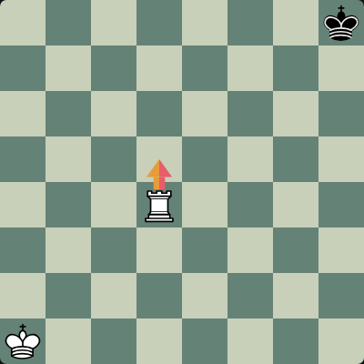](mute/agreement-03-white-analysis.png) |  |
| agreement-03 / black | [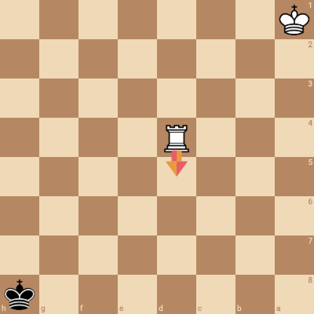](mobile/agreement-03-black.png) |  | [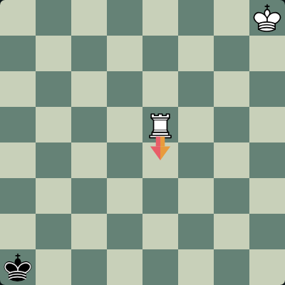](mute/agreement-03-black-analysis.png) |  |
| agreement-04 / white | [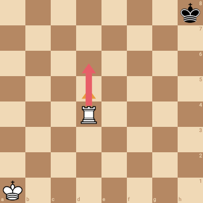](mobile/agreement-04-white.png) |  |  | [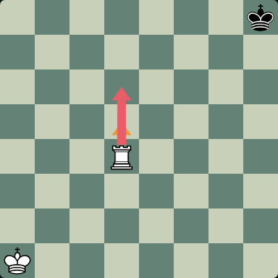](mute/agreement-04-white-postgame.png) |
| agreement-04 / black | [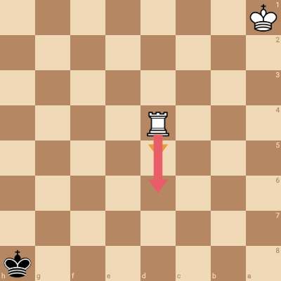](mobile/agreement-04-black.png) | [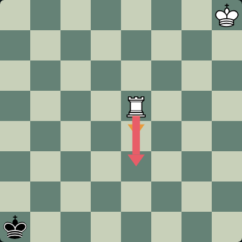](mute/agreement-04-black-puzzle.png) |  |  |
| agreement-05 / white | [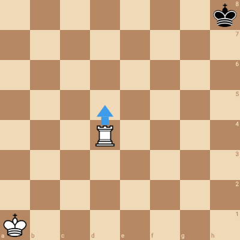](mobile/agreement-05-white.png) |  |  | [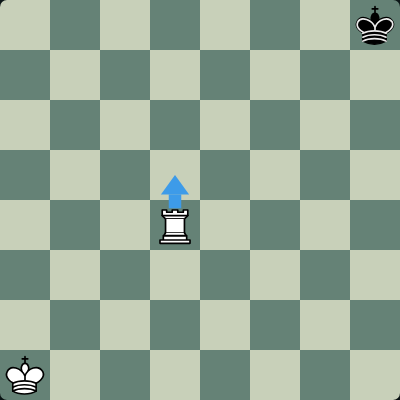](mute/agreement-05-white-postgame.png) |
| agreement-05 / black | [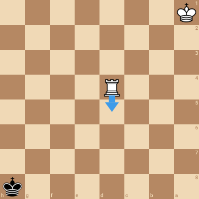](mobile/agreement-05-black.png) |  | [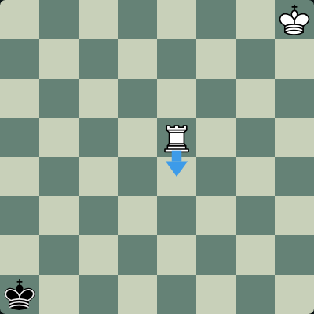](mute/agreement-05-black-analysis.png) |  |
| agreement-06 / white | [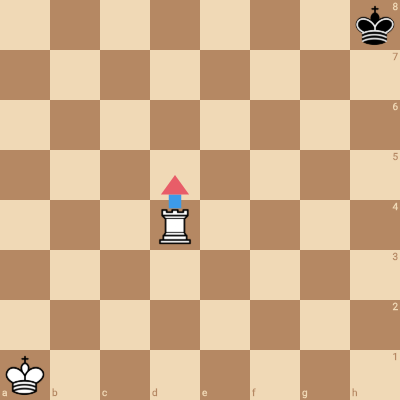](mobile/agreement-06-white.png) |  | [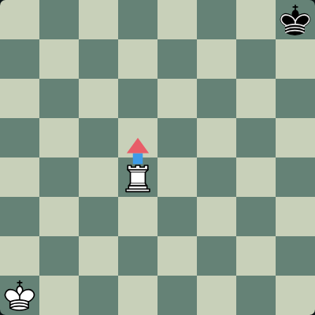](mute/agreement-06-white-analysis.png) |  |
| agreement-06 / black | [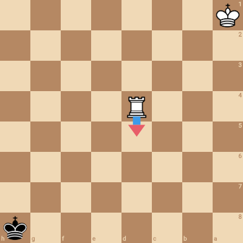](mobile/agreement-06-black.png) |  |  | [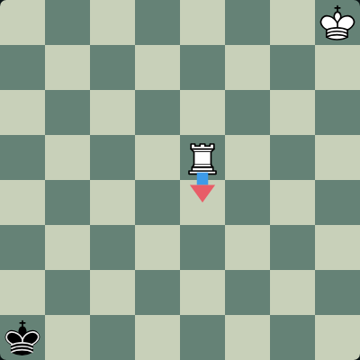](mute/agreement-06-black-postgame.png) |
| agreement-07 / white | [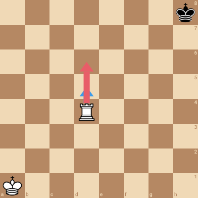](mobile/agreement-07-white.png) | [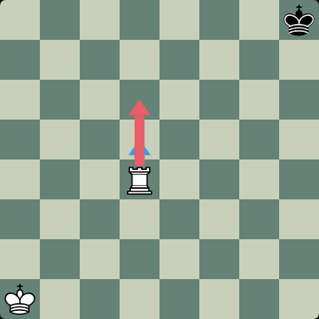](mute/agreement-07-white-puzzle.png) |  |  |
| agreement-07 / black |  |  |  | [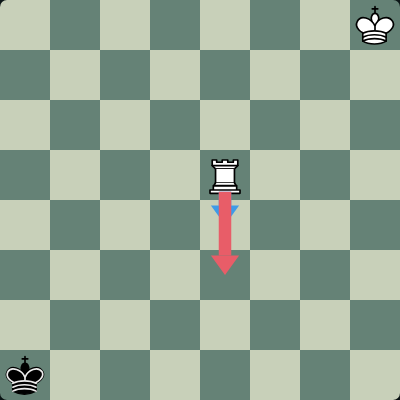](mute/agreement-07-black-postgame.png) |
