# Agreement partitions 08–15

[All comparisons](gallery.md) · [Methodology and limits](../arrow-behavior.md)

| Case / orientation | Mobile Maia | Mute puzzle review | Mute analysis | Mute post-game |
| --- | --- | --- | --- | --- |
| agreement-08 / white | [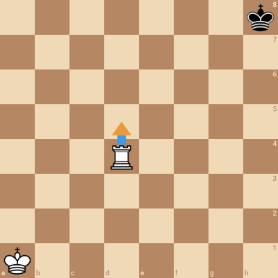](mobile/agreement-08-white.png) | [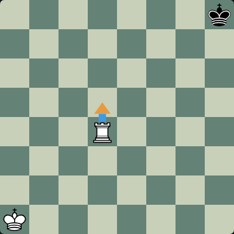](mute/agreement-08-white-puzzle.png) |  |  |
| agreement-08 / black | [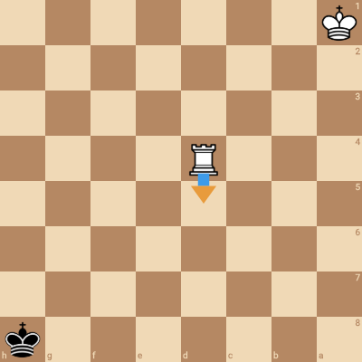](mobile/agreement-08-black.png) |  | [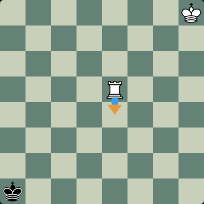](mute/agreement-08-black-analysis.png) |  |
| agreement-09 / white | [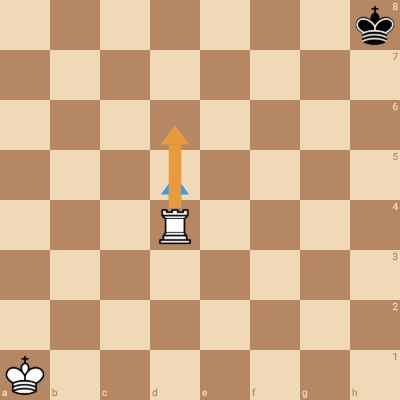](mobile/agreement-09-white.png) |  | [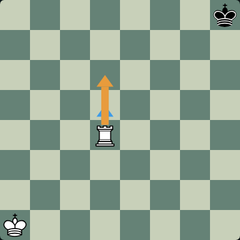](mute/agreement-09-white-analysis.png) |  |
| agreement-09 / black | [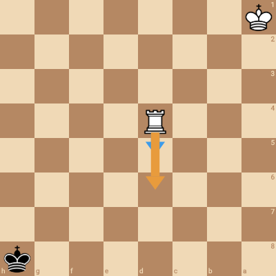](mobile/agreement-09-black.png) |  |  | [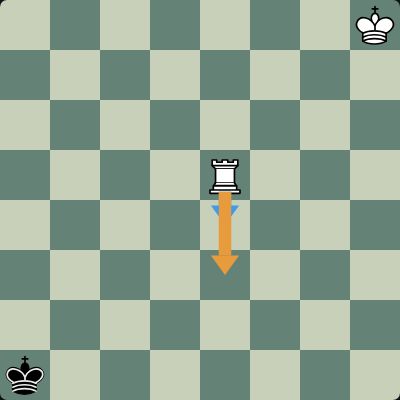](mute/agreement-09-black-postgame.png) |
| agreement-10 / white | [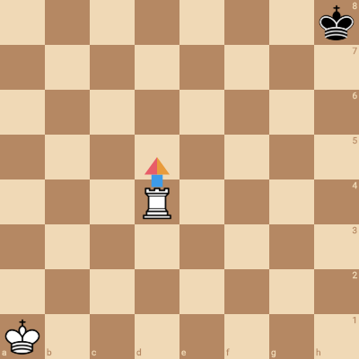](mobile/agreement-10-white.png) |  |  | [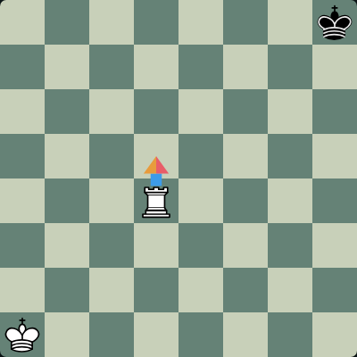](mute/agreement-10-white-postgame.png) |
| agreement-10 / black | [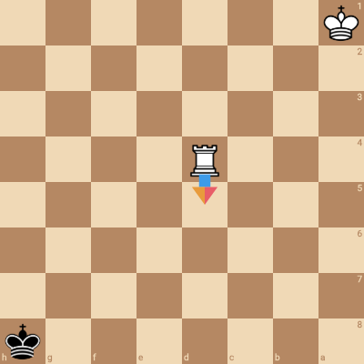](mobile/agreement-10-black.png) |  | [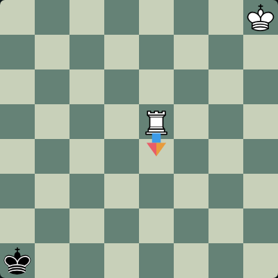](mute/agreement-10-black-analysis.png) |  |
| agreement-11 / white | [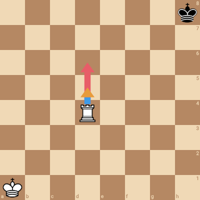](mobile/agreement-11-white.png) |  | [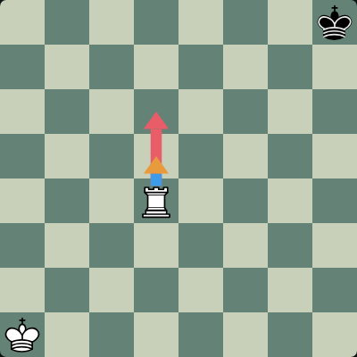](mute/agreement-11-white-analysis.png) |  |
| agreement-11 / black | [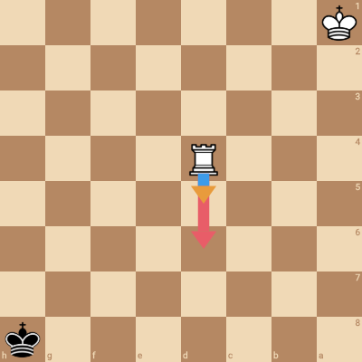](mobile/agreement-11-black.png) | [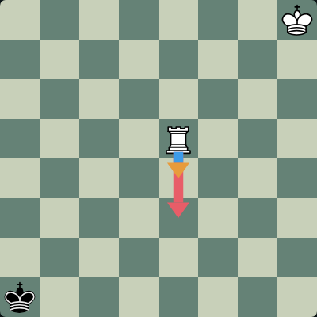](mute/agreement-11-black-puzzle.png) |  |  |
| agreement-12 / white | [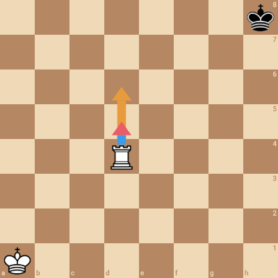](mobile/agreement-12-white.png) | [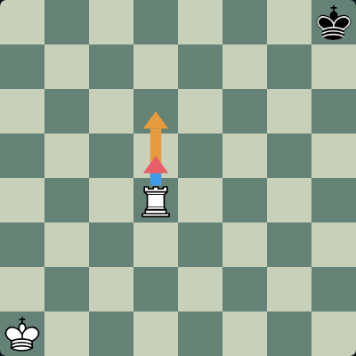](mute/agreement-12-white-puzzle.png) |  |  |
| agreement-12 / black | [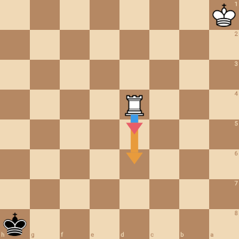](mobile/agreement-12-black.png) |  | [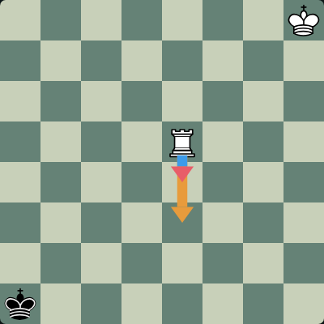](mute/agreement-12-black-analysis.png) |  |
| agreement-13 / white | [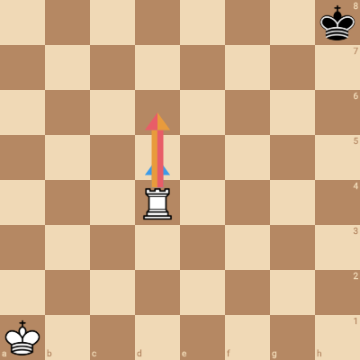](mobile/agreement-13-white.png) | [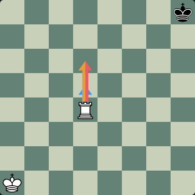](mute/agreement-13-white-puzzle.png) |  |  |
| agreement-13 / black | [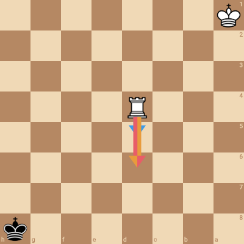](mobile/agreement-13-black.png) |  |  |  |
| agreement-14 / white | [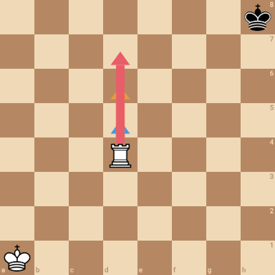](mobile/agreement-14-white.png) |  |  | [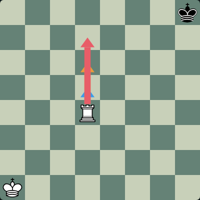](mute/agreement-14-white-postgame.png) |
| agreement-14 / black | [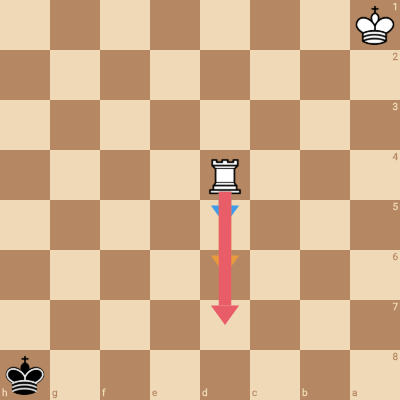](mobile/agreement-14-black.png) |  | [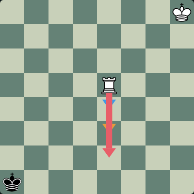](mute/agreement-14-black-analysis.png) |  |
| agreement-15 / white | [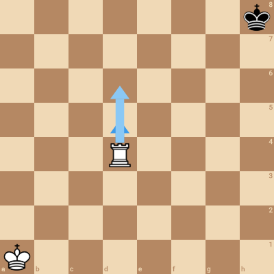](mobile/agreement-15-white.png) |  |  | [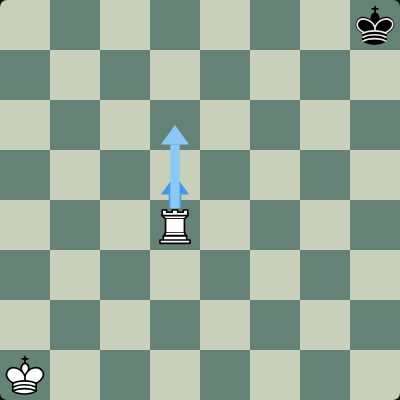](mute/agreement-15-white-postgame.png) |
| agreement-15 / black | [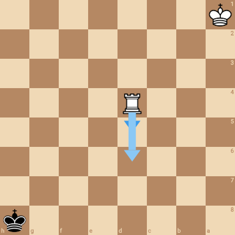](mobile/agreement-15-black.png) |  | [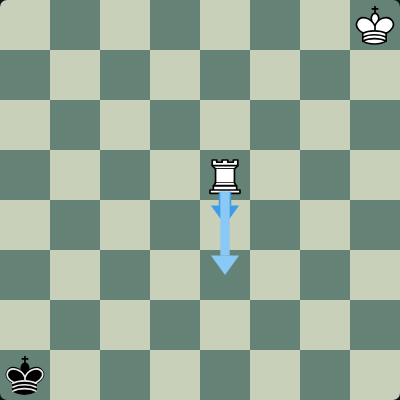](mute/agreement-15-black-analysis.png) |  |
