# Source combinations 08–15

[Gallery](gallery.md) · [Existing behavior](../arrow-behavior.md)

| Case / bottom side | Mobile Maia | Mute puzzle | Mute analysis | Mute post-game |
| --- | --- | --- | --- | --- |
| Sources 08 / white SF d4d5; M1 d4d5; M2 — | [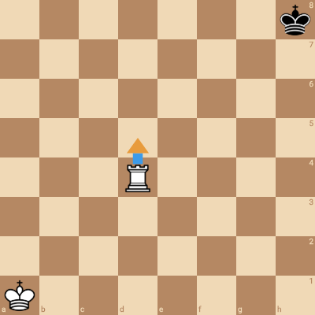](mobile/agreement-08-white.png) | [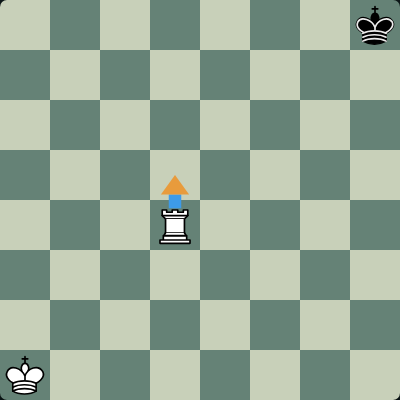](mute/agreement-08-white-puzzle.png) |  |  |
| Sources 08 / black SF d4d5; M1 d4d5; M2 — | [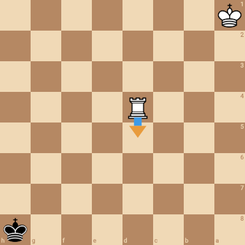](mobile/agreement-08-black.png) | [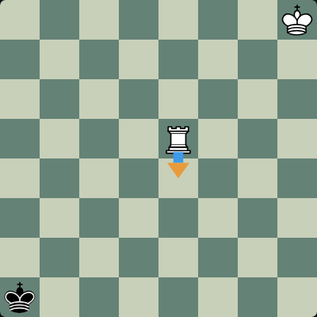](mute/agreement-08-black-puzzle.png) |  |  |
| Sources 09 / white SF d4d5; M1 d4d6; M2 — | [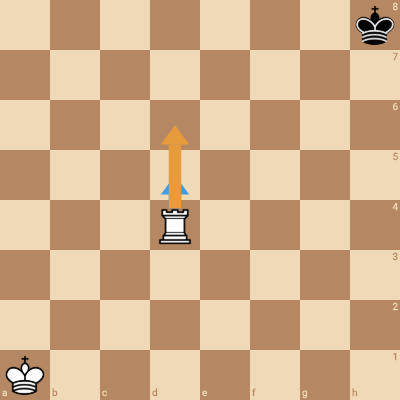](mobile/agreement-09-white.png) |  |  | [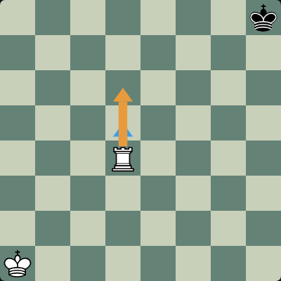](mute/agreement-09-white-postgame.png) |
| Sources 09 / black SF d4d5; M1 d4d6; M2 — | [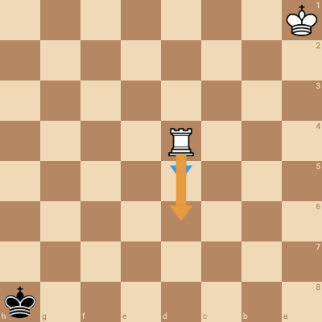](mobile/agreement-09-black.png) | [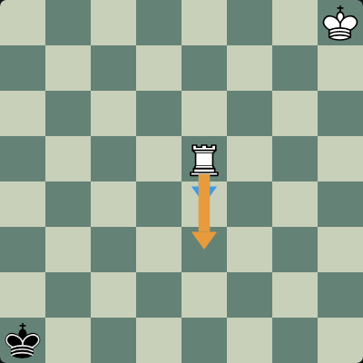](mute/agreement-09-black-puzzle.png) |  |  |
| Sources 10 / white SF d4d5; M1 d4d5; M2 d4d5 | [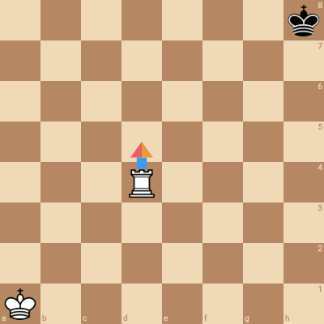](mobile/agreement-10-white.png) |  |  | [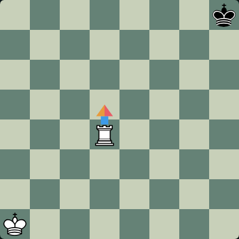](mute/agreement-10-white-postgame.png) |
| Sources 10 / black SF d4d5; M1 d4d5; M2 d4d5 | [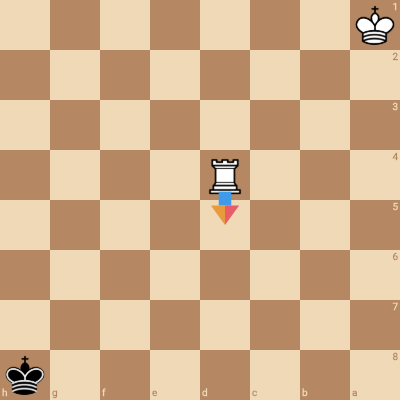](mobile/agreement-10-black.png) |  |  | [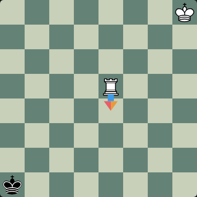](mute/agreement-10-black-postgame.png) |
| Sources 11 / white SF d4d5; M1 d4d5; M2 d4d6 | [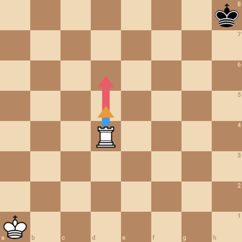](mobile/agreement-11-white.png) |  | [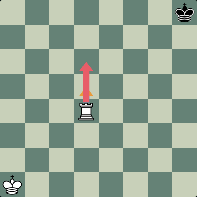](mute/agreement-11-white-analysis.png) |  |
| Sources 11 / black SF d4d5; M1 d4d5; M2 d4d6 | [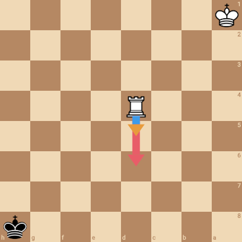](mobile/agreement-11-black.png) |  | [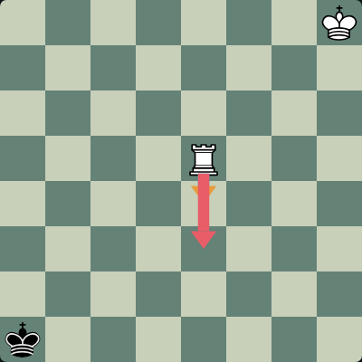](mute/agreement-11-black-analysis.png) |  |
| Sources 12 / white SF d4d5; M1 d4d6; M2 d4d5 | [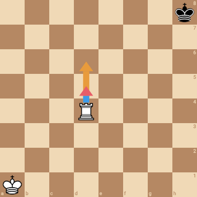](mobile/agreement-12-white.png) |  |  |  |
| Sources 12 / black SF d4d5; M1 d4d6; M2 d4d5 | [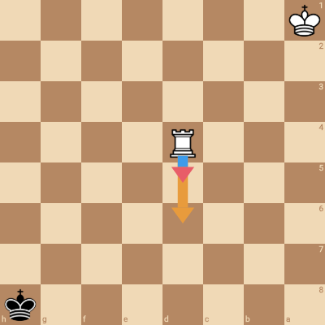](mobile/agreement-12-black.png) |  | [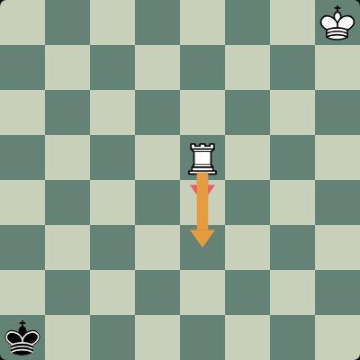](mute/agreement-12-black-analysis.png) |  |
| Sources 13 / white SF d4d5; M1 d4d6; M2 d4d6 | [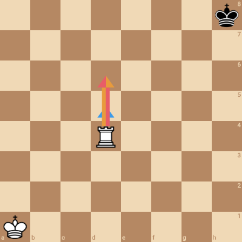](mobile/agreement-13-white.png) | [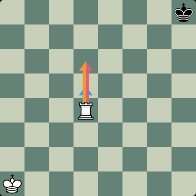](mute/agreement-13-white-puzzle.png) |  |  |
| Sources 13 / black SF d4d5; M1 d4d6; M2 d4d6 | [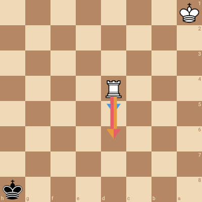](mobile/agreement-13-black.png) | [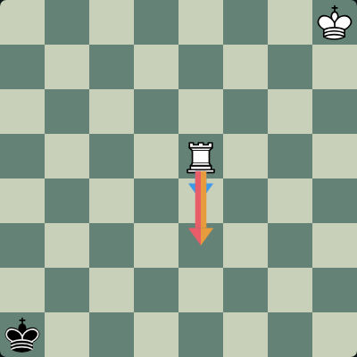](mute/agreement-13-black-puzzle.png) |  |  |
| Sources 14 / white SF d4d5; M1 d4d6; M2 d4d7 | [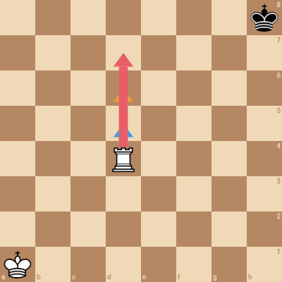](mobile/agreement-14-white.png) |  | [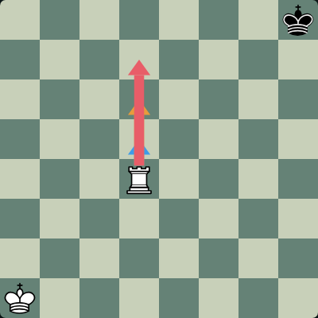](mute/agreement-14-white-analysis.png) |  |
| Sources 14 / black SF d4d5; M1 d4d6; M2 d4d7 | [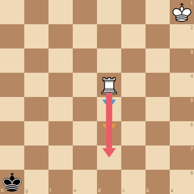](mobile/agreement-14-black.png) |  | [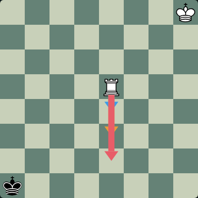](mute/agreement-14-black-analysis.png) |  |
| Sources 15 / white SF d4d5/d4d6; M1 —; M2 — | [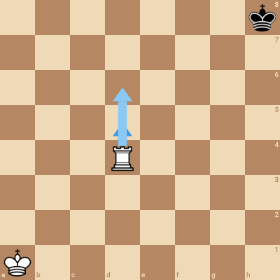](mobile/agreement-15-white.png) | [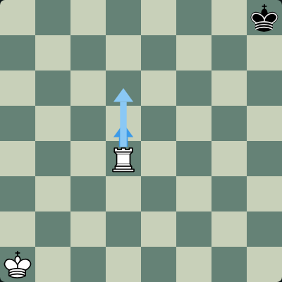](mute/agreement-15-white-puzzle.png) |  |  |
| Sources 15 / black SF d4d5/d4d6; M1 —; M2 — | [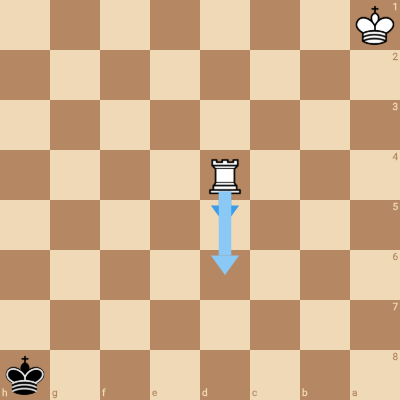](mobile/agreement-15-black.png) |  |  | [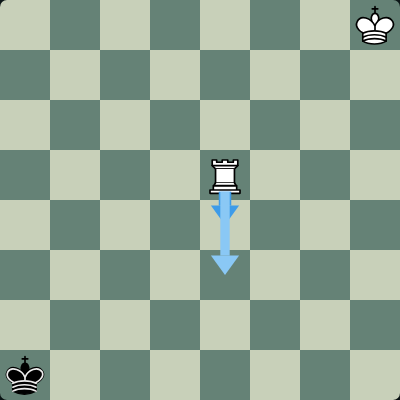](mute/agreement-15-black-postgame.png) |
