# Agreement partitions 16–23

[All comparisons](gallery.md) · [Methodology and limits](../arrow-behavior.md)

| Case / orientation | Mobile Maia | Mute puzzle review | Mute analysis | Mute post-game |
| --- | --- | --- | --- | --- |
| agreement-16 / white | [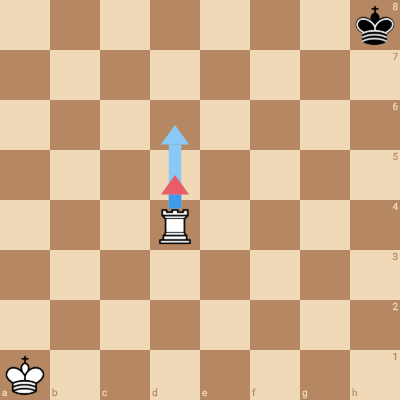](mobile/agreement-16-white.png) |  |  | [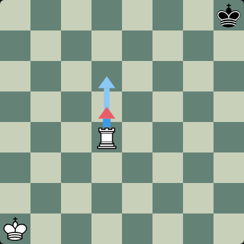](mute/agreement-16-white-postgame.png) |
| agreement-16 / black | [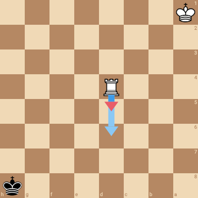](mobile/agreement-16-black.png) |  |  | [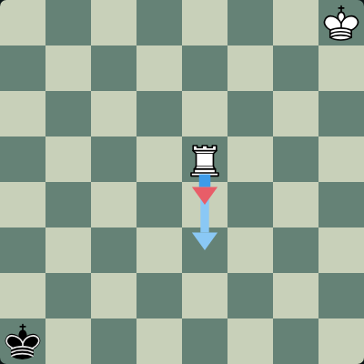](mute/agreement-16-black-postgame.png) |
| agreement-17 / white | [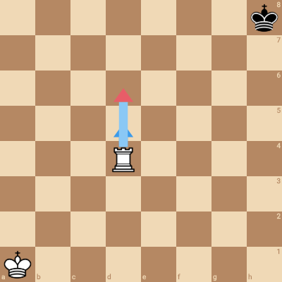](mobile/agreement-17-white.png) | [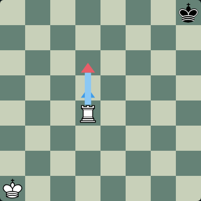](mute/agreement-17-white-puzzle.png) |  |  |
| agreement-17 / black | [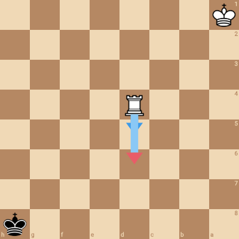](mobile/agreement-17-black.png) | [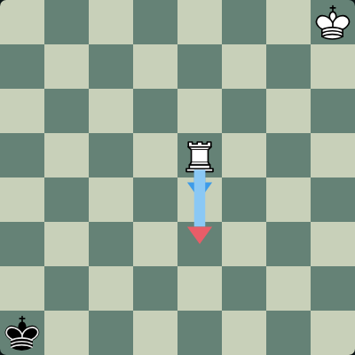](mute/agreement-17-black-puzzle.png) |  |  |
| agreement-18 / white | [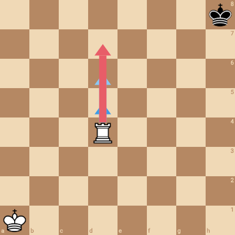](mobile/agreement-18-white.png) |  |  | [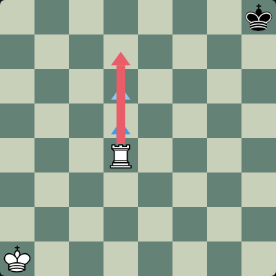](mute/agreement-18-white-postgame.png) |
| agreement-18 / black | [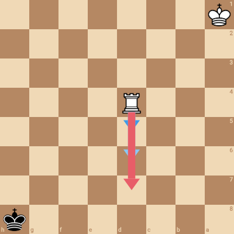](mobile/agreement-18-black.png) |  |  | [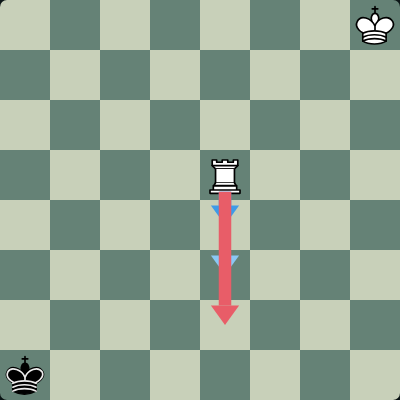](mute/agreement-18-black-postgame.png) |
| agreement-19 / white | [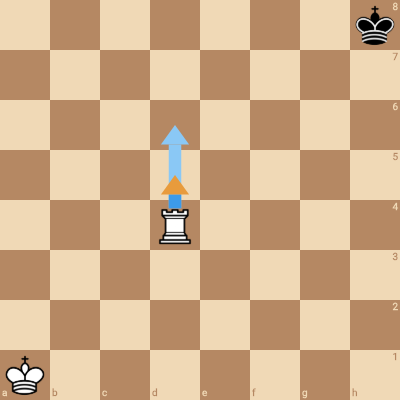](mobile/agreement-19-white.png) |  |  | [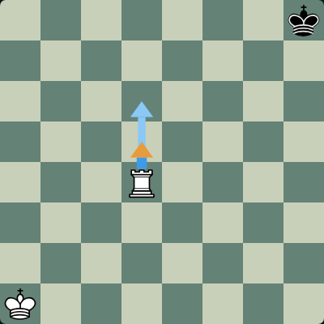](mute/agreement-19-white-postgame.png) |
| agreement-19 / black | [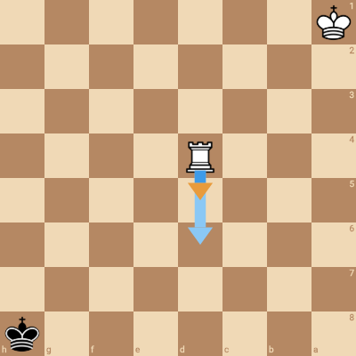](mobile/agreement-19-black.png) |  |  |  |
| agreement-20 / white | [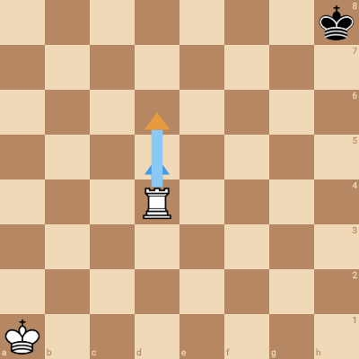](mobile/agreement-20-white.png) |  |  | [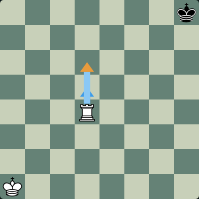](mute/agreement-20-white-postgame.png) |
| agreement-20 / black | [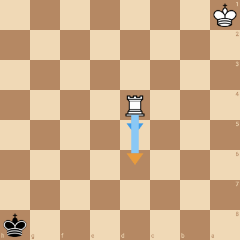](mobile/agreement-20-black.png) |  | [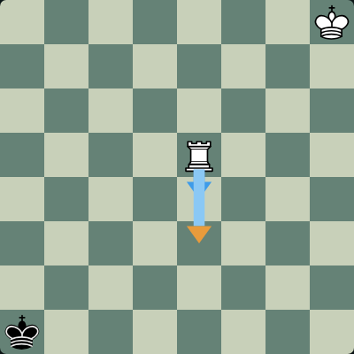](mute/agreement-20-black-analysis.png) |  |
| agreement-21 / white | [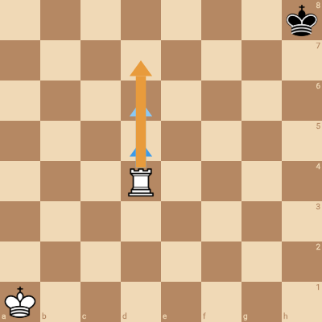](mobile/agreement-21-white.png) |  |  | [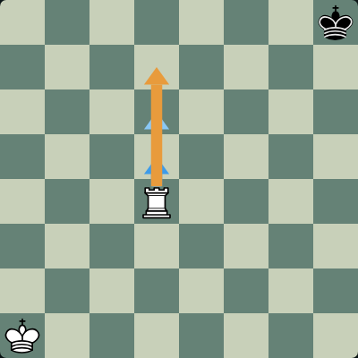](mute/agreement-21-white-postgame.png) |
| agreement-21 / black | [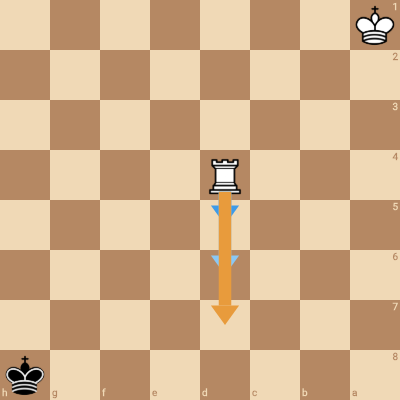](mobile/agreement-21-black.png) |  | [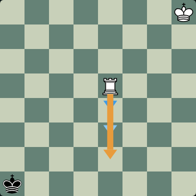](mute/agreement-21-black-analysis.png) |  |
| agreement-22 / white |  |  |  | [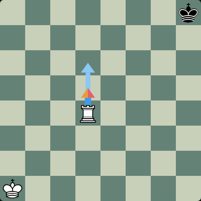](mute/agreement-22-white-postgame.png) |
| agreement-22 / black | [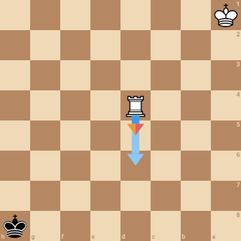](mobile/agreement-22-black.png) |  |  | [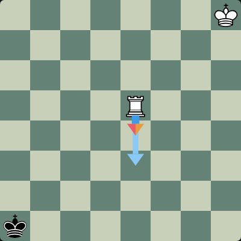](mute/agreement-22-black-postgame.png) |
| agreement-23 / white | [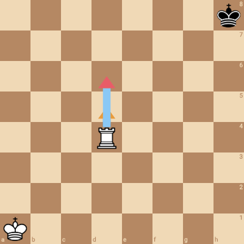](mobile/agreement-23-white.png) | [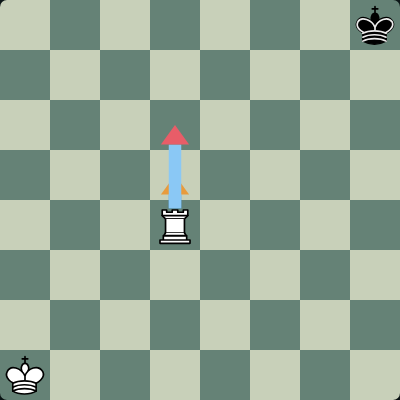](mute/agreement-23-white-puzzle.png) |  |  |
| agreement-23 / black | [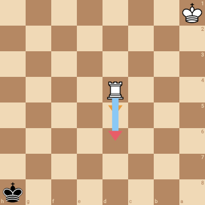](mobile/agreement-23-black.png) | [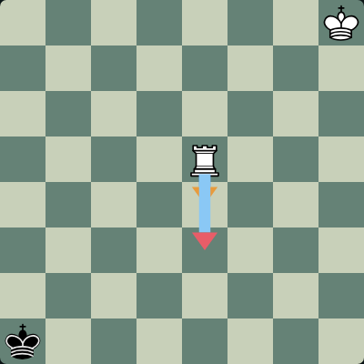](mute/agreement-23-black-puzzle.png) |  |  |
