# Source combinations 16–23

[Gallery](gallery.md) · [Existing behavior](../arrow-behavior.md)

| Case / bottom side | Mobile Maia | Mute puzzle | Mute analysis | Mute post-game |
| --- | --- | --- | --- | --- |
| Sources 16 / white SF d4d5/d4d6; M1 —; M2 d4d5 | [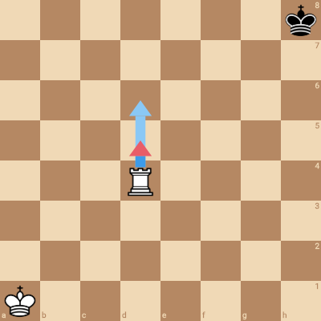](mobile/agreement-16-white.png) |  |  | [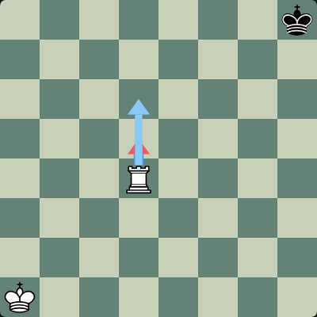](mute/agreement-16-white-postgame.png) |
| Sources 16 / black SF d4d5/d4d6; M1 —; M2 d4d5 | [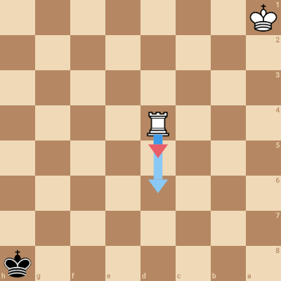](mobile/agreement-16-black.png) |  | [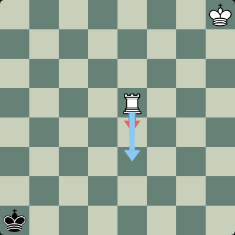](mute/agreement-16-black-analysis.png) |  |
| Sources 17 / white SF d4d5/d4d6; M1 —; M2 d4d6 | [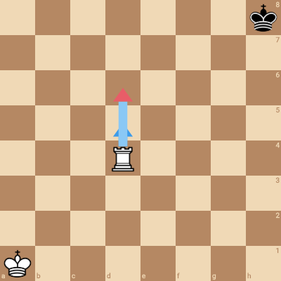](mobile/agreement-17-white.png) | [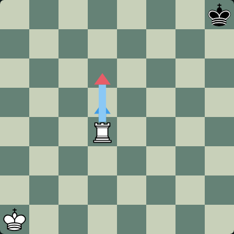](mute/agreement-17-white-puzzle.png) |  |  |
| Sources 17 / black SF d4d5/d4d6; M1 —; M2 d4d6 | [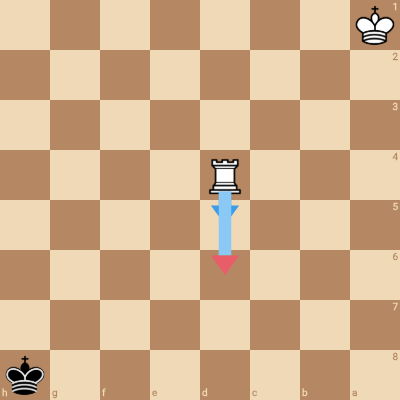](mobile/agreement-17-black.png) |  |  | [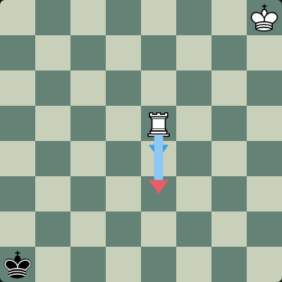](mute/agreement-17-black-postgame.png) |
| Sources 18 / white SF d4d5/d4d6; M1 —; M2 d4d7 | [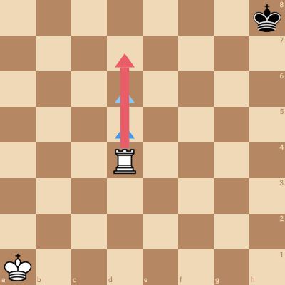](mobile/agreement-18-white.png) |  |  | [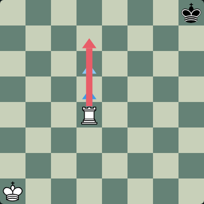](mute/agreement-18-white-postgame.png) |
| Sources 18 / black SF d4d5/d4d6; M1 —; M2 d4d7 | [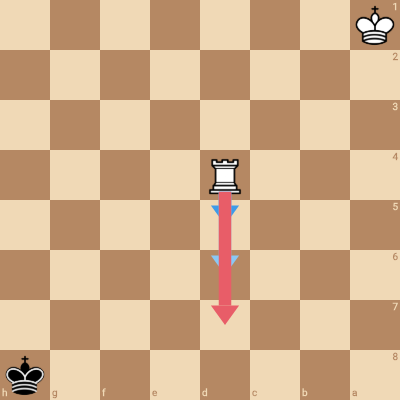](mobile/agreement-18-black.png) |  |  | [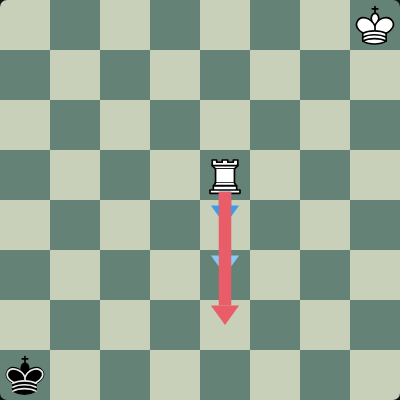](mute/agreement-18-black-postgame.png) |
| Sources 19 / white SF d4d5/d4d6; M1 d4d5; M2 — | [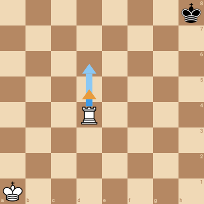](mobile/agreement-19-white.png) |  |  | [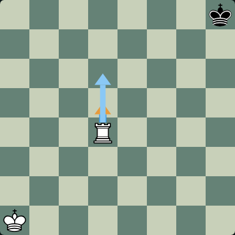](mute/agreement-19-white-postgame.png) |
| Sources 19 / black SF d4d5/d4d6; M1 d4d5; M2 — | [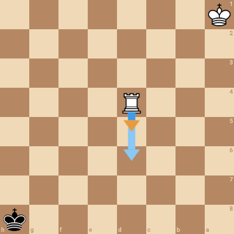](mobile/agreement-19-black.png) |  |  |  |
| Sources 20 / white SF d4d5/d4d6; M1 d4d6; M2 — | [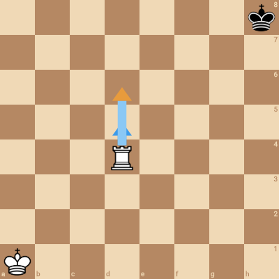](mobile/agreement-20-white.png) |  | [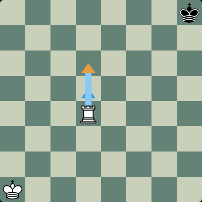](mute/agreement-20-white-analysis.png) |  |
| Sources 20 / black SF d4d5/d4d6; M1 d4d6; M2 — | [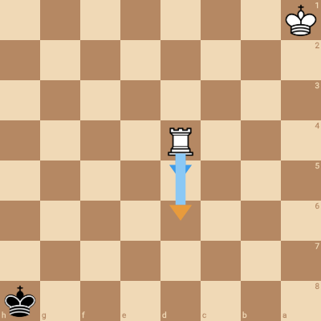](mobile/agreement-20-black.png) |  | [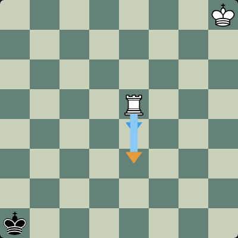](mute/agreement-20-black-analysis.png) |  |
| Sources 21 / white SF d4d5/d4d6; M1 d4d7; M2 — | [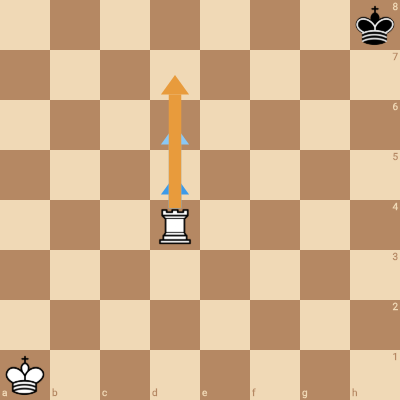](mobile/agreement-21-white.png) |  | [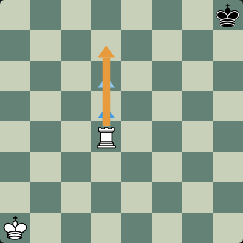](mute/agreement-21-white-analysis.png) |  |
| Sources 21 / black SF d4d5/d4d6; M1 d4d7; M2 — | [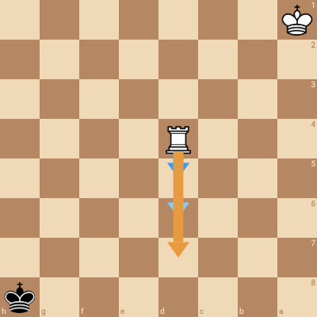](mobile/agreement-21-black.png) |  |  | [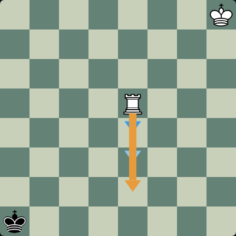](mute/agreement-21-black-postgame.png) |
| Sources 22 / white SF d4d5/d4d6; M1 d4d5; M2 d4d5 |  | [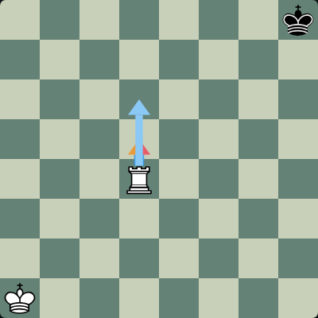](mute/agreement-22-white-puzzle.png) |  |  |
| Sources 22 / black SF d4d5/d4d6; M1 d4d5; M2 d4d5 | [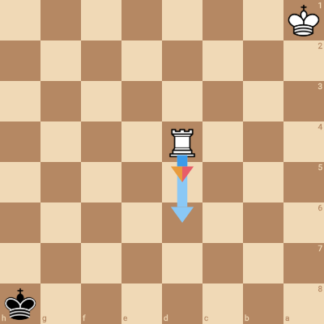](mobile/agreement-22-black.png) | [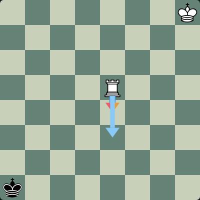](mute/agreement-22-black-puzzle.png) |  |  |
| Sources 23 / white SF d4d5/d4d6; M1 d4d5; M2 d4d6 | [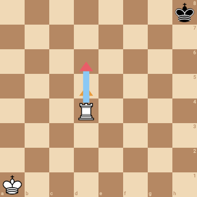](mobile/agreement-23-white.png) |  | [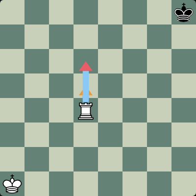](mute/agreement-23-white-analysis.png) |  |
| Sources 23 / black SF d4d5/d4d6; M1 d4d5; M2 d4d6 | [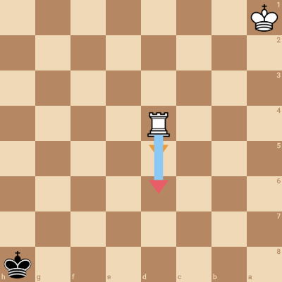](mobile/agreement-23-black.png) |  | [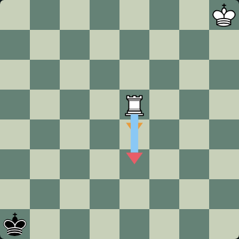](mute/agreement-23-black-analysis.png) |  |
