# Agreement partitions 24–31

[All comparisons](gallery.md) · [Methodology and limits](../arrow-behavior.md)

| Case / orientation | Mobile Maia | Mute puzzle review | Mute analysis | Mute post-game |
| --- | --- | --- | --- | --- |
| agreement-24 / white | [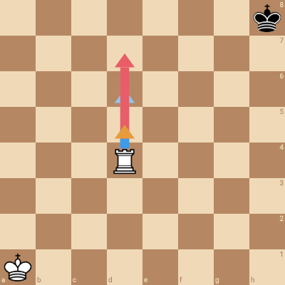](mobile/agreement-24-white.png) |  | [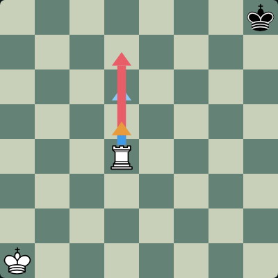](mute/agreement-24-white-analysis.png) |  |
| agreement-24 / black | [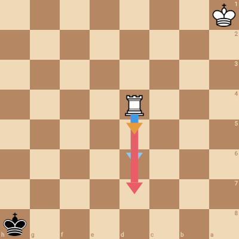](mobile/agreement-24-black.png) | [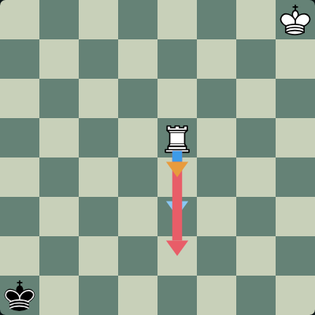](mute/agreement-24-black-puzzle.png) |  |  |
| agreement-25 / white | [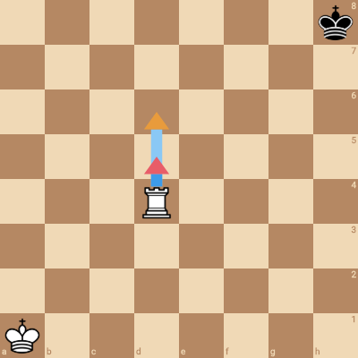](mobile/agreement-25-white.png) |  |  | [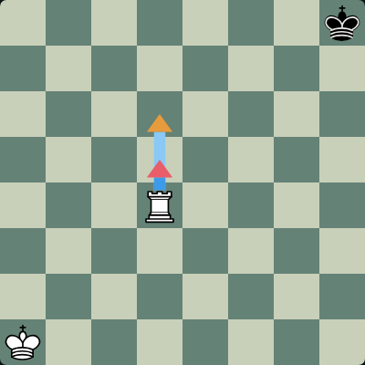](mute/agreement-25-white-postgame.png) |
| agreement-25 / black | [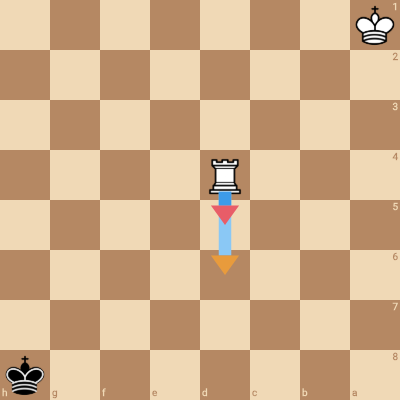](mobile/agreement-25-black.png) | [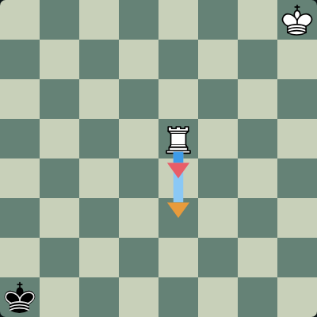](mute/agreement-25-black-puzzle.png) |  |  |
| agreement-26 / white | [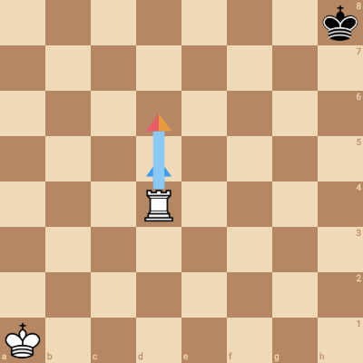](mobile/agreement-26-white.png) | [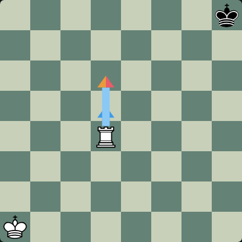](mute/agreement-26-white-puzzle.png) |  |  |
| agreement-26 / black | [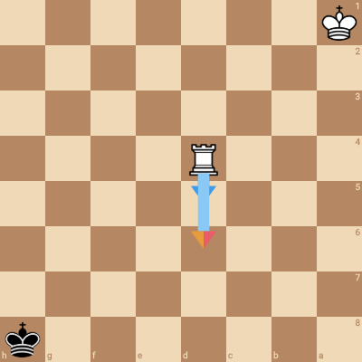](mobile/agreement-26-black.png) | [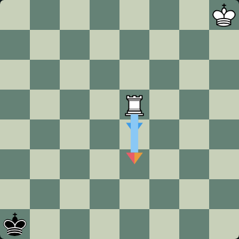](mute/agreement-26-black-puzzle.png) |  |  |
| agreement-27 / white | [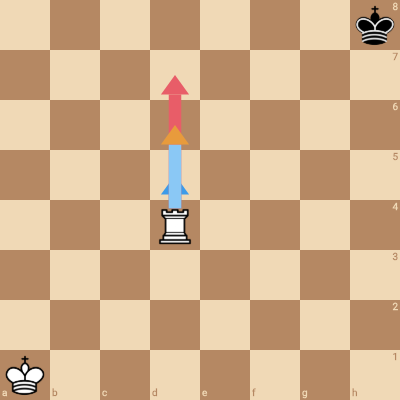](mobile/agreement-27-white.png) |  | [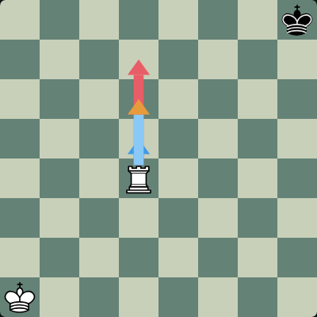](mute/agreement-27-white-analysis.png) |  |
| agreement-27 / black | [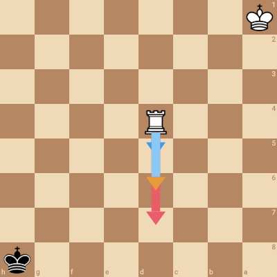](mobile/agreement-27-black.png) | [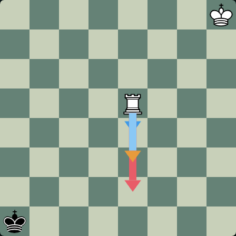](mute/agreement-27-black-puzzle.png) |  |  |
| agreement-28 / white | [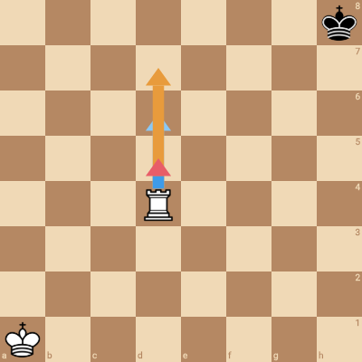](mobile/agreement-28-white.png) | [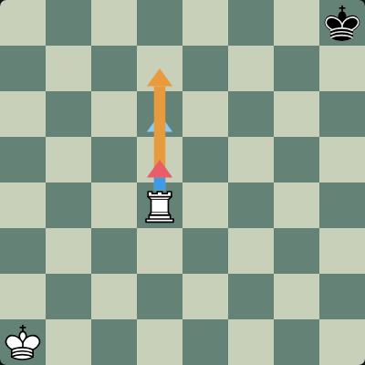](mute/agreement-28-white-puzzle.png) |  |  |
| agreement-28 / black | [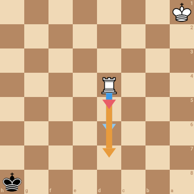](mobile/agreement-28-black.png) |  |  |  |
| agreement-29 / white | [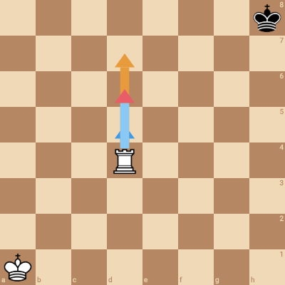](mobile/agreement-29-white.png) |  |  | [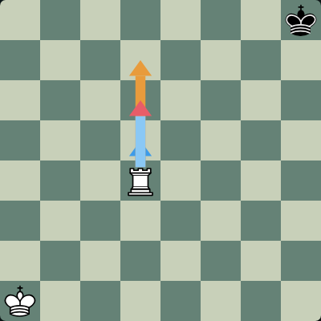](mute/agreement-29-white-postgame.png) |
| agreement-29 / black | [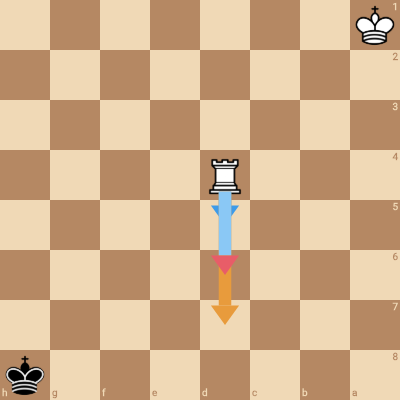](mobile/agreement-29-black.png) |  | [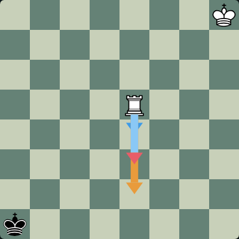](mute/agreement-29-black-analysis.png) |  |
| agreement-30 / white | [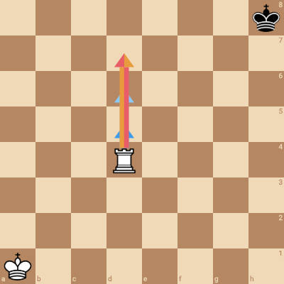](mobile/agreement-30-white.png) | [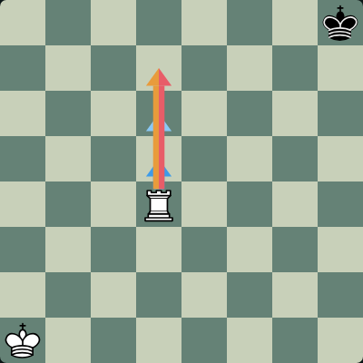](mute/agreement-30-white-puzzle.png) |  |  |
| agreement-30 / black | [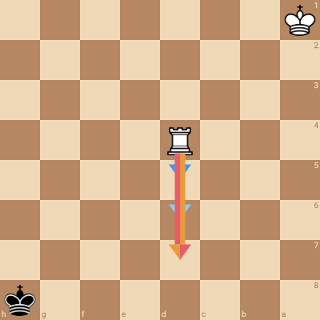](mobile/agreement-30-black.png) |  | [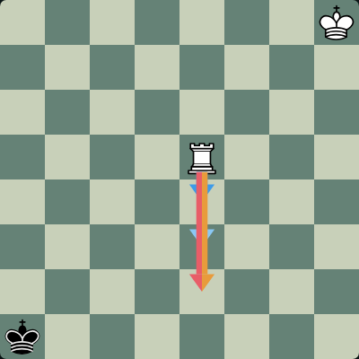](mute/agreement-30-black-analysis.png) |  |
| agreement-31 / white | [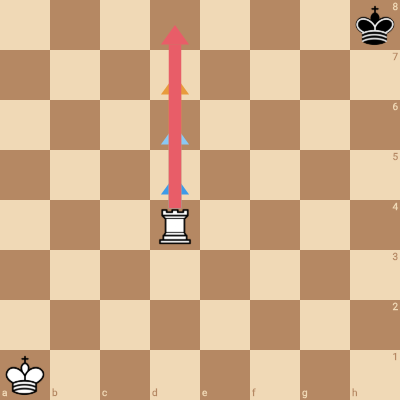](mobile/agreement-31-white.png) | [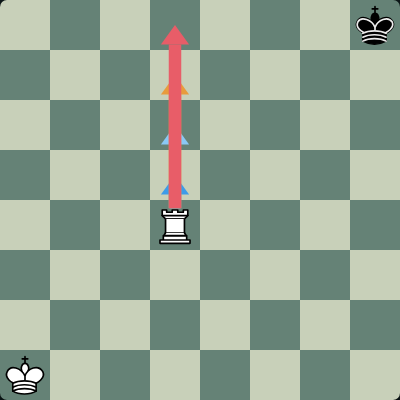](mute/agreement-31-white-puzzle.png) |  |  |
| agreement-31 / black | [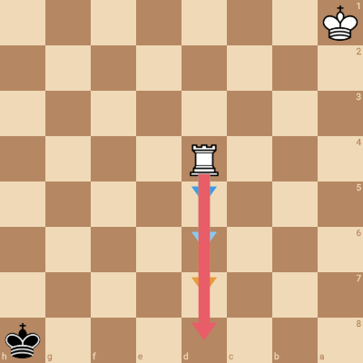](mobile/agreement-31-black.png) |  |  | [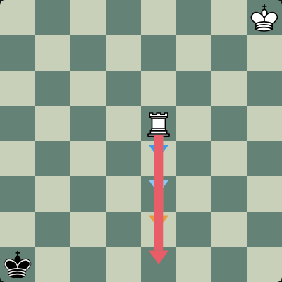](mute/agreement-31-black-postgame.png) |
