# Source combinations 24–31

[Gallery](gallery.md) · [Existing behavior](../arrow-behavior.md)

| Case / bottom side | Mobile Maia | Mute puzzle | Mute analysis | Mute post-game |
| --- | --- | --- | --- | --- |
| Sources 24 / white SF d4d5/d4d6; M1 d4d5; M2 d4d7 | [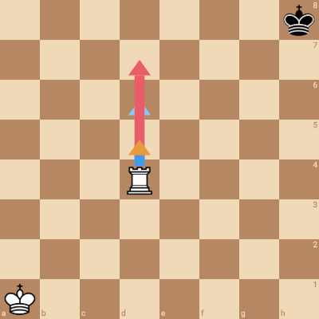](mobile/agreement-24-white.png) |  | [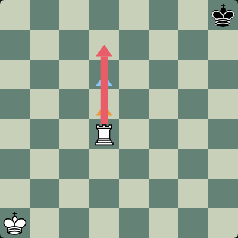](mute/agreement-24-white-analysis.png) |  |
| Sources 24 / black SF d4d5/d4d6; M1 d4d5; M2 d4d7 | [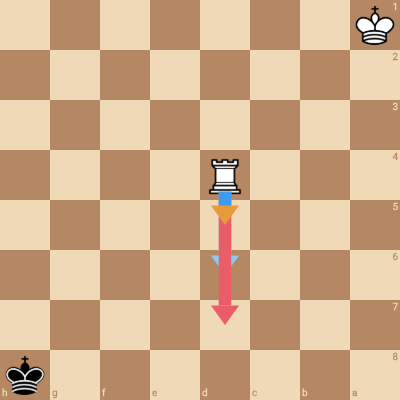](mobile/agreement-24-black.png) |  | [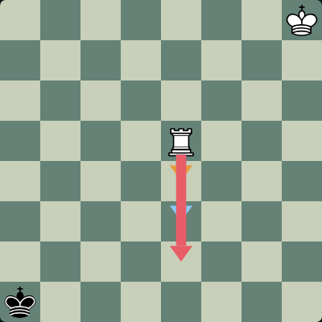](mute/agreement-24-black-analysis.png) |  |
| Sources 25 / white SF d4d5/d4d6; M1 d4d6; M2 d4d5 | [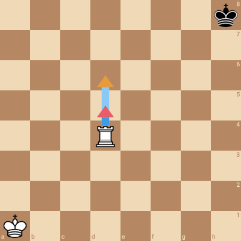](mobile/agreement-25-white.png) | [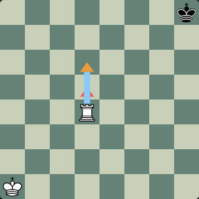](mute/agreement-25-white-puzzle.png) |  |  |
| Sources 25 / black SF d4d5/d4d6; M1 d4d6; M2 d4d5 | [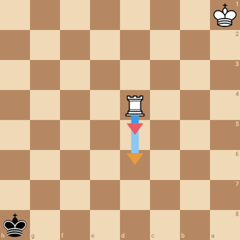](mobile/agreement-25-black.png) | [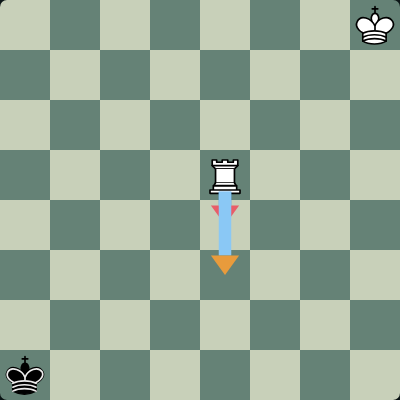](mute/agreement-25-black-puzzle.png) |  |  |
| Sources 26 / white SF d4d5/d4d6; M1 d4d6; M2 d4d6 | [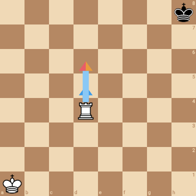](mobile/agreement-26-white.png) | [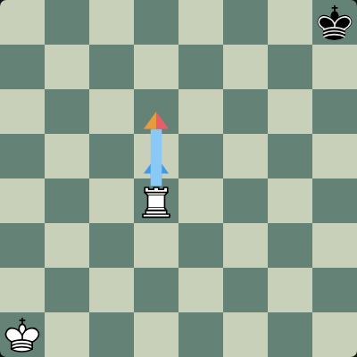](mute/agreement-26-white-puzzle.png) |  |  |
| Sources 26 / black SF d4d5/d4d6; M1 d4d6; M2 d4d6 | [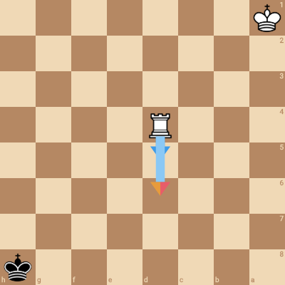](mobile/agreement-26-black.png) |  |  | [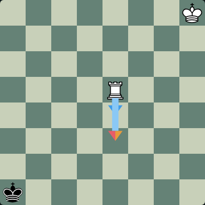](mute/agreement-26-black-postgame.png) |
| Sources 27 / white SF d4d5/d4d6; M1 d4d6; M2 d4d7 | [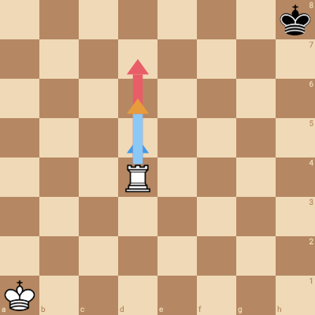](mobile/agreement-27-white.png) |  | [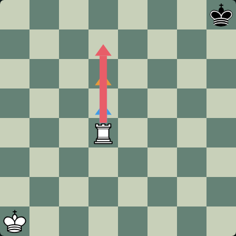](mute/agreement-27-white-analysis.png) |  |
| Sources 27 / black SF d4d5/d4d6; M1 d4d6; M2 d4d7 | [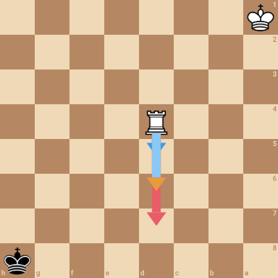](mobile/agreement-27-black.png) |  | [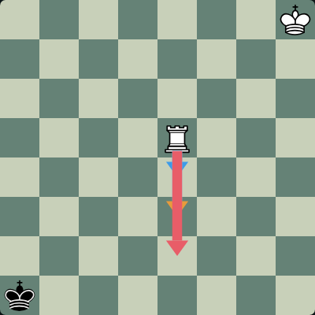](mute/agreement-27-black-analysis.png) |  |
| Sources 28 / white SF d4d5/d4d6; M1 d4d7; M2 d4d5 | [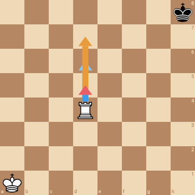](mobile/agreement-28-white.png) |  |  |  |
| Sources 28 / black SF d4d5/d4d6; M1 d4d7; M2 d4d5 | [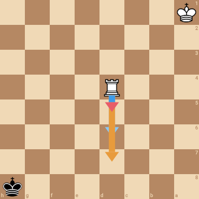](mobile/agreement-28-black.png) |  |  | [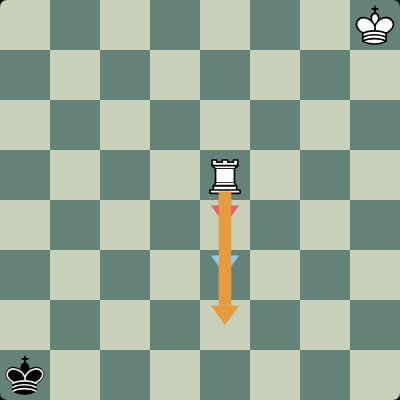](mute/agreement-28-black-postgame.png) |
| Sources 29 / white SF d4d5/d4d6; M1 d4d7; M2 d4d6 | [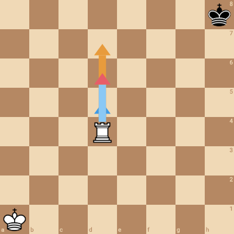](mobile/agreement-29-white.png) |  | [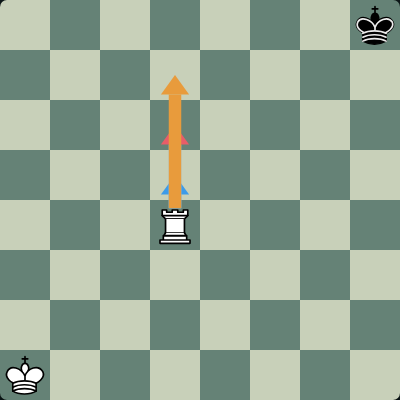](mute/agreement-29-white-analysis.png) |  |
| Sources 29 / black SF d4d5/d4d6; M1 d4d7; M2 d4d6 | [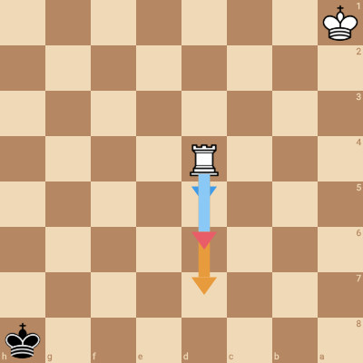](mobile/agreement-29-black.png) |  |  |  |
| Sources 30 / white SF d4d5/d4d6; M1 d4d7; M2 d4d7 | [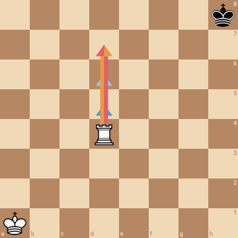](mobile/agreement-30-white.png) | [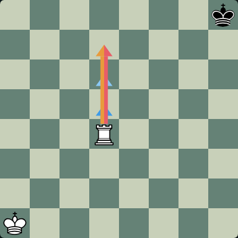](mute/agreement-30-white-puzzle.png) |  |  |
| Sources 30 / black SF d4d5/d4d6; M1 d4d7; M2 d4d7 | [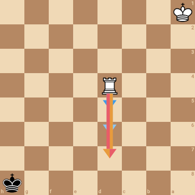](mobile/agreement-30-black.png) |  |  |  |
| Sources 31 / white SF d4d5/d4d6; M1 d4d7; M2 d4d8 | [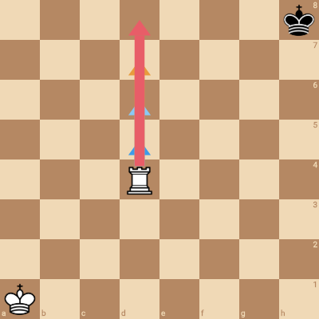](mobile/agreement-31-white.png) | [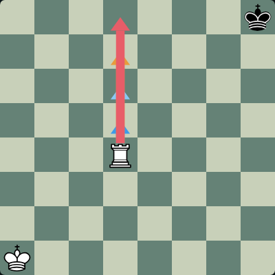](mute/agreement-31-white-puzzle.png) |  |  |
| Sources 31 / black SF d4d5/d4d6; M1 d4d7; M2 d4d8 | [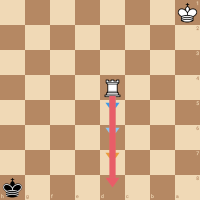](mobile/agreement-31-black.png) |  | [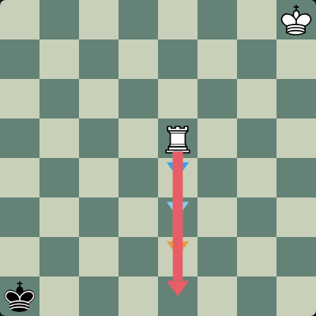](mute/agreement-31-black-analysis.png) |  |
