# Matching-piece geometry and tapering examples

[Gallery](gallery.md) · [Existing behavior](../arrow-behavior.md)

| Case / bottom side | Mobile Maia | Mute puzzle | Mute analysis | Mute post-game |
| --- | --- | --- | --- | --- |
| diagonal / white SF a1h8/h1a8; M1 a1g7; M2 h1b7 | [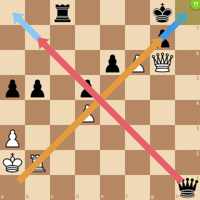](mobile/diagonal-white.png) | [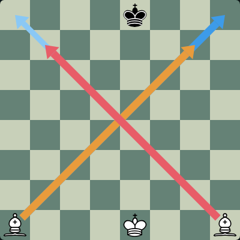](mute/diagonal-white-puzzle.png) |  |  |
| diagonal / black SF a1h8/h1a8; M1 a1g7; M2 h1b7 | [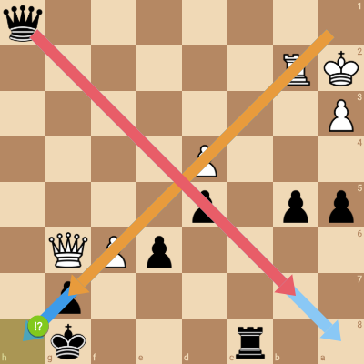](mobile/diagonal-black.png) |  |  | [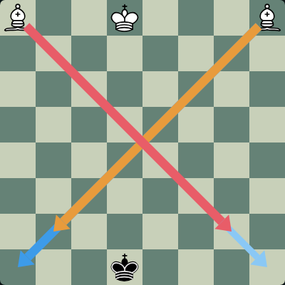](mute/diagonal-black-postgame.png) |
| knight / white SF g1f3/b1c3; M1 g1f3; M2 b1c3 | [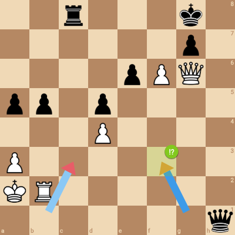](mobile/knight-white.png) | [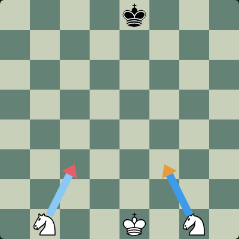](mute/knight-white-puzzle.png) |  |  |
| knight / black SF g1f3/b1c3; M1 g1f3; M2 b1c3 | [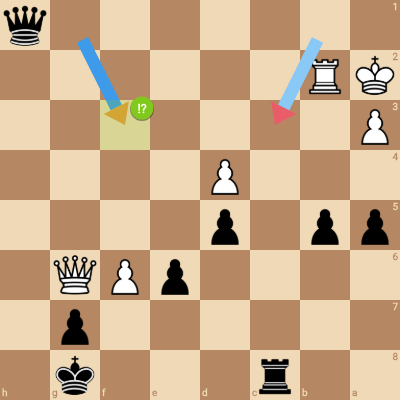](mobile/knight-black.png) |  |  | [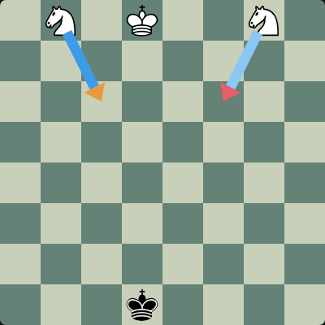](mute/knight-black-postgame.png) |
| opposite / white SF d4a4/d4h4; M1 d4b4; M2 d4h4 | [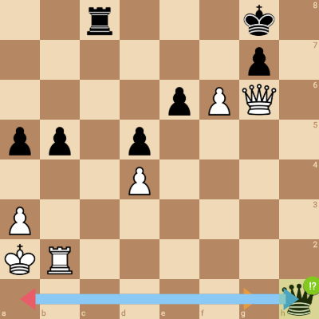](mobile/opposite-white.png) | [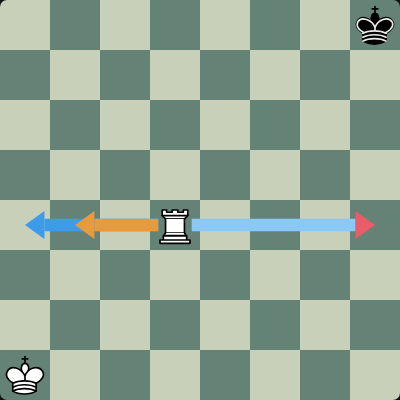](mute/opposite-white-puzzle.png) |  |  |
| opposite / black SF d4a4/d4h4; M1 d4b4; M2 d4h4 | [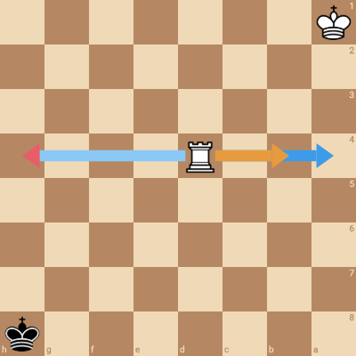](mobile/opposite-black.png) |  | [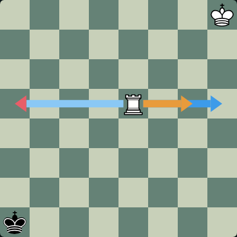](mute/opposite-black-analysis.png) |  |
| promotion / white SF e7e8q/e7e8n; M1 e7e8q; M2 e7e8q | [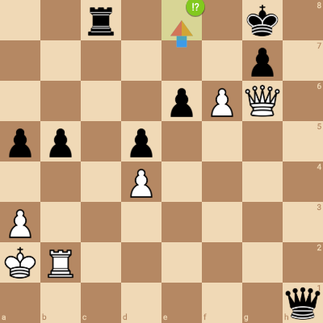](mobile/promotion-white.png) |  |  | [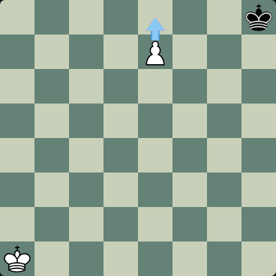](mute/promotion-white-postgame.png) |
| promotion / black SF e7e8q/e7e8n; M1 e7e8q; M2 e7e8q | [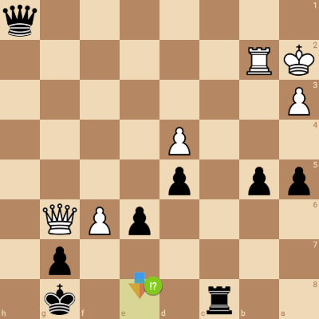](mobile/promotion-black.png) |  | [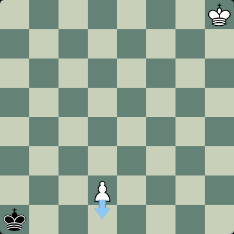](mute/promotion-black-analysis.png) |  |
| castling / white SF e1g1/e1c1; M1 e1g1; M2 e1c1 | [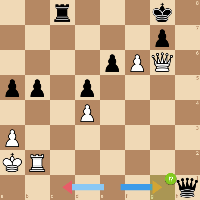](mobile/castling-white.png) | [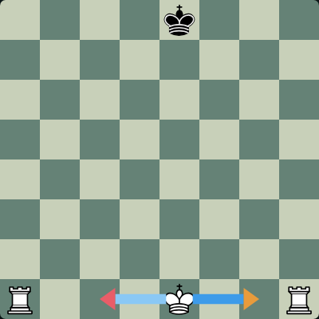](mute/castling-white-puzzle.png) |  |  |
| castling / black SF e1g1/e1c1; M1 e1g1; M2 e1c1 | [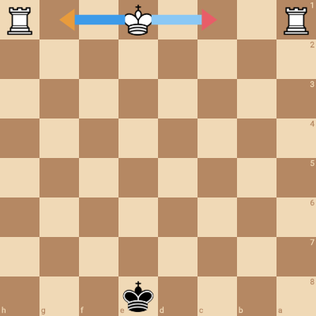](mobile/castling-black.png) |  | [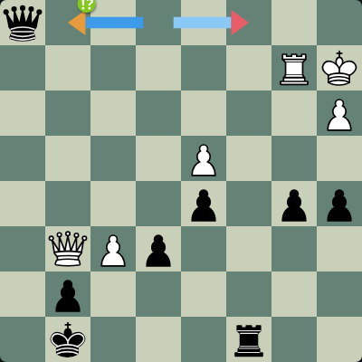](mute/castling-black-analysis.png) |  |
| same-destination / white SF d4e4/e5e4; M1 d4e4; M2 f3e4 | [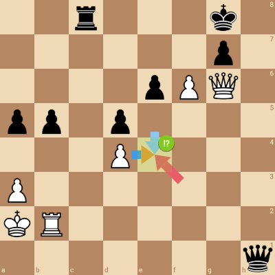](mobile/same-destination-white.png) |  |  | [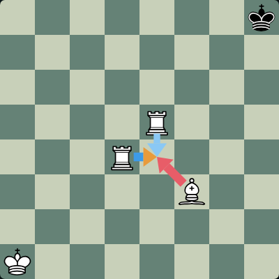](mute/same-destination-white-postgame.png) |
| same-destination / black SF d4e4/e5e4; M1 d4e4; M2 f3e4 | [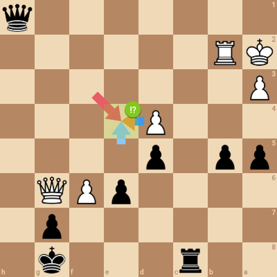](mobile/same-destination-black.png) | [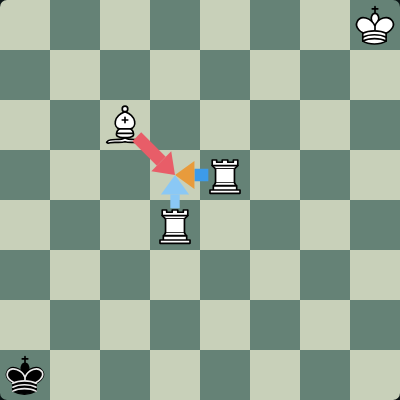](mute/same-destination-black-puzzle.png) |  |  |
| short-long / white SF a1a2/a1a8; M1 a1a2; M2 a1a8 | [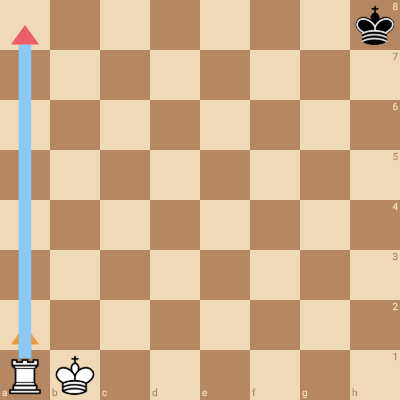](mobile/short-long-white.png) |  | [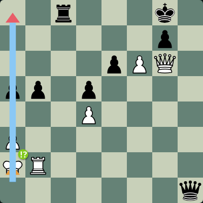](mute/short-long-white-analysis.png) |  |
| short-long / black SF a1a2/a1a8; M1 a1a2; M2 a1a8 | [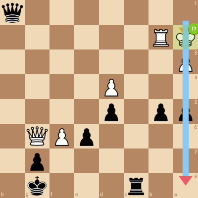](mobile/short-long-black.png) |  |  | [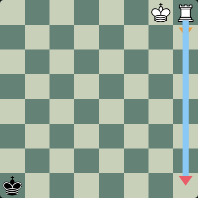](mute/short-long-black-postgame.png) |
| sf-taper / white SF h1h6/c8c7; M1 h1h5; M2 — | [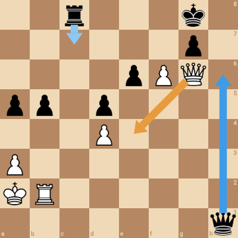](mobile/sf-taper-white.png) |  |  | [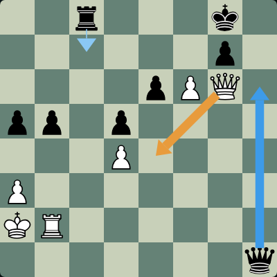](mute/sf-taper-white-postgame.png) |
| sf-taper / black SF h1h6/c8c7; M1 h1h5; M2 — | [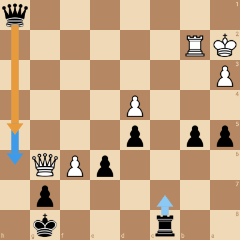](mobile/sf-taper-black.png) |  | [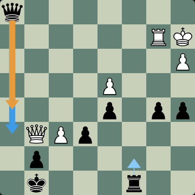](mute/sf-taper-black-analysis.png) |  |
| small-board / white SF h8d4/h8f6; M1 h8e5; M2 h8d4 | [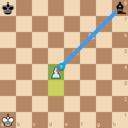](mobile/small-board-white.png) |  |  | [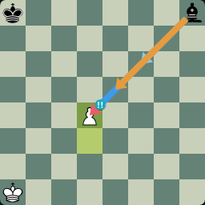](mute/small-board-white-postgame.png) |
| small-board / black SF h8d4/h8f6; M1 h8e5; M2 h8d4 | [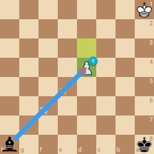](mobile/small-board-black.png) |  |  | [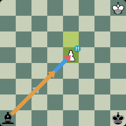](mute/small-board-black-postgame.png) |
