# Geometry, promotions, castling, tapering and small boards

[All comparisons](gallery.md) · [Methodology and limits](../arrow-behavior.md)

| Case / orientation | Mobile Maia | Mute puzzle review | Mute analysis | Mute post-game |
| --- | --- | --- | --- | --- |
| diagonal / white | [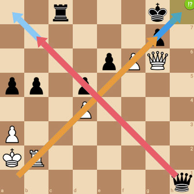](mobile/diagonal-white.png) | [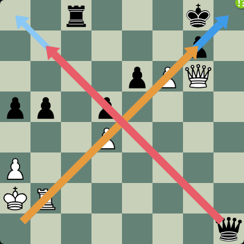](mute/diagonal-white-puzzle.png) |  |  |
| diagonal / black | [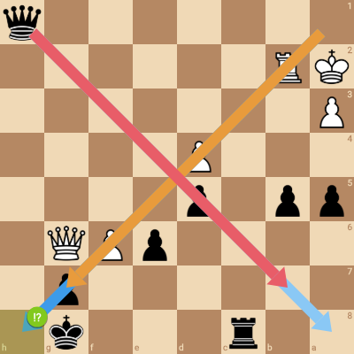](mobile/diagonal-black.png) | [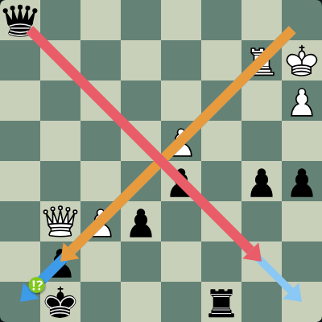](mute/diagonal-black-puzzle.png) |  |  |
| knight / white | [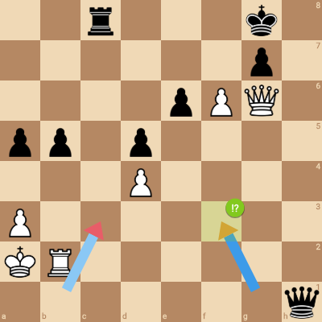](mobile/knight-white.png) | [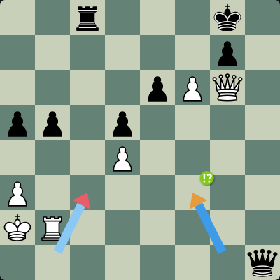](mute/knight-white-puzzle.png) |  |  |
| knight / black | [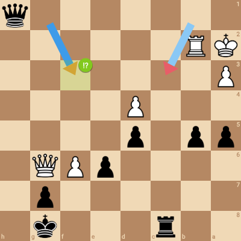](mobile/knight-black.png) |  |  | [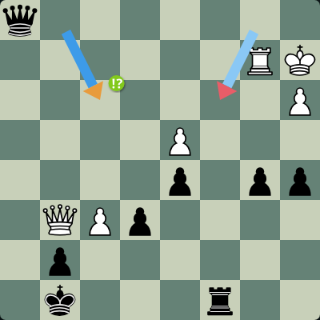](mute/knight-black-postgame.png) |
| opposite / white | [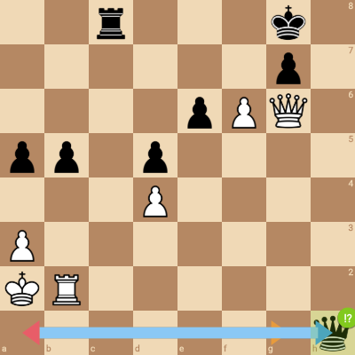](mobile/opposite-white.png) |  |  | [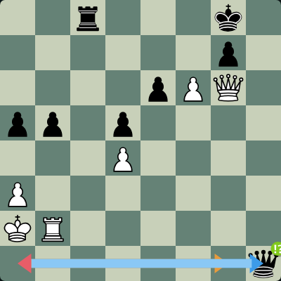](mute/opposite-white-postgame.png) |
| opposite / black | [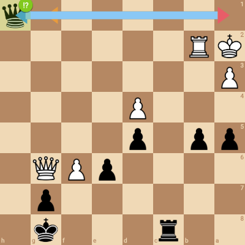](mobile/opposite-black.png) | [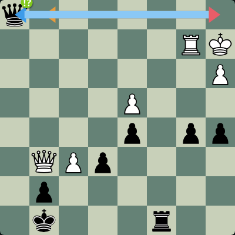](mute/opposite-black-puzzle.png) |  |  |
| promotion / white | [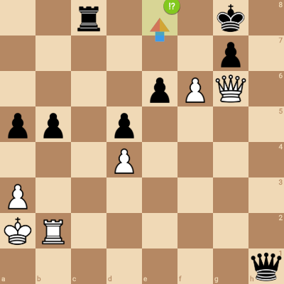](mobile/promotion-white.png) | [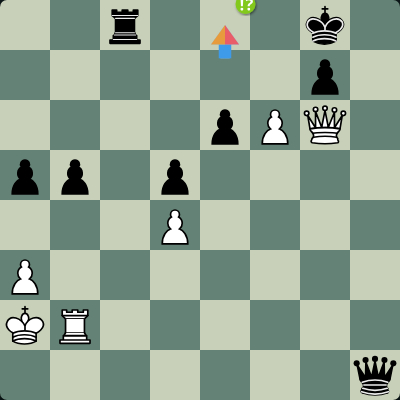](mute/promotion-white-puzzle.png) |  |  |
| promotion / black | [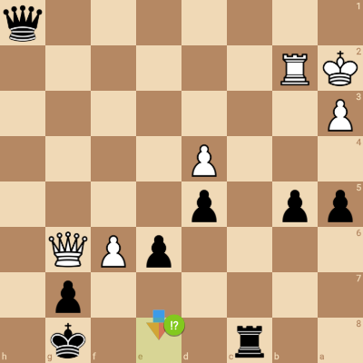](mobile/promotion-black.png) | [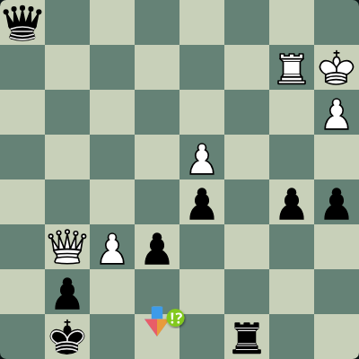](mute/promotion-black-puzzle.png) |  |  |
| castling / white | [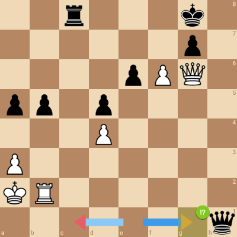](mobile/castling-white.png) |  | [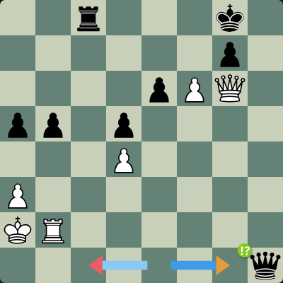](mute/castling-white-analysis.png) |  |
| castling / black | [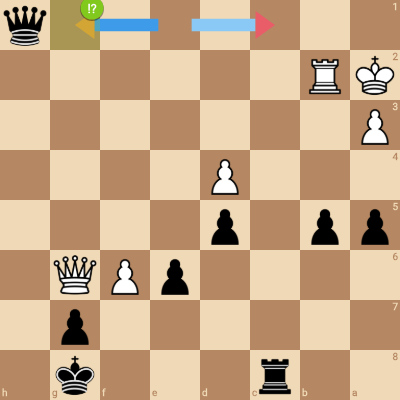](mobile/castling-black.png) | [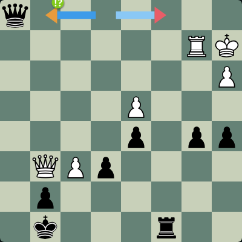](mute/castling-black-puzzle.png) |  |  |
| same-destination / white | [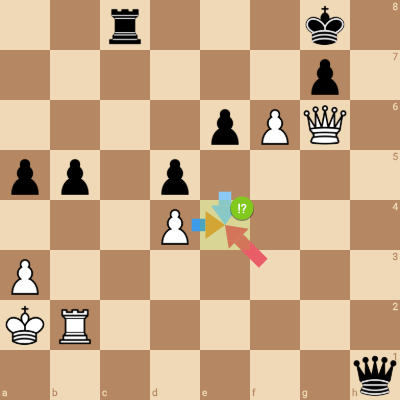](mobile/same-destination-white.png) |  | [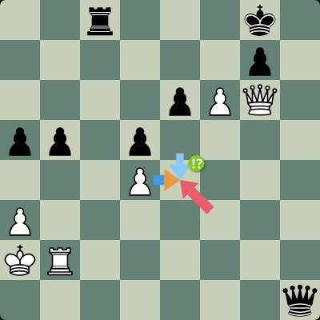](mute/same-destination-white-analysis.png) |  |
| same-destination / black | [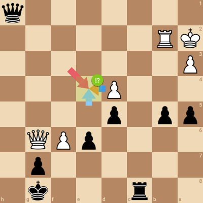](mobile/same-destination-black.png) |  | [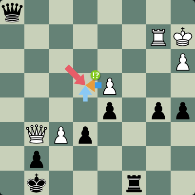](mute/same-destination-black-analysis.png) |  |
| short-long / white | [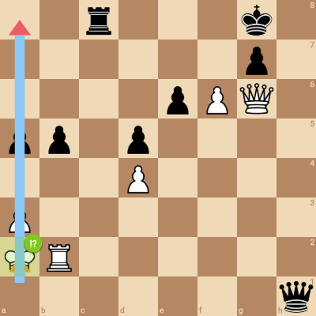](mobile/short-long-white.png) |  |  | [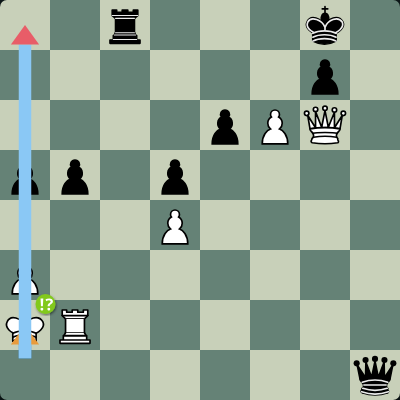](mute/short-long-white-postgame.png) |
| short-long / black | [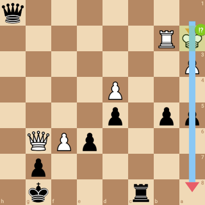](mobile/short-long-black.png) | [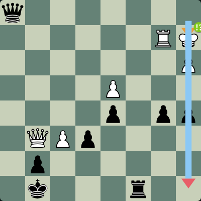](mute/short-long-black-puzzle.png) |  |  |
| sf-taper / white | [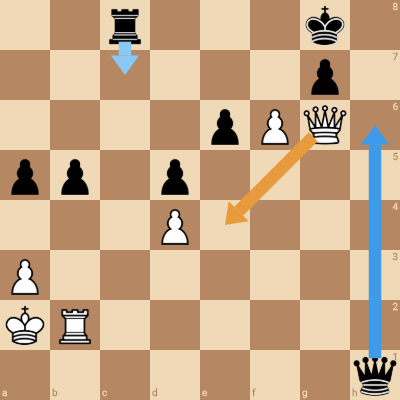](mobile/sf-taper-white.png) |  |  | [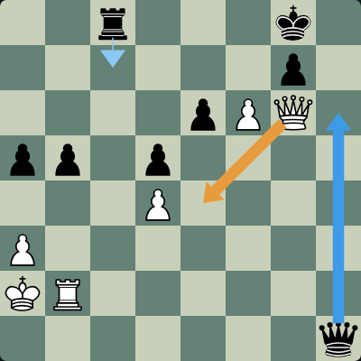](mute/sf-taper-white-postgame.png) |
| sf-taper / black | [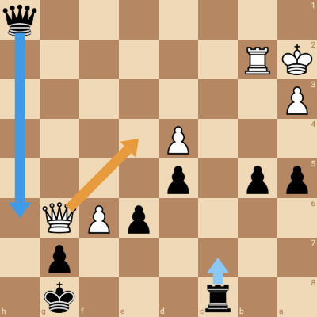](mobile/sf-taper-black.png) |  |  | [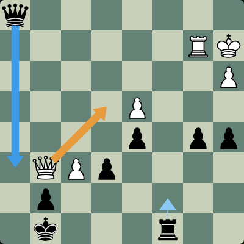](mute/sf-taper-black-postgame.png) |
| small-board / white | [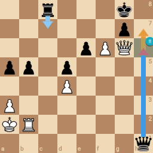](mobile/small-board-white.png) |  |  | [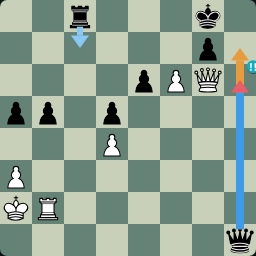](mute/small-board-white-postgame.png) |
| small-board / black | [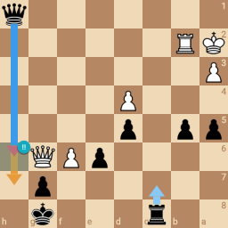](mobile/small-board-black.png) |  | [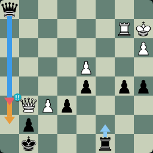](mute/small-board-black-analysis.png) |  |
