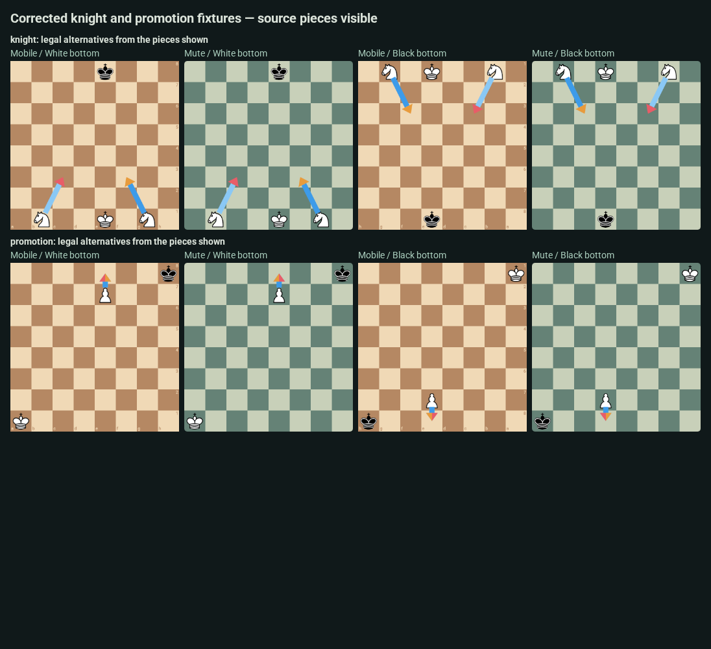

# Full fixture QC review

This replaces the original screenshot set at `586aaaf`. That set contained 18 illegal candidate roots across the geometry/taper examples and badge examples without selected-move history. The renderer comparisons alone did not catch those invalid inputs. This was a fixture-validation and visual-review failure, not evidence of missing pieces in the application.

## Corrected checks

All 48 fixtures now pass independent move-legality checks in **chessops and Mobile Maia’s chess.dart**. Expected piece names are declared explicitly; the browser also verifies those pieces exist visibly on the correct mirrored square, and every arrow has a visible source piece. Every badge has a legal previous FEN/move that produces the shown board and ends on the classified piece.

The 96 orientation/case groups are pixel-identical across Mute puzzle, analysis and post-game fixture paths. All twelve contact sheets below were visually inspected: source pieces, board orientation, arrow origins/destinations, overlap, classification placement and the retained tapering difference. Individual 400px captures remain linked in the full gallery.

**Badge labels are injected palette/layering tests.** The six rows deliberately apply different labels to the same legal `d3–d4` move. They do not claim that pawn move is brilliant, a blunder, or any other engine judgment. Geometry examples have no invented classification badge.

[Input audit: old errors and corrected zero-error result](input-audit.json) · [Mute cross-surface pixel check](surface-pixel-check.json) · [All individual screenshots](gallery.md)

## Complete visual-review index

| Cases | Expected pieces | Fixture rules / visible pieces | Inspected sheet |
| --- | --- | --- | --- |
| agreement-00 | d4: white rook | Pass, both orientations / all three Mute surfaces | [Sheet 1](qc-01.png) |
| agreement-01 | d4: white rook | Pass, both orientations / all three Mute surfaces | [Sheet 1](qc-01.png) |
| agreement-02 | d4: white rook | Pass, both orientations / all three Mute surfaces | [Sheet 1](qc-01.png) |
| agreement-03 | d4: white rook | Pass, both orientations / all three Mute surfaces | [Sheet 1](qc-01.png) |
| agreement-04 | d4: white rook | Pass, both orientations / all three Mute surfaces | [Sheet 2](qc-02.png) |
| agreement-05 | d4: white rook | Pass, both orientations / all three Mute surfaces | [Sheet 2](qc-02.png) |
| agreement-06 | d4: white rook | Pass, both orientations / all three Mute surfaces | [Sheet 2](qc-02.png) |
| agreement-07 | d4: white rook | Pass, both orientations / all three Mute surfaces | [Sheet 2](qc-02.png) |
| agreement-08 | d4: white rook | Pass, both orientations / all three Mute surfaces | [Sheet 3](qc-03.png) |
| agreement-09 | d4: white rook | Pass, both orientations / all three Mute surfaces | [Sheet 3](qc-03.png) |
| agreement-10 | d4: white rook | Pass, both orientations / all three Mute surfaces | [Sheet 3](qc-03.png) |
| agreement-11 | d4: white rook | Pass, both orientations / all three Mute surfaces | [Sheet 3](qc-03.png) |
| agreement-12 | d4: white rook | Pass, both orientations / all three Mute surfaces | [Sheet 4](qc-04.png) |
| agreement-13 | d4: white rook | Pass, both orientations / all three Mute surfaces | [Sheet 4](qc-04.png) |
| agreement-14 | d4: white rook | Pass, both orientations / all three Mute surfaces | [Sheet 4](qc-04.png) |
| agreement-15 | d4: white rook | Pass, both orientations / all three Mute surfaces | [Sheet 4](qc-04.png) |
| agreement-16 | d4: white rook | Pass, both orientations / all three Mute surfaces | [Sheet 5](qc-05.png) |
| agreement-17 | d4: white rook | Pass, both orientations / all three Mute surfaces | [Sheet 5](qc-05.png) |
| agreement-18 | d4: white rook | Pass, both orientations / all three Mute surfaces | [Sheet 5](qc-05.png) |
| agreement-19 | d4: white rook | Pass, both orientations / all three Mute surfaces | [Sheet 5](qc-05.png) |
| agreement-20 | d4: white rook | Pass, both orientations / all three Mute surfaces | [Sheet 6](qc-06.png) |
| agreement-21 | d4: white rook | Pass, both orientations / all three Mute surfaces | [Sheet 6](qc-06.png) |
| agreement-22 | d4: white rook | Pass, both orientations / all three Mute surfaces | [Sheet 6](qc-06.png) |
| agreement-23 | d4: white rook | Pass, both orientations / all three Mute surfaces | [Sheet 6](qc-06.png) |
| agreement-24 | d4: white rook | Pass, both orientations / all three Mute surfaces | [Sheet 7](qc-07.png) |
| agreement-25 | d4: white rook | Pass, both orientations / all three Mute surfaces | [Sheet 7](qc-07.png) |
| agreement-26 | d4: white rook | Pass, both orientations / all three Mute surfaces | [Sheet 7](qc-07.png) |
| agreement-27 | d4: white rook | Pass, both orientations / all three Mute surfaces | [Sheet 7](qc-07.png) |
| agreement-28 | d4: white rook | Pass, both orientations / all three Mute surfaces | [Sheet 8](qc-08.png) |
| agreement-29 | d4: white rook | Pass, both orientations / all three Mute surfaces | [Sheet 8](qc-08.png) |
| agreement-30 | d4: white rook | Pass, both orientations / all three Mute surfaces | [Sheet 8](qc-08.png) |
| agreement-31 | d4: white rook | Pass, both orientations / all three Mute surfaces | [Sheet 8](qc-08.png) |
| reported-J2VCe | h1: black queen, c8: black rook | Pass, both orientations / all three Mute surfaces | [Sheet 9](qc-09.png) |
| badge-brilliant | h8: black bishop, d4: white pawn | Pass, both orientations / all three Mute surfaces | [Sheet 9](qc-09.png) |
| badge-good | h8: black bishop, d4: white pawn | Pass, both orientations / all three Mute surfaces | [Sheet 9](qc-09.png) |
| badge-interesting | h8: black bishop, d4: white pawn | Pass, both orientations / all three Mute surfaces | [Sheet 9](qc-09.png) |
| badge-dubious | h8: black bishop, d4: white pawn | Pass, both orientations / all three Mute surfaces | [Sheet 10](qc-10.png) |
| badge-mistake | h8: black bishop, d4: white pawn | Pass, both orientations / all three Mute surfaces | [Sheet 10](qc-10.png) |
| badge-blunder | h8: black bishop, d4: white pawn | Pass, both orientations / all three Mute surfaces | [Sheet 10](qc-10.png) |
| diagonal | a1: white bishop, h1: white bishop | Pass, both orientations / all three Mute surfaces | [Sheet 10](qc-10.png) |
| knight | b1: white knight, g1: white knight | Pass, both orientations / all three Mute surfaces | [Sheet 11](qc-11.png) |
| opposite | d4: white rook | Pass, both orientations / all three Mute surfaces | [Sheet 11](qc-11.png) |
| promotion | e7: white pawn | Pass, both orientations / all three Mute surfaces | [Sheet 11](qc-11.png) |
| castling | a1: white rook, e1: white king, h1: white rook | Pass, both orientations / all three Mute surfaces | [Sheet 11](qc-11.png) |
| same-destination | d4: white rook, e5: white rook, f3: white bishop | Pass, both orientations / all three Mute surfaces | [Sheet 12](qc-12.png) |
| short-long | a1: white rook | Pass, both orientations / all three Mute surfaces | [Sheet 12](qc-12.png) |
| sf-taper | h1: black queen, c8: black rook | Pass, both orientations / all three Mute surfaces | [Sheet 12](qc-12.png) |
| small-board | h8: black bishop, d4: white pawn | Pass, both orientations / all three Mute surfaces | [Sheet 12](qc-12.png) |

The 288 Mute captures, 96 Flutter captures, six retained-DOM sequences and 21 setting/hover/threat cases were regenerated/rechecked. Focused native tests: 18 passed. Mobile tests: 96 renderer cases plus the complete input audit, 97 passed. No production helper, tapering, model or classification algorithm was changed by this QC correction.
