# Original Qh6 overlap and badge palette examples

[Gallery](gallery.md) · [Existing behavior](../arrow-behavior.md)

| Case / bottom side | Mobile Maia | Mute puzzle | Mute analysis | Mute post-game |
| --- | --- | --- | --- | --- |
| reported-J2VCe / white SF h1h6/c8c7; M1 h1h7; M2 h1h6 |  | [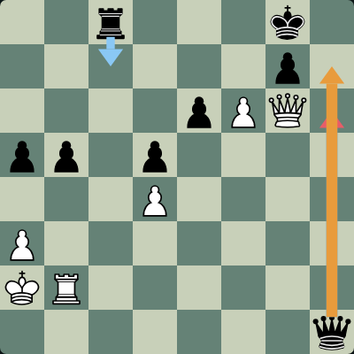](mute/reported-J2VCe-white-puzzle.png) |  |  |
| reported-J2VCe / black SF h1h6/c8c7; M1 h1h7; M2 h1h6 |  |  |  | [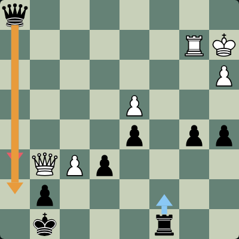](mute/reported-J2VCe-black-postgame.png) |
| badge-brilliant / white SF h8d4/h8f6; M1 h8e5; M2 h8d4 | [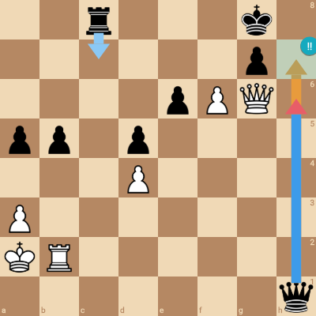](mobile/badge-brilliant-white.png) |  |  |  |
| badge-brilliant / black SF h8d4/h8f6; M1 h8e5; M2 h8d4 |  |  |  |  |
| badge-good / white SF h8d4/h8f6; M1 h8e5; M2 h8d4 |  |  |  | [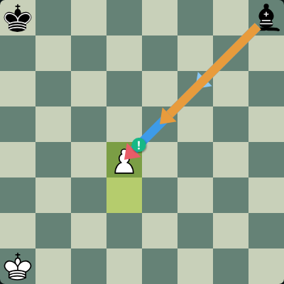](mute/badge-good-white-postgame.png) |
| badge-good / black SF h8d4/h8f6; M1 h8e5; M2 h8d4 |  | [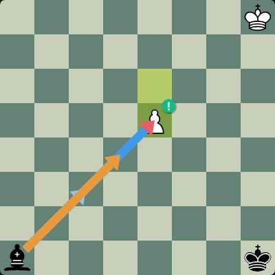](mute/badge-good-black-puzzle.png) |  |  |
| badge-interesting / white SF h8d4/h8f6; M1 h8e5; M2 h8d4 | [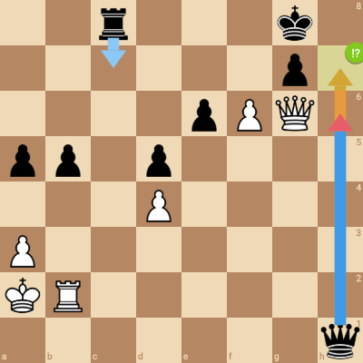](mobile/badge-interesting-white.png) |  |  | [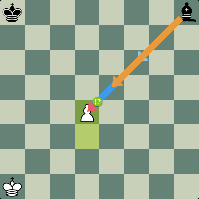](mute/badge-interesting-white-postgame.png) |
| badge-interesting / black SF h8d4/h8f6; M1 h8e5; M2 h8d4 | [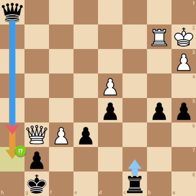](mobile/badge-interesting-black.png) |  |  | [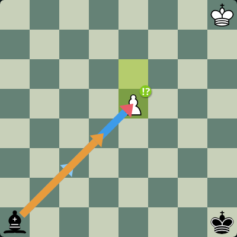](mute/badge-interesting-black-postgame.png) |
| badge-dubious / white SF h8d4/h8f6; M1 h8e5; M2 h8d4 | [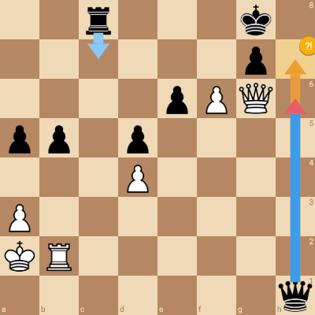](mobile/badge-dubious-white.png) |  |  |  |
| badge-dubious / black SF h8d4/h8f6; M1 h8e5; M2 h8d4 | [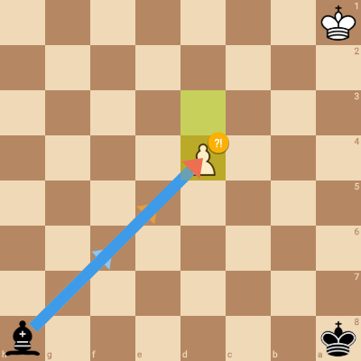](mobile/badge-dubious-black.png) |  |  |  |
| badge-mistake / white SF h8d4/h8f6; M1 h8e5; M2 h8d4 | [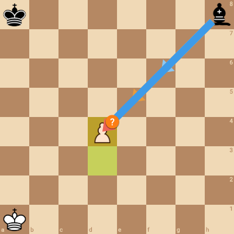](mobile/badge-mistake-white.png) |  |  |  |
| badge-mistake / black SF h8d4/h8f6; M1 h8e5; M2 h8d4 |  |  |  | [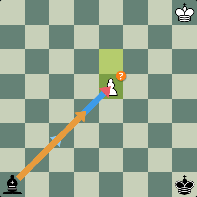](mute/badge-mistake-black-postgame.png) |
| badge-blunder / white SF h8d4/h8f6; M1 h8e5; M2 h8d4 | [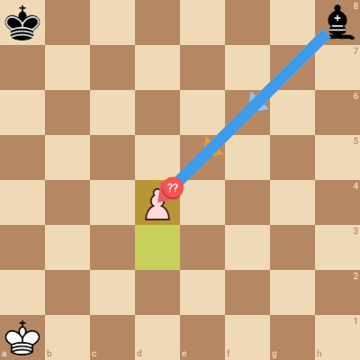](mobile/badge-blunder-white.png) |  |  | [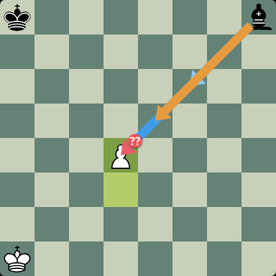](mute/badge-blunder-white-postgame.png) |
| badge-blunder / black SF h8d4/h8f6; M1 h8e5; M2 h8d4 |  |  | [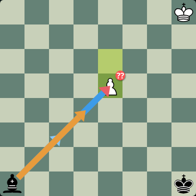](mute/badge-blunder-black-analysis.png) |  |
