# Reported overlap and all six badges

[All comparisons](gallery.md) · [Methodology and limits](../arrow-behavior.md)

| Case / orientation | Mobile Maia | Mute puzzle review | Mute analysis | Mute post-game |
| --- | --- | --- | --- | --- |
| reported-J2VCe / white |  |  |  |  |
| reported-J2VCe / black |  |  |  |  |
| badge-brilliant / white | [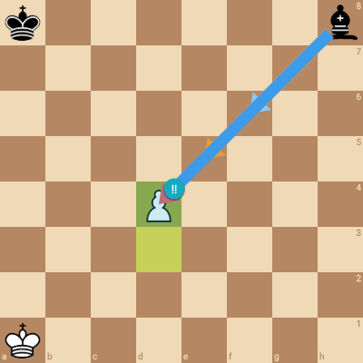](mobile/badge-brilliant-white.png) |  |  |  |
| badge-brilliant / black |  |  |  | [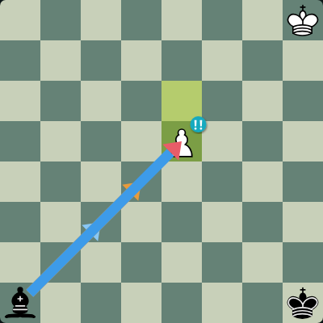](mute/badge-brilliant-black-postgame.png) |
| badge-good / white |  |  |  | [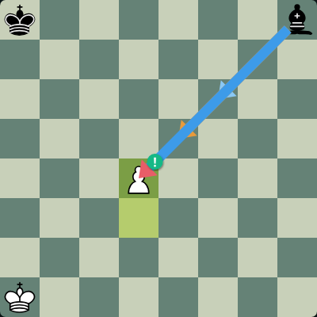](mute/badge-good-white-postgame.png) |
| badge-good / black |  |  |  |  |
| badge-interesting / white | [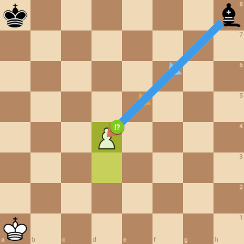](mobile/badge-interesting-white.png) |  | [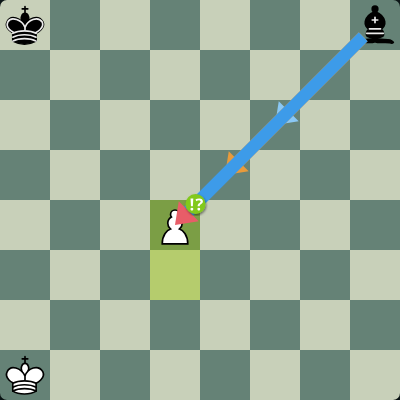](mute/badge-interesting-white-analysis.png) |  |
| badge-interesting / black | [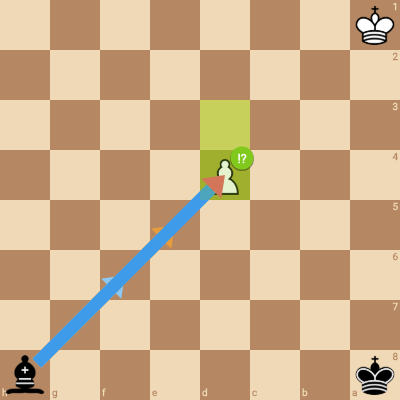](mobile/badge-interesting-black.png) |  |  |  |
| badge-dubious / white | [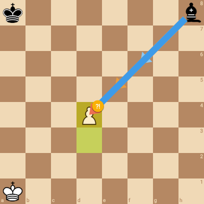](mobile/badge-dubious-white.png) |  | [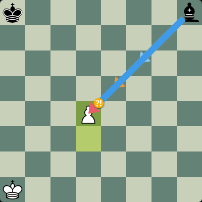](mute/badge-dubious-white-analysis.png) |  |
| badge-dubious / black | [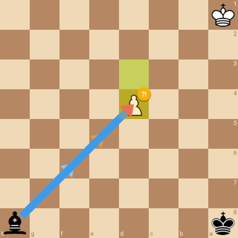](mobile/badge-dubious-black.png) |  | [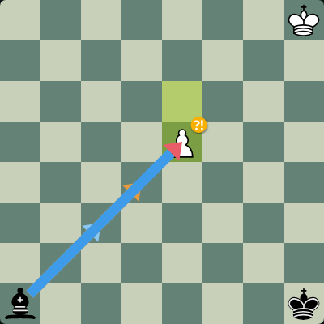](mute/badge-dubious-black-analysis.png) |  |
| badge-mistake / white | [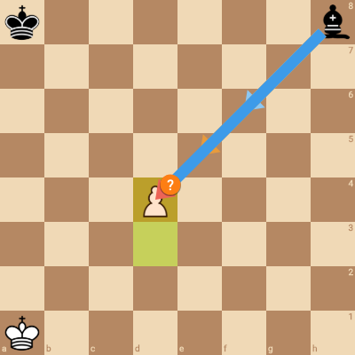](mobile/badge-mistake-white.png) |  |  |  |
| badge-mistake / black |  |  | [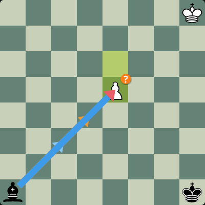](mute/badge-mistake-black-analysis.png) |  |
| badge-blunder / white | [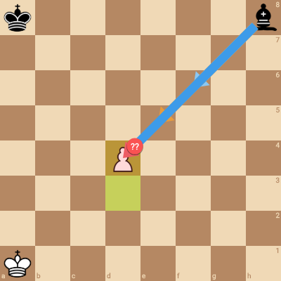](mobile/badge-blunder-white.png) |  |  |  |
| badge-blunder / black |  | [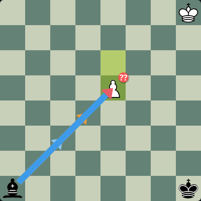](mute/badge-blunder-black-puzzle.png) |  |  |
