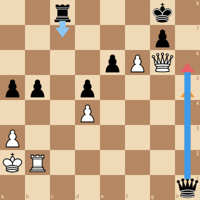
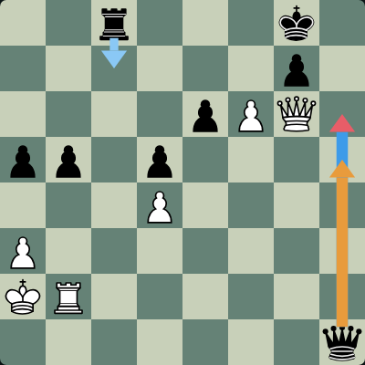
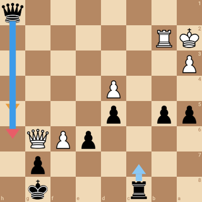
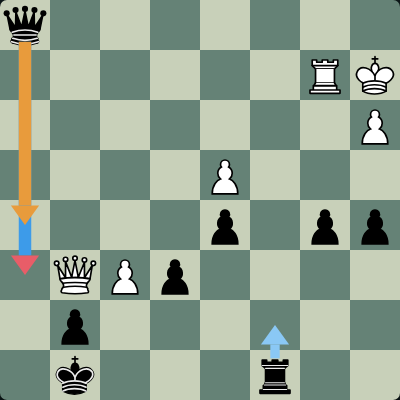

# Qh5 below the Qh6 agreement

[Gallery](gallery.md) · [Existing behavior](../arrow-behavior.md)

| Case / bottom side | Mobile Maia | Mute puzzle | Mute analysis | Mute post-game |
| --- | --- | --- | --- | --- |
| Qh5-shorter / white SF h1h6/c8c7; M1 h1h5; M2 h1h6 |  |  |  |  |
| Qh5-shorter / black SF h1h6/c8c7; M1 h1h5; M2 h1h6 |  |  |  |  |
