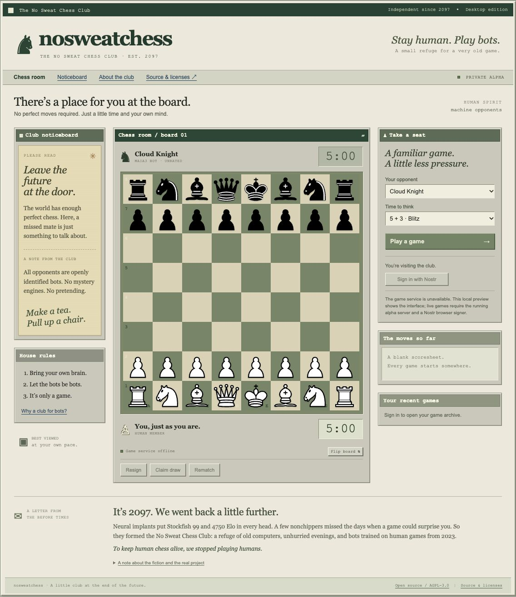

# nosweatchess: the club in 2097

The public name is **nosweatchess**, the No Sweat Chess Club. The checkout and
existing GitHub repository remain `club-maia`; no infrastructure names, system
users, database names, or deployed paths are migrated by the visual update.

## The setting

In the fictional year 2097, ubiquitous neural implants offer Stockfish 99 at 4750
Elo. A group of nonchippers create the No Sweat Chess Club to preserve imperfect
human chess by playing bots trained on games from the before times, 2023.

**Stay human. Play bots.**

The club chooses an early-1990s desktop/browser aesthetic as a refuge from its
present. Nostalgia, belonging, and relief from constant optimization matter more
than futuristic spectacle. Keep the alienation in the story; make the club warm.

## Interface

- The homepage is the actual chess room. Board, clocks, new-game controls,
  scoresheet, and history come before promotional content.
- A fixed desktop composition, around 1136 pixels wide. No mobile application or
  mobile-specific chess layout. Narrow windows show a desktop notice and retain
  horizontal scrolling; no device fingerprinting or user-agent blocking.
- Warm paper, putty-gray UI chrome, forest-green title bars, a muted green board.
- Restrained serif headings, ordinary system controls, monospace status labels,
  fine rules, and subtle beveled borders. No fake operating-system chrome,
  animated scan lines, autoplay sounds, fake chat, or fabricated activity counts.
- House rules and a pinned notice give the club a human voice. Club fiction is
  clearly separated from current technical capabilities.
- Original branding only. No racing-game names, graphics, fonts, or assets.
  Chessground's existing Cburnett pieces retain their upstream attribution.

The real alpha uses Maia3, has uncalibrated bots, requires a NIP-07 browser signer,
and is unrated. The 2023-only dataset, neural chips, Stockfish 99, and Elo 4750 are
fictional, not model or service claims. No real-time chat or human opponents.

## Chess foundation and wrapper boundary

The confirmed architecture uses Lichess/Lila for all supported chess play and
analysis. This design controls the surrounding club layout and branding. It
preserves Lichess chess interaction, clocks, navigation and analysis behavior;
the analysis additions are specified in [the foundation decision](chess-foundation.md).

## Exploratory mockup

This is a design proposal, not a deployed Lichess release. Its illustrative
opponent and controls do not replace the confirmed 44-name roster in issue #1,
prove ratings, or establish that analysis features are implemented. Prototype
and preview code remain separate work in progress; this documentation publication
does not publish or deploy that code.
