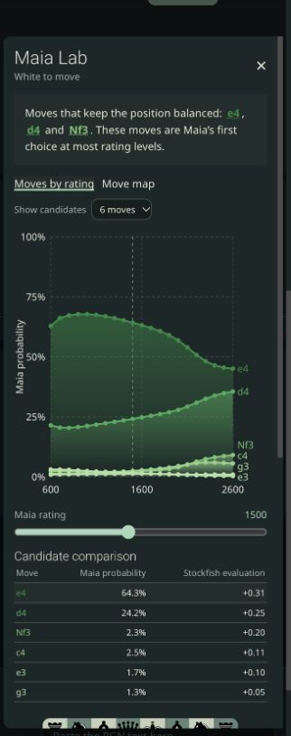
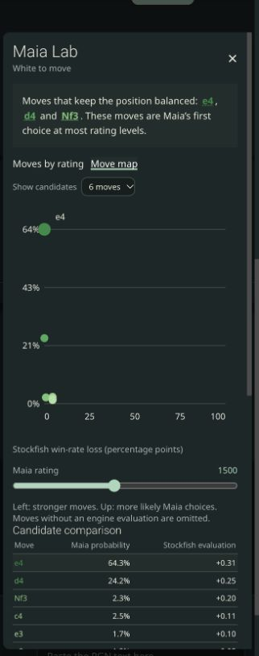

# Maia Lab

## Get started

Maia Lab lets you compare what Maia is likely to play with what Stockfish considers
strong. Open **Maia Lab** beside **Moves by Rating** on the
[analysis board](https://mutechess.org/analysis), in post-game analysis, or in puzzle
**review**. It is unavailable while you are still solving a puzzle.

We credit [maiachess.com](https://www.maiachess.com/) and its
[GPL-3.0 frontend repository](https://github.com/CSSLab/maia-platform-frontend)
for the adapted position-description logic and analysis-interface references,
including inspiration from its MoveMap component. The
[Maia3 engine and models](https://github.com/CSSLab/maia3) supply the move
predictions. These are separate upstream repositories and contributions.

About gives maiachess.com and its frontend repository their own linked credit,
separate from Maia3, through the ten supported native catalogs. The
[follow-up evidence](records/documentation-follow-up-2026-11-25.md) confirms the
separate credits on the live page.

1. Pick a position on the analysis board, then open **Maia Lab**.
2. Use **Show candidates** to compare six or eight moves. The list includes the
   best evaluated moves as well as Maia's likely choices.
3. Move the **Maia rating** slider from 600 to 2600 in steps of 100. This changes
   the Lab view without changing your saved Maia ratings. The slider works on
   both tabs; keyboard users can use the arrow keys and Home/End.
4. Switch between **Moves by rating** and **Move map** using the tabs above the
   chart. Select a move in the chart, map or candidate list to inspect its details.
5. Choose **Explore selected move** to close Lab and enter the variation on the
   analysis board. Close with **×**, Escape or a click outside to leave the
   analysis line as it was.

On a narrow screen, scroll inside the dialog to reach the preview board, selected
move details and **Explore selected move** button.

## Read the charts and numbers

| View or value | What it tells you |
| --- | --- |
| **Moves by rating** | Each curve shows a move's predicted probability across Maia ratings 600–2600. |
| **Move map** | Higher dots are more likely Maia choices at the selected rating. Dots farther left lose less Stockfish win rate relative to the best evaluated move. |
| **Maia probability** | How likely the selected model is to choose that move. The displayed moves are only part of the legal move list, so their percentages need not add up to 100%. |
| **Stockfish evaluation** | The engine score from White's perspective: positive favors White, negative favors Black. A signed `M` value indicates a forced mate. |
| **Empirical Stockfish win rate** | A conversion of the engine score into an estimated win rate for the side to move. It is not Maia's move probability or a measured success rate for this position. |
| **Evaluation loss (pawns)** | How much weaker the move is than the best evaluated move, in pawn units. This value is omitted when the comparison includes forced-mate scores. |

Move colors describe Stockfish quality, not popularity. When dots overlap in the
Move map, use the candidate list to select each move. The preview board highlights
the selected move's source and destination; hover or keyboard focus can also
preview a move through the analysis board's normal preview behavior.

## Understand the position description

The short description can identify tempting mistakes, suggest up to three strong
continuations, and explain whether those moves are Maia's first choice at many
or few rating levels. It uses fixed rules applied to Maia predictions and
Stockfish evaluations. It does not call a chat service or generate free-form
advice.

Descriptions wait for the complete rating sweep and sufficient Stockfish analysis
of every legal move. While that work runs, the dialog explains what is missing;
incomplete values are not treated as zero. If analysis is unavailable, close Lab,
check that the engine is enabled and retry. Model size, move history and engine
search results can change the description.

Maia predicts model choices, not measured human solve rates. A popular move need
not be strong, and a description of an intuitive or difficult choice is not a
verified human difficulty rating. Lab does not change your game's move badges,
accuracy, saved annotations or Maia preferences.

## Live site examples

These narrow-screen captures show the starting position on November 22, 2026,
with the 5M model, move history on, a Lab rating of 1500 and six candidates.
They use real completed browser analysis. The board and further move details
continue below the visible area.

| Moves by rating | Move map |
| --- | --- |
|  |  |

See [capture details](screenshots/README.md#november-22-2026-maia-lab).

## Implementation details

The three entry points use one native accessible dialog,
the existing browser Maia models/Stockfish worker and the same current-position
evidence. No inference is sent to a server. There is no additional model download
beyond the model chosen in Engine settings.

The larger chart shows six or eight real legal candidates, retaining the best
three evaluated roots before Maia's selected-rating leaders. It samples both
players at the same rating from 600 through 2600 in steps of 100, preserving raw
legal policy probabilities; displayed candidates are not renormalized. Missing
rating samples remain gaps. The slider and chart keyboard interaction select a
local viewing rating without changing either existing Maia channel preference.

The table, selected-move details, chart and Move map use the same ranked quality
palette. Hover/focus previews through native ceval ownership checks; selecting a
move highlights its source/destination on the native readonly mini-board. Only
**Explore selected move** closes the dialog and explicitly enters a native
analysis variation. Current arrows, classification badges, native graph, accuracy,
ACPL, learning, mainline and stored annotations keep their existing behavior.

The Move map places empirical Stockfish win-rate loss in percentage points on
its horizontal axis (stronger moves on the left), and raw selected-rating Maia
probability on its vertical axis. Unknown engine evidence is omitted. The table
keeps every displayed candidate accessible when dots coincide. This direct loss
scale is a documented adaptation of upstream's retained MoveMap component.

## Position descriptions

The rule-based summaries adapt
[maiachess.com's frontend source](../third-party/maia-platform-descriptions/README.md),
not an LLM. They consider all 21 rating levels, identify tempting blunders,
list up to three similar-strength continuations, describe the overall outcome
and indicate how often an acceptable move is the model's first choice. They do
not assert measured human difficulty, recompute game classifications or invent
engine evidence. Whole sentences, controls, help, errors and accessibility labels
ship in en-GB, de-DE, es-ES, fr-FR, hi-IN, ja-JP, ko-KR, pt-BR, ru-RU and zh-CN.

A description waits for every legal root to have finite depth-12 evidence and
for every rating sample to arrive. Game analysis retains its usual depth-10
screen; opening Lab requests a bounded depth-12 all-root pass through the same
queue, preserving deeper scores already available. Puzzle review samples ratings
and requests the existing bounded Stockfish all-root search only after opening
Lab. Closing it stops further puzzle samples and cancels its root search.
Existing cancellation, worker recovery and per-phase watchdogs remain intact.

Navigation, engine/model/history changes, hiding the page, disabling analysis or
returning to puzzle solving invalidates the dialog's context. Pending work may
finish internally but cannot publish old results. A failed search produces an
unavailable state; a terminal position has no invented move or continuation.

## Upstream comparison and limits

Upstream source pin: `15cef70619bbd7d70c5b0575af3bcf907aeed62c`. Descriptions use
Maia's 0.08 W/D/L proximity, 0.5/9 mean tempting-move probability, 0.10 empirical
win-rate-loss, 40% treachery and 2/9, 6/9 findability thresholds. The adaptation
requires complete evidence and uses simpler deterministic translated templates.
Colors retain Mute's earlier pinned empirical lookup; current-position palette
estimates remain separate from full-game classifications. Different model sizes,
history, score depth and evidence may produce different descriptions from Maia.

Human bars were an unavailable advanced-view idea in the approved mockup; they
are not included here. Upstream's separate forecasting service, conditional
Lichess-game integration and hidden panel are not a browser-only drop-in.

## Verification

Native tests cover all three integration points and solving/threat/engine gates;
raw probabilities, legal candidate limits, missing/depth/malformed evidence,
full-range descriptions, native catalog functions/placeholder order, dialog
updates/closure and sampling cancellation. Existing chart, quality, snapshot,
review, classification and native UI regressions run unchanged. The native UI
build compiles both entry bundles, shared dialog CSS and all locale catalogs.
Browser/render evidence distinguishes deterministic fixtures from live engine
analysis.

The [historical browser evidence](records/docs398-maia-lab-history.md#november-18-browser-evidence)
retains the November 18/19 deterministic fixtures, lifecycle observations and
presentation review. These are distinct from the dated live examples above.

Historical section links

- [November 18 browser evidence](records/docs398-maia-lab-history.md#november-18-browser-evidence)

- [November 19 presentation correction (#340)](records/docs398-maia-lab-history.md#november-19-presentation-correction-340)

