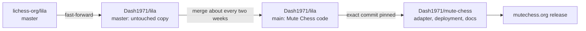

# How we maintain Mute Chess

Mute Chess is a fork of [Lichess](https://github.com/lichess-org/lila). This
page explains how the code is organized, how we take in new Lichess code, and
how we handle security fixes. It is an overview; each section links to the
detailed rules.

## The approach in one paragraph

Stay as close to Lichess as possible. Lichess owns the chess: rules, clocks,
ratings, anti-abuse and the analysis board. We change only what our product
needs, keep each change small and in its own files where we can, and write
down why it exists. Then we merge new Lichess code on a regular schedule.

## What we keep different

- Human-like Maia opponents in quick pairing, and a persistent pool of bots.
- Maia beside Stockfish in analysis, including Maia Lab.
- Sign-in with a Nostr key instead of email and password.
- Multiple stacked premoves.
- Brilliant-move detection from
  [Open Brilly Finder](https://github.com/Dash1971/open-brilly-finder).
- A simpler interface: standard chess only, with fewer menus. No variants.
- Mute Chess branding, with Lichess credits and licenses kept.

Anything not on this list should behave as it does on Lichess. The full policy
is in [Staying aligned with Lichess](upstream-alignment.md).

## Two repositories

**[Dash1971/lila](https://github.com/Dash1971/lila)** is our fork of the
Lichess server and web interface.

- `master` is an untouched copy of Lichess. It only ever moves forward to a
  newer Lichess commit.
- `main` is Mute Chess: Lichess plus our changes, as ordinary Git history.
- We never rebase or force-push `main`.

**[Dash1971/mute-chess](https://github.com/Dash1971/mute-chess)** (this
repository) holds everything that is not Lichess code:

- the adapter that runs the Maia bots;
- deployment scripts and a few small patches for other components;
- documentation, datasets and the bot roster;
- [`deploy/lila/native-pin.json`](../deploy/lila/native-pin.json), which names
  the exact fork commit a release is built from and the Lichess commit it is
  based on.

A change to Lichess code is reviewed in the fork first. A second pull request
here then moves the pin. Details: [Native source in the Lila fork](native-fork.md).

## Taking in new Lichess code

We aim to merge Lichess into the fork about every two weeks.

1. Move the fork's `master` forward to the chosen Lichess commit.
2. Merge it into `main` in its own pull request. It is never mixed with a
   feature.
3. Resolve each conflict against the written reason for our change. Where
   Lichess now does what we needed, drop our change and use theirs.
4. If Lichess added something we do not want, revert it as a separate commit
   and record why.
5. Run the checks, then confirm in a browser that the home page, games,
   analysis, puzzles, profiles and sign-in still look and behave like Mute
   Chess.
6. Move the pin here, release, and run the security verification.

The step-by-step rules are in
[Updating upstream](upstream-alignment.md#updating-upstream). The first merge
through the fork was on 23 November 2026; see its
[report](upstream-integration-2026-11-23.md).

## Keeping track of every difference

[`deploy/lila/upstream-departures.json`](../deploy/lila/upstream-departures.json)
lists every file in the fork that differs from Lichess, with the reason for
the change and how to check it after a merge. Our checks fail if a file
differs from Lichess and is not on the list.

The fewer files we change, the easier each merge is. Shrinking that list is
ongoing work: see
[issue 366](https://github.com/Dash1971/mute-chess/issues/366).

## Security fixes

- Regular merges bring in Lichess's security fixes and dependency updates
  without any special work.
- Lichess security advisories are checked daily. Each
  decision is recorded in [`security-inventory.json`](security-inventory.json).
- A fix that cannot wait for the next merge is copied into the fork with
  `git cherry-pick -x`, which records the Lichess commit it came from.
- Every release records the exact fork commit it was built from, and is
  verified against that record after it is deployed.

Details: [Security maintenance](security-maintenance.md).

## Where to read more

| Topic | Page |
| --- | --- |
| Policy, supported differences, update steps | [upstream-alignment.md](upstream-alignment.md) |
| Fork history, pinned builds, release identity | [native-fork.md](native-fork.md) |
| Advisories, versions, verification | [security-maintenance.md](security-maintenance.md) |
| Running your own instance | [installation.md](installation.md) |
| Every other page | [documentation index](README.md) |
