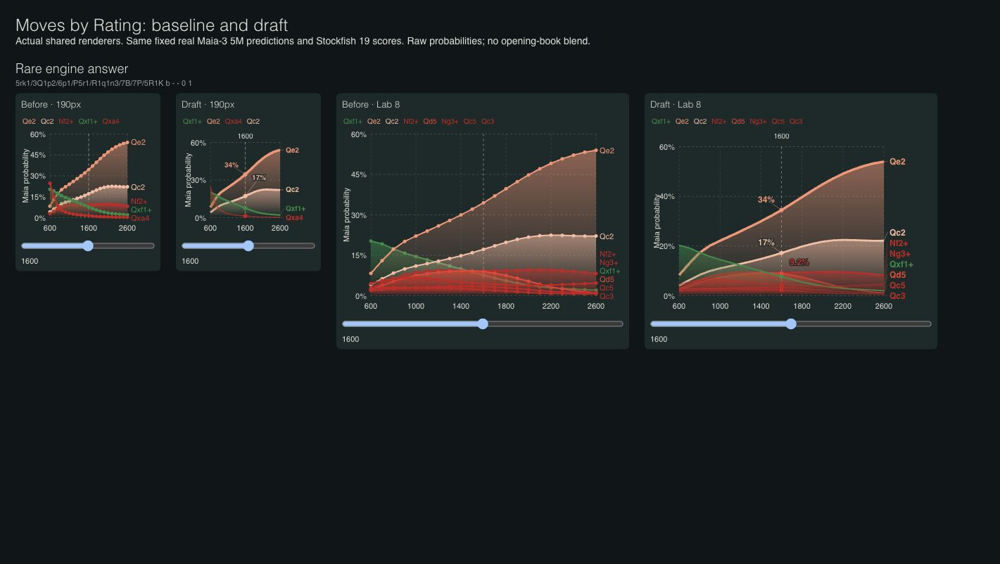

# Moves by Rating draft comparison — November 27, 2026

Status: draft implementation for [#413](https://github.com/Dash1971/mute-chess/issues/413).
No merge or deployment. Automated browser evidence; human design acceptance is pending.

## Source and method

Baseline native commit: `f042367d18dac287dbfde5f9d20a0be088b3a11a`.
Candidate native commit: `50a169e6eb876c14a5e6642985eeb8577165fcd4`,
tree `ce884de81904ddd50ad63197ed782322427dcdbf`.
Maia frontend reference: [`50083f295d7043b54eeaa2f53f459b1c5aee9937`](https://github.com/CSSLab/maia-platform-frontend/tree/50083f295d7043b54eeaa2f53f459b1c5aee9937), GPL-3.0.

The screenshots execute the **actual baseline and candidate shared chart renderers**
using the same fixed, freshly computed real engine outputs. They are component
fixtures using native compiled CSS/catalogs, not complete application page captures,
synthetic model curves or live maiachess.com output. English headings such as
Before/Draft and fixture sliders are test annotations, not added product copy.

- Maia3 5M ONNX: SHA-256 `ddae2aa893b5ca7ec94d24178871f1c337d09fd72ff38abe8d76b8ecf08cb942`.
- ONNX Runtime 1.31.1, CPU; **history off**, same current position repeated in eight
  frames. Self and opponent ratings both 600–2600 in 100-point steps (21 samples).
- Native legal-move tokenizer/vocabulary and full legal softmax policy. No opening
  book, temperature change, selected-subset renormalization or per-position adjustment.
- Stockfish 19 smallnet/1MB, existing `@lichess-org/stockfish-web` 0.5.0 package:
  all legal roots to depth 10, one thread, 32 MiB hash. White-perspective CP/mate
  scores feed the unchanged complete-pool quality mapper.
- Fixed full capture SHA-256: `2195442d638a94d06e99ab8c5563f7e5c18bbf5d3a5202349b665521e371e42b`.
  Probabilities/search outputs may differ with runtime, model, history or depth;
  this comparison isolates rendering and selection using identical inputs.

| Position | Exact FEN | Legal roots | SF best (White score) | Largest policy / axis top |
| --- | --- | --- | --- | --- |
| Opening | `rnbqkbnr/pppppppp/8/8/8/8/PPPPPPPP/RNBQKBNR w KQkq - 0 1` | 20 | d4 (28 cp) | 67.8% / 80% |
| Queen trap | `rnb1kbnr/ppp1pppp/2q5/8/8/2N5/PPPPBPPP/R1BQK1NR w KQkq - 4 5` | 29 | Bb5 (626 cp) | 62.6% / 80% |
| Rare engine answer | `5rk1/3Q1p2/6p1/P5r1/R1q1n3/7B/7P/5R1K b - - 0 1` | 47 | Qxf1+ (M-2) | 54.0% / 60% |
| Byrne–Fischer middlegame | `r2q1rk1/pp2ppbp/1np2np1/2Q5/3PPBb1/2N2N2/PP3PPP/3RKB1R w K - 5 11` | 56 | Be2 (42 cp) | 88.4% / 100% |

The queen trap follows `1. e4 d5 2. exd5 Qxd5 3. Nc3 Qe6+ 4. Be2 Qc6`.
The middlegame FEN is retained in the native `stockfish-light-fast.json` analysis
fixture. The rare-answer FEN matches the position used in the original upstream
comparison: `Qxf1+` remains present although Maia strongly favors `Qe2`.

## Visual evidence

[Full four-position comparison](assets/chart413/real-positions.jpg): each row shows
baseline compact, candidate compact, baseline Lab8 and candidate Lab8. Compact
plots are 190×149; Lab plots are 400×260 in this comparison (the production
shared renderer also supports its existing 300px Lab height).

- [375px mobile comparison](assets/chart413/mobile-375.jpg); 320px checked with
  no horizontal document overflow and all candidate endpoint names inside the SVG.
- [All ten native locale catalogs](assets/chart413/locales.jpg), each rendering the
  same rare-answer position before/after at 190×149. Fixture annotations remain
  English. Existing help, preview controls and axis copy use native translations;
  percentage labels use the document locale. No new catalog keys or placeholders.
- [Locale label bounds](assets/chart413/locale-bounds.json): all ten candidate
  plots' text bounds fit. Initial inspection found Hindi/Chinese axis/top-marker
  clipping; the candidate offsets were corrected before these final captures.
- [Keyboard focus](assets/chart413/keyboard.jpg): End focuses rating 2600, opens
  the raw-probability tooltip and raises/dims the correct curve. Enter updates the
  rating to 2600; redraw retains the active highlight. Unit tests additionally
  cover arrows, Home, sample gaps, pointer tooltip and activation ownership.

## Review decisions and limits

The compact set is capped at six and intentionally omits some earlier union
members. Lab still accepts six/eight independently and includes its best three
evaluated roots; compact selection never changes Lab's candidate algorithm.
Curves retain exact native quality colors. Share labels can be absent when the
space/collision tests reject them; tooltip values are complete and precise.
Endpoint connectors can spread near-zero moves without implying a higher
probability. Strong interior-peak names appear only where they fit.

The real cases exercise 60%, 80% and 100% scales, dense near-zero endpoints,
an interior peak, a rare engine answer, and high-probability choices. Exact
20/40/60/80/100 boundaries and malformed/missing data are covered by focused
unit inputs, not claimed as additional real-position captures. No live upstream
website parity, alternate model sizes/history modes, full dialog walkthrough,
production browser acceptance or independent human testing is claimed here.

## Validation

- Full native UI suite: **508 passed, zero failed**.
- Focused chart/Lab suite: **19 passed, zero failed**, including final label-offset
  and lint-only corrections; frontend build/type checks passed after those changes.
- Targeted Oxfmt and type-aware Oxlint: **zero warnings/errors**.
- Native pin/source and exact departure registration checked in the companion PR.
- Existing translations reused in all ten locales; arrows, classification badges,
  root-search protocol, Maia input generation and whole-game review are unchanged.

GitHub CI is tracked on the paired draft PRs; local results do not imply that
queued CI jobs have passed. No service activation is part of this record.
